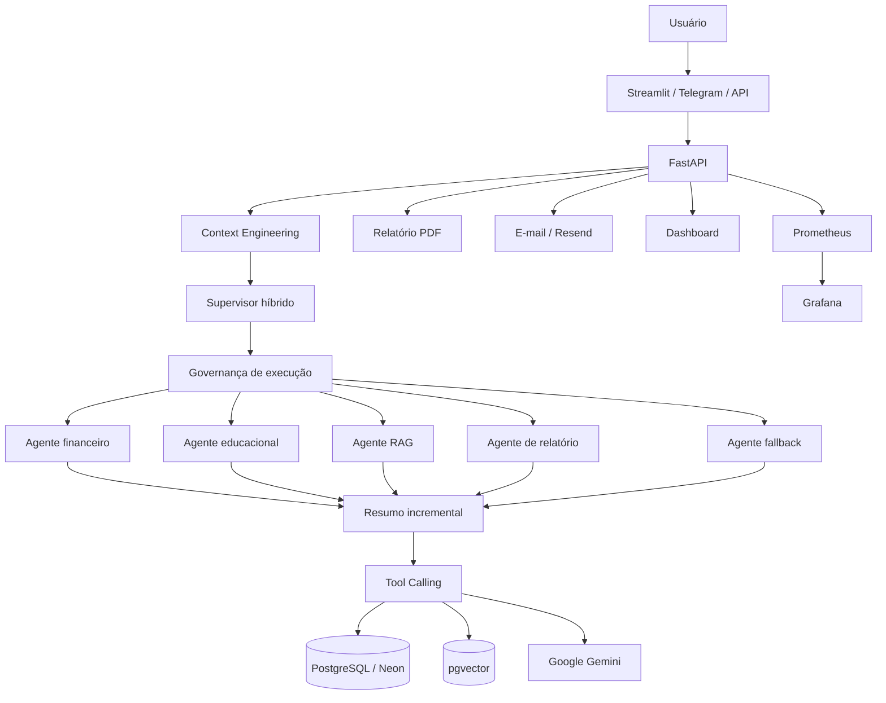
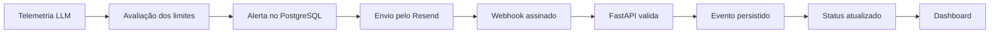

# INNA Financial Coach AI

A **INNA Financial Coach AI** é uma aplicação inteligente de educação financeira que ajuda pessoas a entenderem sua situação financeira, receberem um diagnóstico personalizado e seguirem um plano de ação simples de 30 dias com apoio de IA Generativa.

Educadora Financeira com IA Generativa, arquitetura multiagente, RAG, memória, FastAPI, Streamlit, PostgreSQL, Neon, Render e observabilidade profissional.

Diagnóstico financeiro • Plano de ação • Histórico • Relatórios • Telegram • RAG híbrido • LangGraph • Prometheus • Grafana

---

## Sumário

- [Visão geral](#visão-geral)
- [Demonstração online](#demonstração-online)
- [Problema](#problema)
- [Solução](#solução)
- [Diferenciais](#diferenciais)
- [Status atual](#status-atual)
- [Funcionalidades](#funcionalidades)
- [Arquitetura](#arquitetura)
- [Arquitetura multiagente](#arquitetura-multiagente)
- [Human-in-the-Loop](#human-in-the-loop)
- [RAG, memória e Context Engineering](#rag-memória-e-context-engineering)
- [Tool Calling e persistência](#tool-calling-e-persistência)
- [Telegram multilíngue](#telegram-multilíngue)
- [Observabilidade](#observabilidade)
- [Banco de dados](#banco-de-dados)
- [Dashboard analítico](#dashboard-analítico)
- [API](#api)
- [Estrutura do repositório](#estrutura-do-repositório)
- [Como navegar pelo projeto](#como-navegar-pelo-projeto)
- [Tecnologias](#tecnologias)
- [Instalação local](#instalação-local)
- [Configuração do ambiente](#configuração-do-ambiente)
- [Execução local](#execução-local)
- [Testes](#testes)
- [Deploy](#deploy)
- [Documentação técnica](#documentação-técnica)
- [Segurança e limitações](#segurança-e-limitações)
- [Evidências visuais](#evidências-visuais)
- [Roadmap](#roadmap)
- [Panorama de evolução](#panorama-de-evolução)
- [Desenvolvedores](#desenvolvedores)

---

# Visão geral

A **INNA Financial Coach AI** é uma plataforma inteligente de educação, diagnóstico e acompanhamento financeiro.

A aplicação ajuda pessoas a:

- entender sua situação financeira;
- calcular indicadores importantes;
- identificar riscos;
- organizar renda, gastos, dívidas e reserva;
- receber um plano de ação educativo;
- acompanhar sua evolução;
- consultar histórico;
- gerar relatórios;
- conversar com uma IA com memória e contexto;
- receber atendimento por diferentes canais.

O projeto nasceu como evolução da **INNA AI Copilot Multichannel**, com foco em:

- hackathons;
- portfólio profissional;
- validação técnica;
- uso educacional;
- validação com usuários;
- evolução comercial;
- futura transformação em produto SaaS.

A INNA evoluiu de um MVP em Streamlit para uma arquitetura modular e profissional com:

- Streamlit;
- FastAPI;
- Google Gemini;
- LangGraph;
- agentes especializados;
- RAG híbrido;
- memória financeira;
- resumo conversacional incremental;
- Tool Calling formal;
- PostgreSQL e Neon;
- pgvector;
- Telegram;
- PDF;
- e-mail;
- dashboards;
- Prometheus;
- Grafana;
- alertas;
- auditoria;
- testes automatizados.

> A INNA oferece educação financeira. Ela não substitui consultoria financeira profissional e não recomenda compra ou venda de ativos.

---

## Demonstração online

A versão pública utiliza **Render** para os serviços da aplicação e **Neon PostgreSQL** como banco de dados em nuvem.

### Links de produção

| Recurso | Link |
|---|---|
| App principal — Streamlit | https://inna-app-streamlit.onrender.com |
| API e Swagger — FastAPI | https://inna-api.onrender.com/docs |
| Health Check | https://inna-api.onrender.com/health |
| Dashboard analítico | https://inna-dashboard-streamlit.onrender.com |
| Repositório | https://github.com/Rogerio5/INNA-Financial-Coach-AI |

### Fluxo online validado

```text
Usuário
  ↓
Streamlit online — Render
  ↓
FastAPI online — Render
  ↓
LangGraph / Motor financeiro / RAG / Gemini
  ↓
PostgreSQL / Neon / pgvector
  ↓
Histórico /PDF / Feedback / Telegram / Dashboard
```

---

## Status da versão online

- App principal publicado no Render;
- API FastAPI publicada no Render;
- dashboard publicado no Render;
- PostgreSQL configurado no Neon;
- integração com Gemini ativa;
- diagnóstico financeiro funcionando;
- plano de ação gerado por IA;
- histórico individual funcionando;
- relatório PDF funcionando;
- feedback persistido;
- dashboard lendo dados reais;
- Swagger público;
- health check validado;
- Telegram integrado;
- observabilidade operacional;
- RAG e memória integrados ao núcleo agentic.

---

## Problema

Muitas pessoas não sabem por onde começar a organizar sua vida financeira.

Dúvidas comuns:

- Estou gastando mais do que ganho?
- Minhas dívidas estão perigosas?
- Quanto consigo guardar por mês?
- Minha reserva é suficiente?
- Qual deve ser meu primeiro passo?
- Como criar um plano simples?
- Como acompanhar minha evolução?
- Como manter contexto entre diferentes conversas?
- Como obter orientação educativa sem receber recomendações financeiras indevidas?

---

## Solução

A INNA recebe informações financeiras básicas, calcula indicadores de forma determinística e utiliza IA Generativa para produzir orientações educativas.

A aplicação entrega:

- diagnóstico financeiro;
- score de 0 a 100;
- nível de risco;
- saldo mensal estimado;
- comprometimento da renda;
- estimativa de reserva;
- plano de ação;
- histórico individual;
- memória conversacional;
- relatório PDF;
- respostas contextualizadas por RAG;
- feedback;
- exportação CSV;
- dashboard;
- API para integrações;
- atendimento via Telegram;
- alertas e observabilidade.

---

## Diferenciais

A INNA não é apenas um chatbot.

Ela combina:

- regras financeiras determinísticas;
- IA Generativa;
- arquitetura multiagente;
- arquitetura hierárquica de equipes;
- Human-in-the-Loop persistente;
- revisão humana para operações sensíveis;
- interrupção e retomada por checkpoint;
- decisões de aprovação, correção, rejeição e cancelamento;
- Context Engineering;
- RAG híbrido;
- memória por usuário;
- resumo incremental;
- Tool Calling;
- banco relacional;
- busca vetorial;
- histórico;
- relatórios;
- canais múltiplos;
- observabilidade;
- segurança financeira;
- testes e auditorias.

O sistema:

- entende a intenção;
- monta o contexto;
- seleciona o agente;
- executa ferramentas formais;
- usa memória e RAG;
- gera a resposta;
- atualiza o resumo da conversa;
- persiste os dados;
- registra rastreabilidade e métricas.

> Quando necessário, o sistema pode interromper uma execução para revisão humana e retomá-la exatamente do checkpoint anterior, mantendo o mesmo `thread_id`.


---

## Status atual
```
Panorama por semana
Semana	Área	Situação
Semana 1	LangGraph e núcleo agentic	✅ 100%
Semana 2	RAG, memória e Context Engineering	✅ 100%
Semana 3	Supervisor e arquitetura multiagente	✅ 100%
Semana 4	Tool Calling e persistência	✅ 100%
Semana 5	Confiabilidade e observabilidade	✅ 100%
Semana 6	Produção, integração e entrega	🟡 Em evolução
```

Validação automatizada mais recente
```
2418 passed
1 skipped
0 failed
```
Regressões específicas também foram executadas para:

- memória;
- RAG;
- contexto;
- agentes;
- supervisor;
- ferramentas;
- persistência;
- topologia;
- Telegram;
- observabilidade.

---

## Funcionalidades

### Diagnóstico financeiro
- formulário financeiro;
- cálculo de renda;
- gastos fixos;
- gastos variáveis;
- dívidas;
- reserva;
- saldo mensal;
- comprometimento da renda;
- meses estimados de reserva;
- score financeiro;
- risco baixo, médio ou alto;
- diagnóstico educativo;
- plano de ação;
- fallback seguro;
- modo mock.

### Histórico e acompanhamento
- histórico individual;
- recuperação por usuário;
- evolução do score;
- evolução de saldo;
- persistência por thread;
- retomada de conversas;
- memória financeira;
- resumo incremental;
- substituição de fatos antigos;
- preservação de fatos relevantes.
  
### Relatórios e exportações
- PDF;
- CSV;
- histórico;
- feedback;
- relatórios técnicos;
- auditorias;
- dashboards;
- métricas.

### Canais
- Streamlit;
- FastAPI;
- Telegram;
- e-mail;
- dashboard;
- API preparada para outros frontends.

---

## Arquitetura
### Arquitetura de alto nível


### Fluxo principal

```
Usuário
  ↓
Interface ou canal
  ↓
FastAPI
  ↓
Context Engineering
  ↓
Supervisor
  ↓
Governança
  ↓
Agente especializado
  ↓
Ferramentas / RAG / Memória
  ↓
Persistência
  ↓
Resumo incremental
  ↓
Resposta
```

---

## Arquitetura multiagente
### Fluxo do LangGraph
```
START
  ↓
context_builder
  ↓
supervisor
  ↓
execution_governance
  ↓
agente especializado
  ↓
conversation_summary
  ↓
END
```

---

## Componentes concluídos

- estado tipado;
- supervisor híbrido;
- seleção por intenção;
- regras determinísticas;
- Gemini complementar;
- agente financeiro;
- agente educacional;
- agente RAG;
- agente de relatório;
- agente fallback;
- revisor de risco;
- governança;
- limite de passos;
- limite de visitas;
- detecção de loops;
- bloqueio por orçamento;
- histórico de rotas;
- trace;
- checkpoint;
- retomada por thread_id.

---

## RAG, memória e Context Engineering
### RAG
- busca vetorial;
- busca textual;
- recuperação híbrida;
- reranking;
- pgvector;
- versionamento documental;
- hash SHA-256;
- bloqueio de duplicidade;
- relação entre versões;
- validação de tipo;
- validação de tamanho;
- validação UTF-8;
- bloqueio de documento vazio;
- proteção contra prompt injection;
- documento e chunk IDs;
- scores;
- trace_id;
- retrieval_trace;
- persistência JSONB;
- integração com API e agentes.

### Memória
- memória por usuário;
- memória semântica financeira;
- recuperação de renda e gastos;
- prioridade para fatos mais novos;
- preservação de fatos anteriores;
- isolamento por usuário;
- isolamento por thread;
- eventos de evolução;
- rastreabilidade;
- proteção contra fatos inventados.

### Resumo conversacional incremental
- criado automaticamente;
- atualizado a cada conversa relevante;
- versionado;
- persistido pelo checkpoint;
- limitado por tokens;
- sanitizado;
- sem duplicação de ações;
- sem transformar mensagens do assistente em fatos pessoais;
- integrado ao Context Engineering.

---

## Tool Calling e persistência
### Tool Calling
- Tool Registry;
- contratos Pydantic;
- executor formal;
- permissões;
- validação de argumentos;
- contexto de execução;
- resultados estruturados;
- erros estruturados;
- RAG como ferramenta;
- diagnóstico financeiro;
- histórico financeiro;
- integração com os agentes.

### Persistência
- PostgreSQL;
- Neon;
- pgvector;
- JSONB;
- checkpoint;
- thread;
- histórico;
- memória;
- Telegram;
- filas;
- receipts;
- idempotência;
- replay protection;
- worker recuperável;
- concorrência otimista;
- eventos auditáveis.

---

## Telegram multilíngue

A INNA também funciona pelo Telegram por meio de webhook integrado à FastAPI.

### Funcionalidades
- atendimento guiado;
- seleção de idioma;
- moedas por região;
- diagnóstico persistido;
- resumo da resposta;
- plano completo disponível nos outros canais;
- comandos /start, /idioma, /help e /cancelar;
- fila e worker;
- estado persistido;
- recuperação após falhas;
- métricas;
- dashboard operacional.

### Idiomas e moedas
- Português Brasil — BRL;
- English US — USD;
- English UK — GBP;
- Español — EUR;
- Deutsch — EUR;
- Français — EUR;
- Italiano — EUR;
- Русский — RUB;
- العربية — SAR;
- Română — RON;
- Українська — UAH;
- Schweiz — CHF.

---

## Arquitetura
```
Telegram
  ↓
Webhook FastAPI
  ↓
Fila persistente
  ↓
Worker
  ↓
LangGraph
  ↓
Ferramentas / Gemini / RAG
  ↓
PostgreSQL / Neon
  ↓
Resposta / Dashboard / PDF
```

Endpoint:
```
POST /telegram/webhook
```

---

## Observabilidade

A INNA possui uma camada de observabilidade para acompanhar:

- custos;
- tokens;
- latência;
- erros;
- disponibilidade;
- alertas;
- worker;
- Telegram;
- filas;
- conflitos;
- recuperação;
- entrega de e-mails;
- saúde das integrações.

### Componentes
- logs estruturados;
- sanitização;
- Prometheus;
- OpenMetrics;
- Grafana;
- health;
- readiness;
- recording rules;
- alert rules;
- SLO;
- error budget;
- burn rate;
- runbooks;
- dashboard Grafana;
- auditoria de cardinalidade;
- métricas de LLM;
- alertas por severidade;
- Resend;
- Svix;
- webhook assinado;
- reenvio seguro;
- auditoria das notificações.

### Fluxo de alertas


### Eventos do Resend
```
email.sent
email.delivered
email.delivery_delayed
email.bounced
email.failed
email.suppressed
email.complained
email.opened
email.clicked
```

Endpoint:
```
POST /webhooks/resend
```

### Proteções

- assinatura criptográfica;
- idempotência;
- proteção contra replay;
- eventos fora de ordem;
- preservação do status entregue;
- máximo de tentativas;
- bloqueio de reenvio indevido;
- destinatário mascarado;
- segredos fora do código.

---

## Banco de dados

A INNA utiliza PostgreSQL localmente e Neon em produção.

### Dados persistidos

- diagnósticos;
- feedbacks;
- histórico;
- usuários;
- memória;
- checkpoints;
- documentos;
- chunks;
- embeddings;
- traces;
- Telegram;
- filas;
- receipts;
- alertas;
- notificações;
- eventos do Resend;
- observabilidade.

### Tabelas principais conhecidas
```
diagnosticos_financeiros
feedbacks_usuarios
llm_alerts_inna
llm_alert_notifications_inna
resend_webhook_events_inna
```

Outras tabelas relacionadas a memória, RAG, filas, Telegram e checkpoint podem ser consultadas diretamente em:

- src/database/
- src/models/
- scripts/

---

## Dashboard analítico

O dashboard utiliza dados reais do PostgreSQL/Neon.

### Indicadores
- total de diagnósticos;
- usuários únicos;
- score médio;
- saldo médio;
- feedback útil;
- risco;
- evolução de score;
- evolução de saldo;
- ranking;
- últimos diagnósticos;
- últimos feedbacks;
- leitura executiva;
- filtros;
- exportação CSV.

### Observabilidade

O dashboard profissional também apresenta:

- custos de LLM;
- projeção mensal;
- uso de orçamento;
- consumo por modelo;
- consumo por operação;
- alertas;
- notificações;
- taxa de entrega;
- eventos de webhook;
- saúde do PostgreSQL;
- saúde do Resend;
- saúde do webhook;
- falhas nas últimas 24 horas;
- reenvio controlado.

---

## API

Swagger:
```
https://inna-api.onrender.com/docs
```

Endpoints principais
```
GET  /
GET  /health
POST /diagnostico
POST /feedback
GET  /diagnosticos
GET  /feedbacks
GET  /diagnosticos/{diagnostico_id}/relatorio
GET  /diagnosticos/usuario/{nome}
POST /telegram/webhook
POST /webhooks/resend
```
Como a API evolui continuamente, utilize o Swagger como fonte principal para schemas, parâmetros e respostas atualizadas.

---

## Estrutura do repositório
```
INNA-Financial-Coach-AI/
├── .streamlit/               # Configurações do Streamlit
├── api/                      # FastAPI, schemas, rotas e webhooks
├── assets/                   # Imagens e recursos
├── data/                     # Dados locais e arquivos de apoio
├── docs/                     # Documentação técnica
│   ├── audits/               # Auditorias profissionais
│   └── prints/               # Evidências visuais
├── reports/                  # Relatórios e saídas de auditoria
├── scripts/                  # Scripts operacionais
├── src/
│   ├── agents/               # LangGraph, agentes, supervisor e governança
│   ├── channels/             # Telegram e canais
│   ├── dashboard_pages/      # Páginas do dashboard
│   ├── database/             # Persistência
│   ├── models/               # Modelos
│   ├── observability/        # Métricas, alertas e saúde
│   ├── services/             # Memória, RAG, filas e integrações
│   ├── tools/                # Tool Calling
│   ├── utils/                # Utilitários
│   ├── app.py                # App Streamlit
│   └── dashboard.py          # Dashboard
├── tests/                    # Testes automatizados
├── .env.example
├── .gitignore
├── Procfile.api
├── Procfile.streamlit
├── requirements.txt
├── runtime.txt
├── LICENSE
└── README.md
```

### Como navegar pelo projeto
```
| Interesse             | Pasta                                          |
| --------------------- | ---------------------------------------------- |
| Entender a API        | [`api/`](api/)                                 |
| Ver os agentes        | [`src/agents/`](src/agents/)                   |
| Ver o RAG e a memória | [`src/services/`](src/services/)               |
| Ver Tool Calling      | [`src/tools/`](src/tools/)                     |
| Ver Telegram          | [`src/channels/`](src/channels/)               |
| Ver banco de dados    | [`src/database/`](src/database/)               |
| Ver observabilidade   | [`src/observability/`](src/observability/)     |
| Ver o dashboard       | [`src/dashboard_pages/`](src/dashboard_pages/) |
| Ver testes            | [`tests/`](tests/)                             |
| Ver documentação      | [`docs/`](docs/)                               |
| Ver auditorias        | [`docs/audits/`](docs/audits/)                 |
| Ver prints            | [`docs/prints/`](docs/prints/)                 |
| Ver scripts           | [`scripts/`](scripts/)                         |
| Ver relatórios        | [`reports/`](reports/)                         |

```

Índices recomendados
Para melhorar ainda mais a experiência no GitHub, criar:
```
docs/README.md
docs/audits/README.md
scripts/README.md
reports/README.md
tests/README.md
src/agents/README.md
src/services/README.md
src/observability/README.md
src/tools/README.md
```

---

## Tecnologias
- Backend, IA e agentes
- Python;
- FastAPI;
- Google Gemini;
- LangGraph;
- Pydantic;
- SQLAlchemy;
- Uvicorn;
- Requests.

### RAG e memória
- pgvector;
- embeddings;
- busca híbrida;
- reranking;
- Context Engineering;
- memória semântica;
- PostgreSQL;
- JSONB.

### Interface
- Streamlit;
- Pandas;
- ReportLab;
- Telegram Bot API.

### Observabilidade
- Prometheus;
- OpenMetrics;
- Grafana;
- Resend;
- Svix;
- logs estruturados.

### Deploy
- Render;
- Neon;
- GitHub.

### Qualidade
- pytest;
- testes unitários;
- testes estruturais;
- testes de integração;
- regressão;
- auditorias.

---

## Instalação local
1. Clonar
```
git clone https://github.com/Rogerio5/INNA-Financial-Coach-AI.git
cd INNA-Financial-Coach-AI
```
2. Criar o ambiente virtual
```
python -m venv .venv
```
3. Ativar no Windows
```
.\.venv\Scripts\Activate.ps1
```
4. Atualizar o pip
```
python -m pip install --upgrade pip
```
5. Instalar dependências
```
pip install -r requirements.txt
```

---

## Configuração do ambiente

Crie .env a partir de .env.example.

### Exemplo resumido:
```
APP_NAME=inna-financial-coach-ai
APP_ENV=development

INNA_MOCK_MODE=true

GEMINI_API_KEY=
GEMINI_MODEL=

DATABASE_URL=

API_HOST=127.0.0.1
API_PORT=8000
API_BASE_URL=http://127.0.0.1:8000

STREAMLIT_PORT=8504

RESEND_API_KEY=
RESEND_WEBHOOK_SECRET=
EMAIL_FROM=

LLM_ALERT_EMAIL_ENABLED=false
LLM_ALERT_EMAIL_TO=

LOG_LEVEL=INFO
```
Nunca envie chaves reais para o GitHub.

---

## Execução local
### API
```
python -m uvicorn api.main:app --reload --port 8000
```
### Acesse:
```
http://127.0.0.1:8000/docs
http://127.0.0.1:8000/health
```
### Streamlit
```
streamlit run src/app.py --server.port 8504
```
### Dashboard
```
streamlit run src/dashboard.py --server.port 8505
```
### Modo mock
```
INNA_MOCK_MODE=true
```
### Gemini real
```
INNA_MOCK_MODE=false
GEMINI_API_KEY=sua_chave
```

---

## Testes
### Suíte completa
```
python -m pytest -q
```
### Resultado mais recente:
```
2028 passed, 1 skipped
```
### Testes unitários
```
python -m pytest tests\unit -q
```
### Verificações básicas
```
python -m py_compile api\main.py
python -m pip check
git diff --check
```
### Testes específicos

A suíte possui testes para:

- motor financeiro;
- API;
- LangGraph;
- supervisor;
- agentes;
- memória;
- resumo incremental;
- RAG;
- retrieval trace;
- tools;
- persistência;
- Telegram;
- filas;
- observabilidade;
- alertas;
- webhooks;
- segurança;
- topologia;
- regressão.

---

## Deploy
### Serviços
```
inna-api
inna-app-streamlit
inna-dashboard-streamlit
```
### FastAPI
```
python -m uvicorn api.main:app --host 0.0.0.0 --port $PORT
```
### Streamlit
```
streamlit run src/app.py --server.port $PORT --server.address 0.0.0.0
```
### Dashboard
```
streamlit run src/dashboard.py --server.port $PORT --server.address 0.0.0.0
```
Consulte:

Deploy Render + Neon/

---

## Documentação técnica
### Produto
- Validação do Produto
- Roadmap
- Arquitetura geral
- Pitch
### RAG e memória
- Arquitetura RAG
- Status atual do RAG
- Roadmap RAG
- RAG híbrido
- Reranking
- Testes RAG
- Upload de documentos
- Memória por usuário
- Agentic RAG
### Segurança
- Segurança Financeira
- Diretrizes da INNA
### Auditorias
- docs/audits/

---

## Segurança e limitações

A INNA:

- não recomenda compra ou venda de ativos;
- não promete rentabilidade;
- não substitui consultores certificados;
- não solicita senhas;
- não toma decisões pelo usuário;
- não deve ser a única fonte para decisões financeiras;
- utiliza linguagem educativa;
- protege dados sensíveis;
- mantém segredos fora do repositório;
- valida documentos;
- protege contra prompt injection;
- usa permissões nas ferramentas;
- audita operações críticas;
- evita salvar prompts completos em telemetria.

### Evidências visuais
- App online
- Diagnóstico online
- Relatório PDF
- Histórico
- Swagger
- Dashboard
- Dashboard com dados
- Serviços Render
- Dados no Neon

  ---

## Roadmap
### Concluído:
 
- Streamlit;
- FastAPI;
- PostgreSQL;
- Neon;
- Render;
- Gemini;
- PDF;
- histórico;
- feedback;
- dashboard;
- Telegram;
- LangGraph;
- supervisor;
- agentes;
- agente de relatório;
- revisor de risco;
- Tool Calling;
- RAG híbrido;
- reranking;
- versionamento documental;
- memória;
- resumo incremental;
- Prometheus;
- Grafana;
- alertas;
- SLO;
- auditorias;
- testes extensos.

### Próximas prioridades
- Docker da API;
- Docker do worker;
- Docker do Streamlit;
- Docker Compose;
- Ruff;
- mypy;
- Bandit;
- pip-audit;
- pytest-cov;
- CI de qualidade;
- CI de segurança;
- build e scan de imagens;
- testes E2E integrais;
- OpenTelemetry;
- testes de carga;
- CD automatizado;
- documentação final de implantação;
- demonstração final.

---

## Panorama de evolução
### Semana 1 — LangGraph e núcleo agentic

Status: ✅ 100%

Concluído:

- núcleo;
- estado;
- roteamento;
- persistência;
- retomada;
- falhas;
- topologia;
- documentação;
- testes;
- auditoria.

### Semana 2 — RAG, memória e Context Engineering

Status: ✅ 100%

Concluído:

- RAG seguro;
- versionamento;
- rastreabilidade;
- memória;
- contexto;
- resumo incremental;
- privacidade;
- testes.

### Semana 3 — Supervisor e arquitetura multiagente

Status: ✅ 100%

Concluído:

- supervisor híbrido;
- agentes;
- relatório;
- risco;
- governança;
- loops;
- orçamento;
- auditoria.

### Semana 4 — Tool Calling e persistência

Status: ✅ 100%

Concluído:

- Tool Registry;
- contratos;
- executor;
- permissões;
- ferramentas;
- PostgreSQL;
- filas;
- receipts;
- idempotência;
- worker;
- Telegram persistente.

### Semana 5 — Confiabilidade e observabilidade

Status: ✅ 100%

Concluído:

- logs;
- métricas;
- Prometheus;
- Grafana;
- health;
- readiness;
- SLO;
- alertas;
- runbooks;
- CI de validação.

### Semana 6 — Produção, integração e entrega

Status: 🟡 Em evolução

Já disponível:

- deploy;
- canais;
- banco;
- observabilidade;
- testes;
- agentes;
- memória;
- relatórios.

Ainda falta:

- Docker;
- Compose;
- CI/CD completo;
- OpenTelemetry;
- carga;
- E2E integral;
- documentação final de implantação.

--- 

## Desenvolvedores
- [Rogerio](https://github.com/Rogerio5)
---
## Conclusão

A INNA Financial Coach AI evoluiu de um MVP de diagnóstico para uma plataforma financeira educativa com arquitetura multiagente, RAG, memória, ferramentas formais, persistência, múltiplos canais, relatórios, segurança e observabilidade.

O README principal apresenta a visão geral do produto. Para entender cada módulo em profundidade, navegue pelas pastas:

docs/
src/
tests/
scripts/
reports/

O próximo marco do projeto é executar a plataforma integralmente com Docker Compose, CI de qualidade e segurança, testes E2E, tracing distribuído e automação de deploy.
