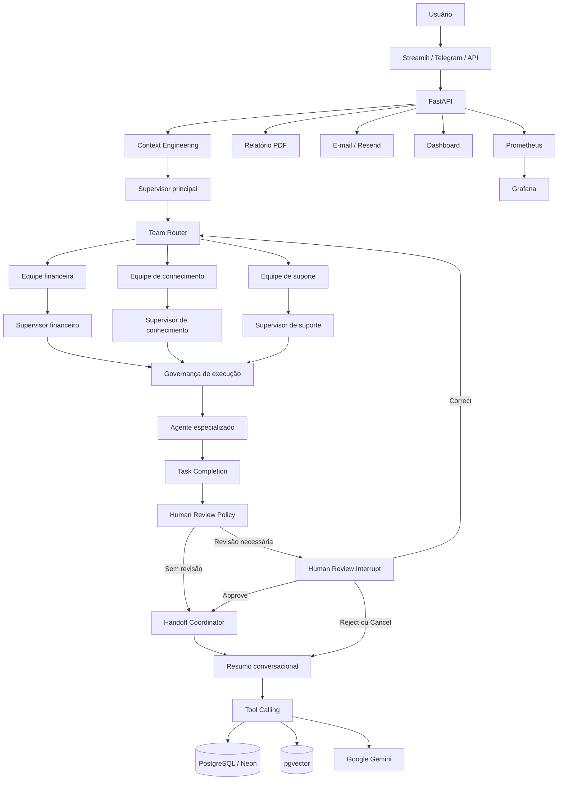

# INNA Financial Coach AI

A **INNA Financial Coach AI** é uma aplicação inteligente de educação financeira que ajuda pessoas a entenderem sua situação financeira, receberem um diagnóstico personalizado e seguirem um plano de ação simples de 30 dias com apoio de IA Generativa.

Educadora Financeira com IA Generativa, arquitetura multiagente, RAG, memória, FastAPI, Streamlit, PostgreSQL, Neon, Render e observabilidade profissional.

Diagnóstico financeiro • Plano de ação • Histórico • Relatórios • Telegram • RAG híbrido • LangGraph • Prometheus • Grafana

---

## Sumário

- [Visão geral](#visão-geral)
- [Demonstração online](#demonstração-online)
- [Status da versão online](#status-da-versão-online)
- [Problema](#problema)
- [Solução](#solução)
- [Diferenciais](#diferenciais)
- [Status atual](#status-atual)
- [Funcionalidades](#funcionalidades)
- [Arquitetura](#arquitetura)
- [Arquitetura multiagente](#arquitetura-multiagente)
- [Human-in-the-Loop](#human-in-the-loop)
- [Componentes concluídos](#componentes-concluídos)
- [RAG, memória e Context Engineering](#rag-memória-e-context-engineering)
- [Tool Calling e persistência](#tool-calling-e-persistência)
- [Telegram multilíngue](#telegram-multilíngue)
- [Observabilidade](#observabilidade)
- [Banco de dados](#banco-de-dados)
- [Dashboard analítico](#dashboard-analítico)
- [API](#api)
- [Estrutura do repositório](#estrutura-do-repositório)
- [Como navegar pelo projeto](#como-navegar-pelo-projeto)
- [Tecnologias](#tecnologias)
- [Instalação local](#instalação-local)
- [Configuração do ambiente](#configuração-do-ambiente)
- [Execução local](#execução-local)
- [Testes](#testes)
- [Deploy](#deploy)
- [Documentação técnica](#documentação-técnica)
- [Segurança e limitações](#segurança-e-limitações)
- [Evidências visuais](#evidências-visuais)
- [Roadmap](#roadmap)
- [Panorama de evolução interna da Inna](#panorama-de-evolução-interna-da-Inna)
- [Aplicação do Bootcamp 2026 — Engenharia de IA na INNA](#Aplicação-do-Bootcamp-2026—Engenharia-de-IA-na-INNA)
- [Desenvolvedores](#desenvolvedores)
- [Conclusão](#conclusão)

---

# Visão geral

A **INNA Financial Coach AI** é uma plataforma inteligente de educação, diagnóstico e acompanhamento financeiro.

A aplicação ajuda pessoas a:

- entender sua situação financeira;
- calcular indicadores importantes;
- identificar riscos;
- organizar renda, gastos, dívidas e reserva;
- receber um plano de ação educativo;
- acompanhar sua evolução;
- consultar histórico;
- gerar relatórios;
- conversar com uma IA com memória e contexto;
- receber atendimento por diferentes canais.

O projeto nasceu como evolução da **INNA AI Copilot Multichannel**, com foco em:

- hackathons;
- portfólio profissional;
- validação técnica;
- uso educacional;
- validação com usuários;
- evolução comercial;
- futura transformação em produto SaaS.

A INNA evoluiu de um MVP em Streamlit para uma arquitetura modular e profissional com:

- Streamlit;
- FastAPI;
- Google Gemini;
- LangGraph;
- agentes especializados;
- RAG híbrido;
- memória financeira;
- resumo conversacional incremental;
- Tool Calling formal;
- PostgreSQL e Neon;
- pgvector;
- Telegram;
- PDF;
- e-mail;
- dashboards;
- Prometheus;
- Grafana;
- alertas;
- auditoria;
- testes automatizados.

> A INNA oferece educação financeira. Ela não substitui consultoria financeira profissional e não recomenda compra ou venda de ativos.

---

## Demonstração online

A versão pública utiliza **Render** para hospedar os serviços da aplicação e **Neon PostgreSQL** como banco de dados em nuvem.

### Links de produção

| Recurso | Acesso |
|---|---|
| App principal — Streamlit | [Abrir aplicação](https://inna-app-streamlit.onrender.com) |
| API e Swagger — FastAPI | [Abrir documentação da API](https://inna-api.onrender.com/docs) |
| Health Check | [Verificar status da API](https://inna-api.onrender.com/health) |
| Dashboard analítico | [Abrir dashboard](https://inna-dashboard-streamlit.onrender.com) |
| Repositório | [Ver código no GitHub](https://github.com/Rogerio5/INNA-Financial-Coach-AI) |

### Fluxo online validado

```text
Usuário
  ↓
Streamlit online — Render
  ↓
FastAPI online — Render
  ↓
LangGraph / Motor financeiro / RAG / Gemini
  ↓
PostgreSQL / Neon / pgvector
  ↓
Histórico / PDF / Feedback / Telegram / Dashboard
```

---

## Status da versão online

- App principal publicado no Render;
- API FastAPI publicada no Render;
- dashboard publicado no Render;
- PostgreSQL configurado no Neon;
- integração com Gemini ativa;
- diagnóstico financeiro funcionando;
- plano de ação gerado por IA;
- histórico individual funcionando;
- relatório PDF funcionando;
- feedback persistido;
- dashboard lendo dados reais;
- Swagger público;
- health check validado;
- Telegram integrado;
- observabilidade operacional;
- RAG e memória integrados ao núcleo agentic.

---

## Problema

Muitas pessoas não sabem por onde começar a organizar sua vida financeira.

Dúvidas comuns:

- Estou gastando mais do que ganho?
- Minhas dívidas estão perigosas?
- Quanto consigo guardar por mês?
- Minha reserva é suficiente?
- Qual deve ser meu primeiro passo?
- Como criar um plano simples?
- Como acompanhar minha evolução?
- Como manter contexto entre diferentes conversas?
- Como obter orientação educativa sem receber recomendações financeiras indevidas?

---

## Solução

A INNA recebe informações financeiras básicas, calcula indicadores de forma determinística e utiliza IA Generativa para produzir orientações educativas.

A aplicação entrega:

- diagnóstico financeiro;
- score de 0 a 100;
- nível de risco;
- saldo mensal estimado;
- comprometimento da renda;
- estimativa de reserva;
- plano de ação;
- histórico individual;
- memória conversacional;
- relatório PDF;
- respostas contextualizadas por RAG;
- feedback;
- exportação CSV;
- dashboard;
- API para integrações;
- atendimento via Telegram;
- alertas e observabilidade.

---

## Diferenciais

A INNA não é apenas um chatbot.

Ela combina:

- regras financeiras determinísticas;
- IA Generativa;
- arquitetura multiagente;
- arquitetura hierárquica de equipes;
- Human-in-the-Loop persistente;
- revisão humana para operações sensíveis;
- interrupção e retomada por checkpoint;
- decisões de aprovação, correção, rejeição e cancelamento;
- Context Engineering;
- RAG híbrido;
- memória por usuário;
- resumo incremental;
- Tool Calling;
- banco relacional;
- busca vetorial;
- histórico;
- relatórios;
- canais múltiplos;
- observabilidade;
- segurança financeira;
- testes e auditorias.

O sistema:

- entende a intenção;
- monta o contexto;
- seleciona o agente;
- executa ferramentas formais;
- usa memória e RAG;
- gera a resposta;
- atualiza o resumo da conversa;
- persiste os dados;
- registra rastreabilidade e métricas.

> Quando necessário, o sistema pode interromper uma execução para revisão humana e retomá-la exatamente do checkpoint anterior, mantendo o mesmo `thread_id`.


---

## Status atual
```
| Etapa | Área | Situação |
|---|---|---|
| Semana 1 | LangGraph e núcleo agentic | ✅ 100% |
| Semana 2 | RAG, memória e Context Engineering | ✅ 100% |
| Semana 3 | Supervisor e arquitetura multiagente | ✅ 100% |
| Semana 4 | Tool Calling e persistência | ✅ 100% |
| Semana 5 | Confiabilidade e observabilidade | ✅ 100% |
| Semana 6 | Produção, integração e entrega | 🟡 Em evolução |
| Semana adicional 1 | Arquitetura hierárquica e Human-in-the-Loop | 🟡 Núcleo concluído |
```
Validação automatizada mais recente
```
2418 passed
1 skipped
0 failed
```
Regressões específicas também foram executadas para:

- memória;
- RAG;
- contexto;
- agentes;
- supervisor;
- ferramentas;
- persistência;
- topologia;
- Telegram;
- observabilidade.

---

## Funcionalidades

### Diagnóstico financeiro
- formulário financeiro;
- cálculo de renda;
- gastos fixos;
- gastos variáveis;
- dívidas;
- reserva;
- saldo mensal;
- comprometimento da renda;
- meses estimados de reserva;
- score financeiro;
- risco baixo, médio ou alto;
- diagnóstico educativo;
- plano de ação;
- fallback seguro;
- modo mock.

### Histórico e acompanhamento
- histórico individual;
- recuperação por usuário;
- evolução do score;
- evolução de saldo;
- persistência por thread;
- retomada de conversas;
- memória financeira;
- resumo incremental;
- substituição de fatos antigos;
- preservação de fatos relevantes.
  
### Relatórios e exportações
- PDF;
- CSV;
- histórico;
- feedback;
- relatórios técnicos;
- auditorias;
- dashboards;
- métricas.

### Canais
- Streamlit;
- FastAPI;
- Telegram;
- e-mail;
- dashboard;
- API preparada para outros frontends.

---

## Arquitetura

### Arquitetura de alto nível



---

## Fluxo principal

```text
Usuário
  ↓
Interface ou canal
  ↓
FastAPI
  ↓
Context Engineering
  ↓
Supervisor principal
  ↓
Team Router
  ↓
Supervisor da equipe
  ↓
Governança de execução
  ↓
Agente especializado
  ↓
Task Completion
  ↓
Human Review Policy
  ├─ sem revisão → Handoff Coordinator
  └─ revisão necessária → Human Review Interrupt
       ├─ approve → Handoff Coordinator
       ├─ correct → Team Router
       └─ reject/cancel → Conversation Summary
  ↓
Ferramentas / RAG / Memória
  ↓
Persistência
  ↓
Resposta
```

---

## Arquitetura multiagente

### Fluxo do LangGraph

```text
START
  ↓
context_builder
  ↓
supervisor
  ↓
team_router
  ↓
team_supervisor
  ↓
execution_governance
  ↓
agente especializado
  ↓
task_completion
  ↓
human_review_policy
  ├─ sem revisão → handoff_coordinator
  └─ revisão necessária → human_review_interrupt
       ├─ approve → handoff_coordinator
       ├─ correct → team_router
       └─ reject/cancel → conversation_summary
  ↓
conversation_summary
  ↓
END
```
---

---

## Human-in-the-Loop

A INNA possui um fluxo persistente de revisão humana para execuções que exigem validação adicional antes da continuidade.

A política de revisão pode considerar:

- nível de risco;
- confiança da resposta;
- inconsistências encontradas;
- informações ausentes;
- tipo da operação;
- limites de segurança;
- necessidade de validação humana.

Quando uma revisão é necessária, o LangGraph utiliza `interrupt()` para pausar a execução e preservar seu estado em um checkpoint.

A retomada utiliza:

```python
Command(resume=decision)
```

O mesmo `thread_id` é utilizado para localizar o checkpoint correto e continuar a execução.

### Decisões disponíveis

- `approve`: aprova o resultado e continua o fluxo;
- `correct`: aplica correções e retorna ao roteamento;
- `reject`: rejeita o resultado e encaminha o fluxo para encerramento;
- `cancel`: cancela a revisão.

### Fluxo da revisão

```text
task_completion
  ↓
human_review_policy
  ├─ sem revisão → handoff_coordinator
  └─ revisão necessária → human_review_interrupt
       ├─ approve → handoff_coordinator
       ├─ correct → team_router
       └─ reject/cancel → conversation_summary
```

O recurso é opt-in para manter compatibilidade com o fluxo existente:

```python
executar_nucleo_inna_persistente(
    mensagem=mensagem,
    thread_id=thread_id,
    human_review_enabled=True,
)
```

A implementação possui:

- contratos tipados;
- política determinística;
- interrupção persistente;
- retomada com `Command(resume=...)`;
- isolamento por `thread_id`;
- testes unitários;
- testes de integração;
- testes reais com `MemorySaver`;
- proteção contra retomada em thread incorreta.

---
---

## Componentes concluídos

- estado tipado;
- Context Engineering;
- supervisor principal;
- supervisor híbrido;
- arquitetura multiagente;
- arquitetura hierárquica de equipes;
- Team Router;
- supervisor financeiro;
- supervisor de conhecimento;
- supervisor de suporte;
- seleção por intenção;
- roteamento entre equipes;
- regras determinísticas;
- Gemini complementar;
- agente financeiro;
- agente educacional;
- agente RAG;
- agente de relatório;
- agente fallback;
- revisor de risco;
- governança de execução;
- Handoff Coordinator;
- Task Completion;
- política de revisão humana;
- Human Review Interrupt;
- interrupção persistente com `interrupt()`;
- retomada com `Command(resume=...)`;
- isolamento de checkpoint por `thread_id`;
- aprovação, correção, rejeição e cancelamento;
- compatibilidade com o fluxo anterior;
- Human-in-the-Loop desabilitado por padrão;
- ativação por `human_review_enabled=True`;
- limite de passos;
- limite de visitas;
- detecção de loops;
- bloqueio por orçamento;
- histórico de rotas;
- trace;
- checkpoint;
- retomada por `thread_id`;
- persistência de estado;
- memória conversacional;
- resumo conversacional incremental;
- integração com RAG;
- integração com Tool Calling;
- testes unitários;
- testes de integração;
- testes reais com `MemorySaver`;
- isolamento entre threads;
- proteção contra retomada na thread incorreta;
- auditoria do fluxo;
- compatibilidade regressiva;
- Pull Request revisado e mesclado;
- 2418 testes aprovados;
- 1 teste ignorado;
- 0 falhas.

---

## RAG, memória e Context Engineering
### RAG
- busca vetorial;
- busca textual;
- recuperação híbrida;
- reranking;
- pgvector;
- versionamento documental;
- hash SHA-256;
- bloqueio de duplicidade;
- relação entre versões;
- validação de tipo;
- validação de tamanho;
- validação UTF-8;
- bloqueio de documento vazio;
- proteção contra prompt injection;
- documento e chunk IDs;
- scores;
- trace_id;
- retrieval_trace;
- persistência JSONB;
- integração com API e agentes.

### Memória
- memória por usuário;
- memória semântica financeira;
- recuperação de renda e gastos;
- prioridade para fatos mais novos;
- preservação de fatos anteriores;
- isolamento por usuário;
- isolamento por thread;
- eventos de evolução;
- rastreabilidade;
- proteção contra fatos inventados.

### Resumo conversacional incremental
- criado automaticamente;
- atualizado a cada conversa relevante;
- versionado;
- persistido pelo checkpoint;
- limitado por tokens;
- sanitizado;
- sem duplicação de ações;
- sem transformar mensagens do assistente em fatos pessoais;
- integrado ao Context Engineering.

---

## Tool Calling e persistência

### Tool Calling

- Tool Registry;
- contratos Pydantic;
- executor formal;
- permissões;
- validação de argumentos;
- contexto de execução;
- resultados estruturados;
- erros estruturados;
- RAG como ferramenta;
- diagnóstico financeiro;
- histórico financeiro;
- integração com os agentes;
- controle de acesso por ferramenta;
- tratamento padronizado de falhas;
- rastreabilidade das execuções;
- integração com o supervisor;
- integração com a governança de execução;
- compatibilidade com agentes especializados.

### Persistência

- PostgreSQL;
- Neon;
- pgvector;
- JSONB;
- checkpoint;
- thread;
- histórico;
- memória;
- Telegram;
- filas;
- receipts;
- idempotência;
- replay protection;
- worker recuperável;
- concorrência otimista;
- checkpoint de revisão humana;
- retomada de execução interrompida;
- isolamento de revisão por thread;
- proteção contra retomada na thread incorreta;
- rastreabilidade das decisões humanas;
- persistência do estado interrompido;
- recuperação pelo mesmo `thread_id`;
- compatibilidade com `Command(resume=...)`;
- proteção contra retomada duplicada;
- continuidade segura após aprovação;
- retorno ao roteamento após correção;
- encerramento controlado após rejeição ou cancelamento;
- auditoria de decisões humanas;
- eventos auditáveis.

---

## Telegram multilíngue

A INNA também funciona pelo Telegram por meio de webhook integrado à FastAPI.

### Funcionalidades
- atendimento guiado;
- seleção de idioma;
- moedas por região;
- diagnóstico persistido;
- resumo da resposta;
- plano completo disponível nos outros canais;
- comandos /start, /idioma, /help e /cancelar;
- fila e worker;
- estado persistido;
- recuperação após falhas;
- métricas;
- dashboard operacional.

### Idiomas e moedas
- Português Brasil — BRL;
- English US — USD;
- English UK — GBP;
- Español — EUR;
- Deutsch — EUR;
- Français — EUR;
- Italiano — EUR;
- Русский — RUB;
- العربية — SAR;
- Română — RON;
- Українська — UAH;
- Schweiz — CHF.

---

### Arquitetura do Telegram
```
Telegram
  ↓
Webhook FastAPI
  ↓
Fila persistente
  ↓
Worker
  ↓
LangGraph
  ↓
Ferramentas / Gemini / RAG
  ↓
PostgreSQL / Neon
  ↓
Resposta / Dashboard / PDF
```

Endpoint:
```
POST /telegram/webhook
```

---

## Observabilidade

A INNA possui uma camada de observabilidade para acompanhar:

- custos;
- tokens;
- latência;
- erros;
- disponibilidade;
- alertas;
- worker;
- Telegram;
- filas;
- conflitos;
- recuperação;
- entrega de e-mails;
- saúde das integrações.

### Componentes
- logs estruturados;
- sanitização;
- Prometheus;
- OpenMetrics;
- Grafana;
- health;
- readiness;
- recording rules;
- alert rules;
- SLO;
- error budget;
- burn rate;
- runbooks;
- dashboard Grafana;
- auditoria de cardinalidade;
- métricas de LLM;
- alertas por severidade;
- Resend;
- Svix;
- webhook assinado;
- reenvio seguro;
- auditoria das notificações.

### Fluxo de alertas


### Eventos do Resend
```
email.sent
email.delivered
email.delivery_delayed
email.bounced
email.failed
email.suppressed
email.complained
email.opened
email.clicked
```

Endpoint:
```
POST /webhooks/resend
```

### Proteções

- assinatura criptográfica;
- idempotência;
- proteção contra replay;
- eventos fora de ordem;
- preservação do status entregue;
- máximo de tentativas;
- bloqueio de reenvio indevido;
- destinatário mascarado;
- segredos fora do código.

---

## Banco de dados

A INNA utiliza PostgreSQL localmente e Neon em produção.

### Dados persistidos

- diagnósticos;
- feedbacks;
- histórico;
- usuários;
- memória;
- checkpoints;
- documentos;
- chunks;
- embeddings;
- traces;
- Telegram;
- filas;
- receipts;
- alertas;
- notificações;
- eventos do Resend;
- observabilidade.

### Tabelas principais conhecidas
```
diagnosticos_financeiros
feedbacks_usuarios
llm_alerts_inna
llm_alert_notifications_inna
resend_webhook_events_inna
```

Outras tabelas relacionadas a memória, RAG, filas, Telegram e checkpoint podem ser consultadas diretamente em:

- src/database/
- src/models/
- scripts/

---

## Dashboard analítico

O dashboard utiliza dados reais do PostgreSQL/Neon.

### Indicadores
- total de diagnósticos;
- usuários únicos;
- score médio;
- saldo médio;
- feedback útil;
- risco;
- evolução de score;
- evolução de saldo;
- ranking;
- últimos diagnósticos;
- últimos feedbacks;
- leitura executiva;
- filtros;
- exportação CSV.

### Observabilidade

O dashboard profissional também apresenta:

- custos de LLM;
- projeção mensal;
- uso de orçamento;
- consumo por modelo;
- consumo por operação;
- alertas;
- notificações;
- taxa de entrega;
- eventos de webhook;
- saúde do PostgreSQL;
- saúde do Resend;
- saúde do webhook;
- falhas nas últimas 24 horas;
- reenvio controlado.

---

## API

Swagger:
```
https://inna-api.onrender.com/docs
```

Endpoints principais
```
GET  /
GET  /health
POST /diagnostico
POST /feedback
GET  /diagnosticos
GET  /feedbacks
GET  /diagnosticos/{diagnostico_id}/relatorio
GET  /diagnosticos/usuario/{nome}
POST /telegram/webhook
POST /webhooks/resend
```
Como a API evolui continuamente, utilize o Swagger como fonte principal para schemas, parâmetros e respostas atualizadas.

---

## Estrutura do repositório
```
INNA-Financial-Coach-AI/
├── .streamlit/               # Configurações do Streamlit
├── api/                      # FastAPI, schemas, rotas e webhooks
├── assets/                   # Imagens e recursos
├── data/                     # Dados locais e arquivos de apoio
├── docs/                     # Documentação técnica
│   ├── audits/               # Auditorias profissionais
│   └── prints/               # Evidências visuais
├── reports/                  # Relatórios e saídas de auditoria
├── scripts/                  # Scripts operacionais
├── src/
│   ├── agents/               # LangGraph, agentes, supervisor e governança
│   ├── channels/             # Telegram e canais
│   ├── dashboard_pages/      # Páginas do dashboard
│   ├── database/             # Persistência
│   ├── models/               # Modelos
│   ├── observability/        # Métricas, alertas e saúde
│   ├── services/             # Memória, RAG, filas e integrações
│   ├── tools/                # Tool Calling
│   ├── utils/                # Utilitários
│   ├── app.py                # App Streamlit
│   └── dashboard.py          # Dashboard
├── tests/                    # Testes automatizados
├── .env.example
├── .gitignore
├── Procfile.api
├── Procfile.streamlit
├── requirements.txt
├── runtime.txt
├── LICENSE
└── README.md
```

### Como navegar pelo projeto

| Interesse | Pasta |
|---|---|
| Entender a API | [`api/`](api/) |
| Ver a arquitetura de agentes e o Human-in-the-Loop | [`src/agents/`](src/agents/) |
| Ver o RAG, a memória e os serviços | [`src/services/`](src/services/) |
| Ver Tool Calling | [`src/tools/`](src/tools/) |
| Ver Telegram e outros canais | [`src/channels/`](src/channels/) |
| Ver persistência e banco de dados | [`src/database/`](src/database/) |
| Ver observabilidade | [`src/observability/`](src/observability/) |
| Ver o dashboard | [`src/dashboard_pages/`](src/dashboard_pages/) |
| Ver os testes automatizados | [`tests/`](tests/) |
| Ver a documentação técnica | [`docs/`](docs/) |
| Ver auditorias | [`docs/audits/`](docs/audits/) |
| Ver evidências visuais | [`docs/prints/`](docs/prints/) |
| Ver scripts operacionais | [`scripts/`](scripts/) |
| Ver relatórios | [`reports/`](reports/) |


### Documentação recomendada por módulo

Para melhorar a navegação e a experiência no GitHub, o projeto poderá incluir arquivos `README.md` específicos em cada área:

- [`docs/README.md`](docs/README.md)
- [`docs/audits/README.md`](docs/audits/README.md)
- [`scripts/README.md`](scripts/README.md)
- [`reports/README.md`](reports/README.md)
- [`tests/README.md`](tests/README.md)
- [`src/agents/README.md`](src/agents/README.md)
- [`src/services/README.md`](src/services/README.md)
- [`src/observability/README.md`](src/observability/README.md)
- [`src/tools/README.md`](src/tools/README.md)

---

## Tecnologias

### Backend, IA e agentes

- Python;
- FastAPI;
- Google Gemini;
- LangGraph;
- Pydantic;
- SQLAlchemy;
- Uvicorn;
- Requests;
- arquitetura multiagente;
- arquitetura hierárquica de equipes;
- Human-in-the-Loop;
- Context Engineering;
- Tool Calling;
- checkpoint e retomada por `thread_id`.

### RAG, memória e dados

- PostgreSQL;
- Neon;
- pgvector;
- JSONB;
- embeddings;
- busca textual;
- busca vetorial;
- busca híbrida;
- reranking;
- memória semântica;
- memória financeira;
- resumo conversacional incremental;
- versionamento documental.

### Interfaces e canais

- Streamlit;
- FastAPI Swagger;
- Pandas;
- ReportLab;
- Telegram Bot API;
- e-mail com Resend;
- webhooks;
- dashboard analítico.

### Observabilidade

- Prometheus;
- OpenMetrics;
- Grafana;
- logs estruturados;
- métricas de LLM;
- health check;
- readiness;
- SLO;
- alertas;
- Resend;
- Svix;
- auditoria de eventos.

### Persistência e processamento

- PostgreSQL;
- Neon;
- pgvector;
- checkpoints;
- filas persistentes;
- receipts;
- idempotência;
- replay protection;
- worker recuperável;
- concorrência otimista.

### Deploy e infraestrutura

- Render;
- Neon;
- GitHub;
- Procfile;
- variáveis de ambiente;
- serviços separados para API, Streamlit e dashboard.

### Qualidade e testes

- pytest;
- testes unitários;
- testes estruturais;
- testes de integração;
- testes de regressão;
- testes reais com `MemorySaver`;
- testes de arquitetura e topologia;
- auditorias técnicas;
- validação com `git diff --check`;
- 2418 testes aprovados;
- 1 teste ignorado;
- 0 falhas.

### Próximas tecnologias planejadas

- Docker;
- Docker Compose;
- Ruff;
- mypy;
- Bandit;
- pip-audit;
- pytest-cov;
- GitHub Actions;
- OpenTelemetry;
- tracing distribuído;
- testes de carga;
- CI/CD.

---

## Instalação local
1. Clonar
```
git clone https://github.com/Rogerio5/INNA-Financial-Coach-AI.git
cd INNA-Financial-Coach-AI
```
2. Criar o ambiente virtual
```
python -m venv .venv
```
3. Ativar no Windows
```
.\.venv\Scripts\Activate.ps1
```
4. Atualizar o pip
```
python -m pip install --upgrade pip
```
5. Instalar dependências
```
pip install -r requirements.txt
```

---

## Configuração do ambiente

Crie .env a partir de .env.example.

### Exemplo resumido:
```
APP_NAME=inna-financial-coach-ai
APP_ENV=development

INNA_MOCK_MODE=true

GEMINI_API_KEY=
GEMINI_MODEL=

DATABASE_URL=

API_HOST=127.0.0.1
API_PORT=8000
API_BASE_URL=http://127.0.0.1:8000

STREAMLIT_PORT=8504

RESEND_API_KEY=
RESEND_WEBHOOK_SECRET=
EMAIL_FROM=

LLM_ALERT_EMAIL_ENABLED=false
LLM_ALERT_EMAIL_TO=

LOG_LEVEL=INFO
```
Nunca envie chaves reais para o GitHub.

---

## Execução local
### API
```
python -m uvicorn api.main:app --reload --port 8000
```
### Acesse:
```
http://127.0.0.1:8000/docs
http://127.0.0.1:8000/health
```
### Streamlit
```
streamlit run src/app.py --server.port 8504
```
### Dashboard
```
streamlit run src/dashboard.py --server.port 8505
```
### Modo mock
```
INNA_MOCK_MODE=true
```
### Gemini real
```
INNA_MOCK_MODE=false
GEMINI_API_KEY=sua_chave
```

---

## Testes
### Suíte completa
```
python -m pytest -q
```
### Resultado mais recente:
```
2028 passed, 1 skipped
```
### Testes unitários
```
python -m pytest tests\unit -q
```
### Verificações básicas
```
python -m py_compile api\main.py
python -m pip check
git diff --check
```
### Testes específicos

A suíte possui testes para:

- motor financeiro;
- API;
- LangGraph;
- supervisor;
- agentes;
- memória;
- resumo incremental;
- RAG;
- retrieval trace;
- tools;
- persistência;
- Telegram;
- filas;
- observabilidade;
- alertas;
- webhooks;
- segurança;
- topologia;
- regressão.

---

## Deploy
### Serviços
```
inna-api
inna-app-streamlit
inna-dashboard-streamlit
```
### FastAPI
```
python -m uvicorn api.main:app --host 0.0.0.0 --port $PORT
```
### Streamlit
```
streamlit run src/app.py --server.port $PORT --server.address 0.0.0.0
```
### Dashboard
```
streamlit run src/dashboard.py --server.port $PORT --server.address 0.0.0.0
```
Consulte:

Deploy Render + Neon/

---

## Documentação técnica
### Produto
- Validação do Produto
- Roadmap
- Arquitetura geral
- Pitch
### RAG e memória
- Arquitetura RAG
- Status atual do RAG
- Roadmap RAG
- RAG híbrido
- Reranking
- Testes RAG
- Upload de documentos
- Memória por usuário
- Agentic RAG
### Segurança
- Segurança Financeira
- Diretrizes da INNA
### Auditorias
- docs/audits/

---

## Segurança e limitações

A INNA:

- não recomenda compra ou venda de ativos;
- não promete rentabilidade;
- não substitui consultores certificados;
- não solicita senhas;
- não toma decisões pelo usuário;
- não deve ser a única fonte para decisões financeiras;
- utiliza linguagem educativa;
- protege dados sensíveis;
- mantém segredos fora do repositório;
- valida documentos;
- protege contra prompt injection;
- usa permissões nas ferramentas;
- audita operações críticas;
- evita salvar prompts completos em telemetria.

### Evidências visuais
- App online
- Diagnóstico online
- Relatório PDF
- Histórico
- Swagger
- Dashboard
- Dashboard com dados
- Serviços Render
- Dados no Neon

  ---

## Roadmap

### Concluído

- Streamlit;
- FastAPI;
- PostgreSQL;
- Neon;
- Render;
- Gemini;
- PDF;
- histórico;
- feedback;
- dashboard;
- Telegram;
- LangGraph;
- supervisor principal;
- arquitetura multiagente;
- arquitetura hierárquica de equipes;
- Team Router;
- supervisores especializados;
- roteamento entre equipes;
- agentes especializados;
- agente financeiro;
- agente educacional;
- agente RAG;
- agente de relatório;
- agente fallback;
- revisor de risco;
- governança de execução;
- Handoff Coordinator;
- Task Completion;
- Human-in-the-Loop;
- política de revisão humana;
- Human Review Interrupt;
- interrupção persistente com `interrupt()`;
- retomada com `Command(resume=...)`;
- checkpoint por `thread_id`;
- aprovação, correção, rejeição e cancelamento;
- Tool Calling;
- RAG híbrido;
- reranking;
- versionamento documental;
- memória;
- resumo incremental;
- Prometheus;
- Grafana;
- alertas;
- SLO;
- auditorias;
- testes unitários;
- testes de integração;
- testes reais com `MemorySaver`;
- testes extensos;
- 2418 testes aprovados;
- 1 teste ignorado;
- 0 falhas.

---

### Próximas prioridades

#### Human-in-the-Loop em produção

- tabela PostgreSQL de revisões humanas;
- repository do Human-in-the-Loop;
- service layer de revisão;
- endpoints FastAPI para revisões;
- fila de revisões pendentes;
- painel administrativo de revisões;
- autenticação e autorização de revisores;
- controle de concorrência entre revisores;
- idempotência das decisões;
- expiração de revisões pendentes;
- auditoria das decisões humanas;
- métricas do fluxo HITL;
- testes end-to-end do fluxo de revisão.

#### Containerização e qualidade

- Docker da API;
- Docker do worker;
- Docker do Streamlit;
- Docker Compose;
- Ruff;
- mypy;
- Bandit;
- pip-audit;
- pytest-cov;
- CI de qualidade;
- CI de segurança;
- build e scan de imagens.

#### Observabilidade e entrega

- testes E2E integrais;
- OpenTelemetry;
- tracing distribuído;
- testes de carga;
- CD automatizado;
- documentação final de implantação;
- demonstração final.

---

## Panorama de evolução interna da INNA

### Fase interna 1 — LangGraph e núcleo agentic

### Fase interna 2 — RAG, memória e Context Engineering

### Fase interna 3 — Supervisor e arquitetura multiagente

### Fase interna 4 — Tool Calling e persistência

### Fase interna 5 — Confiabilidade e observabilidade

### Fase interna 6 — Produção, integração e entrega

### Fase adicional — Arquitetura hierárquica e Human-in-the-Loop

## Panorama de evolução interna da INNA

### Fase interna 1 — LangGraph e núcleo agentic

Status: ✅ concluida

Concluído:

- núcleo agentic;
- estado tipado;
- roteamento inicial;
- persistência;
- retomada por `thread_id`;
- tratamento de falhas;
- topologia do grafo;
- documentação;
- testes;
- auditoria.

---

### Fase interna 2 — RAG, memória e Context Engineering

Status: ✅ concluida

Concluído:

- RAG seguro;
- busca híbrida;
- reranking;
- versionamento documental;
- rastreabilidade;
- memória por usuário;
- memória financeira;
- Context Engineering;
- resumo conversacional incremental;
- isolamento por thread;
- privacidade;
- testes.

---

### Fase interna 3 — Supervisor e arquitetura multiagente

Status: ✅ concluida

Concluído:

- supervisor híbrido;
- seleção por intenção;
- agentes especializados;
- agente financeiro;
- agente educacional;
- agente RAG;
- agente de relatório;
- agente fallback;
- revisor de risco;
- governança de execução;
- limite de passos;
- limite de visitas;
- detecção de loops;
- controle de orçamento;
- auditoria.

---

### Fase interna 4 — Tool Calling e persistência

Status: ✅ concluida

Concluído:

- Tool Registry;
- contratos Pydantic;
- executor formal;
- permissões;
- validação de argumentos;
- ferramentas financeiras;
- RAG como ferramenta;
- PostgreSQL;
- Neon;
- pgvector;
- filas;
- receipts;
- idempotência;
- replay protection;
- worker recuperável;
- concorrência otimista;
- Telegram persistente.

---

### Fase interna 5 — Confiabilidade e observabilidade

Status: ✅ concluida

Concluído:

- logs estruturados;
- sanitização;
- métricas;
- Prometheus;
- Grafana;
- health check;
- readiness;
- SLO;
- error budget;
- alertas;
- runbooks;
- métricas de LLM;
- observabilidade do worker;
- CI de validação;
- auditoria de cardinalidade.

---

### Fase interna 6 — Produção, integração e entrega

Status: 🟡 Em evolução

Já disponível:

- deploy no Render;
- PostgreSQL no Neon;
- Streamlit;
- FastAPI;
- Telegram;
- dashboard;
- banco de dados;
- observabilidade;
- testes automatizados;
- agentes;
- memória;
- RAG;
- relatórios;
- PDF;
- e-mail;
- webhooks.

Ainda falta:

- Docker da API;
- Docker do worker;
- Docker do Streamlit;
- Docker Compose;
- CI/CD completo;
- OpenTelemetry;
- tracing distribuído;
- testes de carga;
- testes E2E integrais;
- documentação final de implantação;
- demonstração final.

---

### Fase adicional — Arquitetura hierárquica e Human-in-the-Loop

Status: 🟡 Núcleo concluído

Concluído:

- arquitetura hierárquica de equipes;
- Team Router;
- supervisor financeiro;
- supervisor de conhecimento;
- supervisor de suporte;
- roteamento entre equipes;
- Handoff Coordinator;
- Task Completion;
- contrato de revisão humana;
- política de revisão determinística;
- integração com LangGraph;
- `interrupt()`;
- `Command(resume=...)`;
- checkpoint por `thread_id`;
- aprovação;
- correção;
- rejeição;
- cancelamento;
- isolamento entre threads;
- proteção contra retomada na thread incorreta;
- testes unitários;
- testes de integração;
- testes reais com `MemorySaver`;
- compatibilidade com o fluxo anterior;
- Pull Request;
- merge na branch `feature/inna-agent-core`;
- 2418 testes aprovados;
- 1 teste ignorado;
- 0 falhas.

Próxima evolução:

- tabela PostgreSQL de revisões humanas;
- repository do Human-in-the-Loop;
- service layer de revisão;
- endpoints FastAPI;
- fila de revisões pendentes;
- painel administrativo;
- autenticação de revisores;
- controle de concorrência;
- idempotência das decisões;
- auditoria;
- métricas;
- testes end-to-end.

---

## Aplicação do Bootcamp 2026 — Engenharia de IA na INNA

### Semana 1 — Agentes, fundamentos

Status: ✅ Concluída

Conteúdos estudados:

- fundamentos de agentes de IA;
- observação, raciocínio e execução de ações;
- uso de ferramentas por agentes;
- Context Engineering;
- saídas estruturadas;
- SmolAgents;
- LlamaIndex;
- LangGraph;
- integração com modelos de linguagem.

Conteúdos aplicados na INNA:

- núcleo agentic;
- agentes especializados;
- estado tipado;
- roteamento por intenção;
- ferramentas formais;
- contexto estruturado;
- respostas com contratos;
- integração com o Google Gemini.

---

### Semana 2 — Agentes, multiagente e produção

Status: ✅ Concluída

Conteúdos estudados:

- LangGraph;
- State Machines;
- arquiteturas multiagentes;
- supervisão;
- handoffs;
- persistência de estado;
- checkpoints;
- Human-in-the-Loop;
- avaliação de agentes;
- observabilidade;
- Arize Phoenix;
- DeepEval.

Conteúdos aplicados na INNA:

- supervisor principal;
- arquitetura multiagente;
- Team Router;
- supervisores especializados;
- agentes por domínio;
- Handoff Coordinator;
- Task Completion;
- governança de execução;
- persistência por `thread_id`;
- interrupção com `interrupt()`;
- retomada com `Command(resume=...)`;
- checkpoints;
- Phoenix e OpenTelemetry;
- avaliação automatizada com DeepEval;
- testes de arquitetura e regressão.

---

## Semana 3 — RAG, fundamentos e retrieval avançado

Status: 🟡 Em finalização

### Conteúdos estudados
- chunking;
- embeddings;
- busca textual;
- busca vetorial;
- busca híbrida;
- reranking;
- grounding;
- Sentence-Window Retrieval;
- Auto-Merging Retrieval;
- RAG Triad;
- Knowledge Graphs para RAG;
- Neo4j;
- Cypher;
- GraphRAG;
- trade-offs entre qualidade, custo e performance.

### Conteúdos aplicados na INNA
- RAG híbrido;
- PostgreSQL e pgvector;
- recuperação textual e vetorial;
- reranking;
- Sentence-Window Retrieval;
- comparação A/B entre estratégias de retrieval;
- estrutura de avaliação com RAG Triad;
- Answer Relevancy;
- Faithfulness;
- Contextual Relevancy;
- Quality Gate;
- controle de custo;
- controle de latência;
- análise do tamanho do contexto;
- relatórios JSON e Markdown;
- histórico de experimentos;
- proteção de privacidade;
- controle de cota da Gemini API.

### Implementações concluídas
- RAG híbrido operacional;
- busca textual e vetorial integradas;
- reranking;
- Sentence-Window Retrieval;
- feature flag para ativação segura;
- comparação A/B entre baseline e Sentence-Window;
- integração real com DeepEval;
- três executores da RAG Triad;
- Gemini como modelo avaliador;
- recuperação real no Neon/PostgreSQL;
- Quality Gate;
- relatórios de avaliação;
- histórico de execuções;
- proteção contra armazenamento de respostas e contextos brutos;
- limitador compartilhado da Gemini API;
- tratamento de erros HTTP 429;
- controle de intervalo entre chamadas;
- retentativas controladas;
- testes unitários e de regressão;
- 109 testes relacionados à Semana 3 aprovados em ambiente offline;
- smoke test real aprovado com Gemini e Neon;
- commit técnico da Semana 3 criado.
- Resultado do Smoke Test real

### Pergunta avaliada:

Como montar uma reserva financeira?
```
- Baseline — RAG híbrido atual
- Answer Relevancy = 1.0
- Faithfulness = 1.0
- Contextual Relevancy = 0.3142857
- RAG híbrido com Sentence-Window
- Answer Relevancy = 1.0
- Faithfulness = 1.0
- Contextual Relevancy = 0.8125
- Deltas
- Answer Relevancy = 0.0
- Faithfulness = 0.0
- Contextual Relevancy = +0.498214
- Quality Gate
- QUALITY_GATE_COMPLETE=True
- QUALITY_GATE_PASSED=True
- RAG_TRIAD_AVERAGE=0.9375
- MAXIMUM_REGRESSION=APROVADA
```
O Sentence-Window não apresentou regressão em Answer Relevancy ou Faithfulness e melhorou significativamente a Contextual Relevancy neste primeiro caso.

### Implementações ainda pendentes
- executar as quatro perguntas financeiras restantes;
- consolidar o experimento completo com cinco perguntas;
- analisar estabilidade entre os cinco casos;
- comparar médias, regressões, latência, custo e tamanho de contexto;
- tomar a decisão final sobre ativação do Sentence-Window;
- implementar Auto-Merging Retrieval;
- comparar Auto-Merging com o RAG híbrido atual;
- finalizar o Quality Gate consolidado da Semana 3;
- gerar documentação e evidências finais;
- atualizar README e relatório técnico;
- analisar Knowledge Graph e GraphRAG;
- avaliar Neo4j e Cypher somente caso haja ganho técnico comprovado.
-Decisão atual sobre produção

Apesar do resultado positivo no smoke test, o Sentence-Window ainda permanece desativado em produção:
```
INNA_RAG_SENTENCE_WINDOW_ENABLED=false
```
A ativação somente será considerada após o experimento completo com cinco perguntas não apresentar regressão relevante.

Situação atual
```
RAG_HIBRIDO=CONCLUIDO
BUSCA_TEXTUAL=CONCLUIDA
BUSCA_VETORIAL=CONCLUIDA
RERANKING=CONCLUIDO

SENTENCE_WINDOW=IMPLEMENTADO
SENTENCE_WINDOW_TESTADO=SIM
SENTENCE_WINDOW_SMOKE_TEST=APROVADO
SENTENCE_WINDOW_PRODUCAO=DESATIVADO

RAG_TRIAD_ARQUITETURA=CONCLUIDA
ANSWER_RELEVANCY_EXECUTOR=CONCLUIDO
FAITHFULNESS_EXECUTOR=CONCLUIDO
CONTEXTUAL_RELEVANCY_EXECUTOR=CONCLUIDO

QUALITY_GATE=CONCLUIDO
QUALITY_GATE_SMOKE_TEST=APROVADO

GEMINI_REAL=VALIDADO
NEON_POSTGRESQL_REAL=VALIDADO
DEEPEVAL_REAL=VALIDADO

PERGUNTAS_CONCLUIDAS=1_DE_5
PERGUNTAS_RESTANTES=4
EXPERIMENTO_COMPLETO_5_PERGUNTAS=PENDENTE

AUTO_MERGING=PENDENTE
KNOWLEDGE_GRAPH_INTEGRADO=PENDENTE
NEO4J_INTEGRADO=PENDENTE
CYPHER_IMPLEMENTADO=PENDENTE
GRAPHRAG_IMPLEMENTADO=PENDENTE

DOCUMENTACAO_FINAL=PENDENTE
SEMANA_3=EM_FINALIZACAO
```

--- 

## Desenvolvedores
- [Rogerio](https://github.com/Rogerio5)

---

## Conclusão

A INNA Financial Coach AI evoluiu de um MVP de diagnóstico financeiro para uma plataforma educativa de IA com arquitetura multiagente, equipes hierárquicas, RAG híbrido, memória, Context Engineering, Tool Calling, persistência, múltiplos canais, relatórios, segurança e observabilidade.

O núcleo agentic já possui supervisão, roteamento especializado, governança de execução, agentes por função, checkpoint por `thread_id` e Human-in-the-Loop persistente. Quando necessário, a execução pode ser interrompida para revisão humana e retomada com `Command(resume=...)`, preservando o estado anterior e permitindo aprovação, correção, rejeição ou cancelamento.

A plataforma também integra FastAPI, Streamlit, PostgreSQL, Neon, pgvector, Telegram, PDF, e-mail, dashboards, Prometheus, Grafana, alertas e uma suíte extensa de testes automatizados.

O README principal apresenta a visão geral do produto. Para entender cada módulo em profundidade, navegue pelas pastas:

- [`docs/`](docs/)
- [`src/`](src/)
- [`tests/`](tests/)
- [`scripts/`](scripts/)
- [`reports/`](reports/)

O próximo marco do projeto é transformar o núcleo de revisão humana em um fluxo completo de produção, com tabela PostgreSQL de revisões, repository, service layer, endpoints FastAPI, fila de revisões pendentes, painel administrativo, autenticação de revisores, auditoria, métricas e testes end-to-end.

Em seguida, a evolução continuará com Docker Compose, CI de qualidade e segurança, OpenTelemetry, tracing distribuído, testes de carga e automação de deploy.
