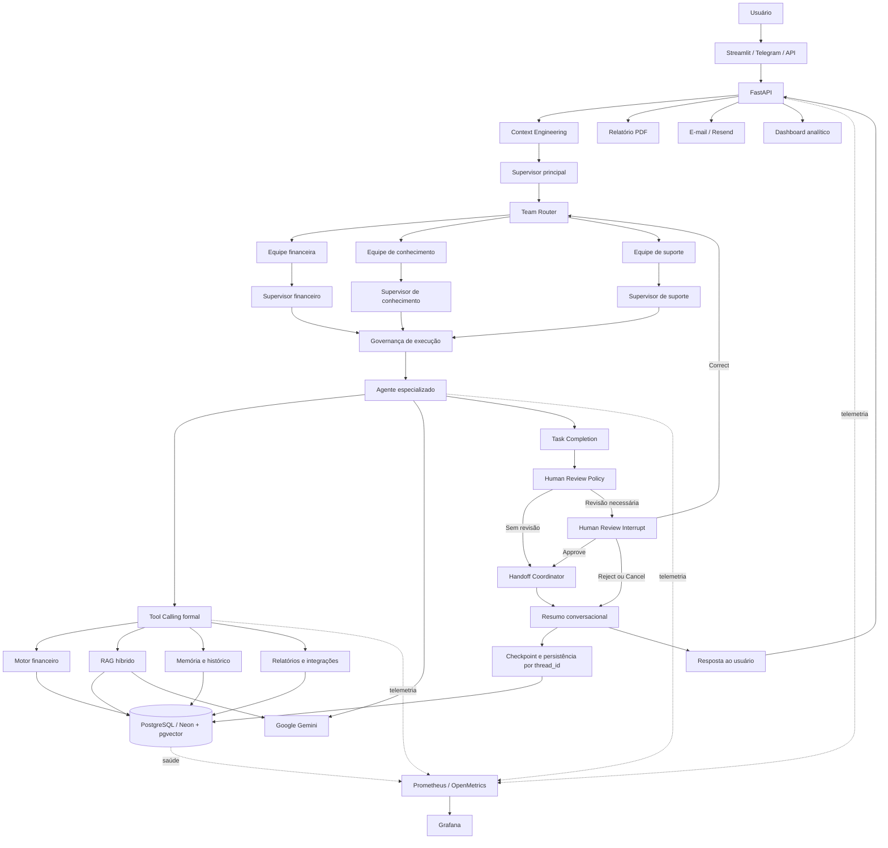
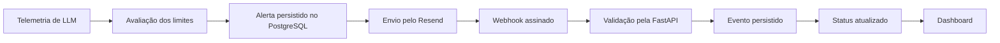

# INNA Financial Coach AI

Plataforma de educação financeira com IA Generativa, arquitetura multiagente, RAG híbrido, memória, Human-in-the-Loop, FastAPI, Streamlit, PostgreSQL/Neon e observabilidade.

A INNA gera diagnósticos financeiros educativos, planos de ação, histórico, relatórios e respostas contextualizadas, combinando cálculos determinísticos com Google Gemini.

> Projeto educacional. Não substitui consultoria financeira profissional nem recomenda compra ou venda de ativos.

---

## Sumário

- [Visão geral](#visão-geral)
- [Demonstração online](#demonstração-online)
- [Status da versão online](#status-da-versão-online)
- [Problema](#problema)
- [Solução](#solução)
- [Diferenciais](#diferenciais)
- [Status atual](#status-atual)
- [Funcionalidades](#funcionalidades)
- [Arquitetura](#arquitetura)
- [Arquitetura multiagente](#arquitetura-multiagente)
- [Human-in-the-Loop](#human-in-the-loop)
- [Componentes concluídos](#componentes-concluídos)
- [RAG, memória e Context Engineering](#rag-memória-e-context-engineering)
- [Tool Calling e persistência](#tool-calling-e-persistência)
- [Telegram multilíngue](#telegram-multilíngue)
- [Observabilidade](#observabilidade)
- [Banco de dados](#banco-de-dados)
- [Dashboard analítico](#dashboard-analítico)
- [API](#api)
- [Estrutura do repositório](#estrutura-do-repositório)
- [Como navegar pelo projeto](#como-navegar-pelo-projeto)
- [Tecnologias](#tecnologias)
- [Instalação local](#instalação-local)
- [Configuração do ambiente](#configuração-do-ambiente)
- [Execução local](#execução-local)
- [Testes](#testes)
- [Deploy](#deploy)
- [Documentação técnica](#documentação-técnica)
- [Segurança e limitações](#segurança-e-limitações)
- [Evidências visuais](#evidências-visuais)
- [Roadmap](#roadmap)
- [Panorama de evolução interna da Inna](#panorama-de-evolução-interna-da-Inna)
- [Aplicação do Bootcamp 2026 — Engenharia de IA na INNA](#Aplicação-do-Bootcamp-2026—Engenharia-de-IA-na-INNA)
- [Desenvolvedores](#desenvolvedores)
- [Conclusão](#conclusão)

---

# Visão geral

A **INNA Financial Coach AI** é uma plataforma inteligente de educação, diagnóstico e acompanhamento financeiro.

A aplicação ajuda pessoas a:

- entender sua situação financeira;
- calcular indicadores importantes;
- identificar riscos;
- organizar renda, gastos, dívidas e reserva;
- receber um plano de ação educativo;
- acompanhar sua evolução;
- consultar o histórico;
- gerar relatórios;
- conversar com uma IA com memória e contexto;
- receber atendimento por diferentes canais.

O projeto nasceu como evolução da **INNA AI Copilot Multichannel**, com foco em:

- hackathons;
- portfólio profissional;
- validação técnica;
- uso educacional;
- validação com usuários;
- evolução comercial;
- futura transformação em produto SaaS.

A INNA evoluiu de um MVP em Streamlit para uma arquitetura modular e profissional com:

- Streamlit;
- FastAPI;
- Google Gemini;
- LangGraph;
- agentes especializados;
- RAG híbrido;
- memória financeira;
- resumo conversacional incremental;
- Tool Calling formal;
- PostgreSQL e Neon;
- pgvector;
- Telegram;
- PDF;
- e-mail;
- dashboards;
- Prometheus;
- Grafana;
- alertas;
- auditoria;
- testes automatizados.

> A INNA oferece educação financeira. Ela não substitui consultoria financeira profissional e não recomenda compra ou venda de ativos.

---

## Demonstração online

A versão pública utiliza **Render** para hospedar os serviços da aplicação e **Neon PostgreSQL** como banco de dados em nuvem.

### Links de produção

| Recurso | Acesso |
|---|---|
| App principal — Streamlit | [Abrir aplicação](https://inna-app-streamlit.onrender.com) |
| API e Swagger — FastAPI | [Abrir documentação da API](https://inna-api.onrender.com/docs) |
| Health Check | [Verificar status da API](https://inna-api.onrender.com/health) |
| Dashboard analítico | [Abrir dashboard](https://inna-dashboard-streamlit.onrender.com) |
| Repositório | [Ver código no GitHub](https://github.com/Rogerio5/INNA-Financial-Coach-AI) |

### Fluxo online validado

```text
Usuário
  ↓
Streamlit online — Render
  ↓
FastAPI online — Render
  ↓
LangGraph / Motor financeiro / RAG / Gemini
  ↓
PostgreSQL / Neon / pgvector
  ↓
Histórico / PDF / Feedback / Telegram / Dashboard
```

---

## Status da versão online

- app principal publicado no Render;
- API FastAPI publicada no Render;
- dashboard publicado no Render;
- PostgreSQL configurado no Neon;
- integração com Gemini validada;
- diagnóstico financeiro operacional;
- plano de ação gerado por IA;
- histórico individual disponível;
- geração de relatório PDF validada;
- feedback persistido no banco de dados;
- dashboard integrado a dados reais;
- documentação Swagger pública;
- health check validado;
- integração com Telegram configurada;
- observabilidade configurada;
- RAG híbrido e memória integrados ao núcleo agentic.

---

## Problema

Muitas pessoas têm dificuldade para entender sua situação financeira e não sabem por onde começar a organizar renda, gastos, dívidas e objetivos.

Dúvidas comuns:

- Estou gastando mais do que ganho?
- Minhas dívidas representam um risco?
- Quanto consigo guardar por mês?
- Minha reserva financeira é suficiente?
- Qual deve ser meu primeiro passo?
- Como criar um plano simples e realista?
- Como acompanhar minha evolução financeira?
- Como manter contexto entre diferentes conversas?
- Como receber orientação educativa sem recomendações financeiras indevidas?

---

## Solução

A INNA recebe informações financeiras básicas, calcula indicadores de forma determinística e utiliza IA Generativa para transformar esses dados em orientações educativas, contextualizadas e fáceis de entender.

A aplicação oferece:

- diagnóstico financeiro;
- score de 0 a 100;
- classificação de risco;
- saldo mensal estimado;
- comprometimento da renda;
- estimativa de reserva financeira;
- plano de ação educativo;
- histórico individual;
- memória conversacional;
- relatório PDF;
- respostas contextualizadas por RAG híbrido;
- registro de feedback;
- exportação CSV;
- dashboard analítico;
- API para integrações;
- atendimento via Telegram;
- alertas e observabilidade.

---

## Diferenciais

A INNA não é apenas um chatbot.

Ela combina:

- regras financeiras determinísticas;
- IA Generativa;
- arquitetura multiagente;
- arquitetura hierárquica de equipes;
- Human-in-the-Loop com persistência de estado;
- revisão humana para operações sensíveis;
- interrupção e retomada por checkpoint;
- decisões de aprovação, correção, rejeição e cancelamento;
- Context Engineering;
- RAG híbrido;
- memória por usuário;
- resumo conversacional incremental;
- Tool Calling formal;
- banco de dados relacional;
- busca textual e vetorial;
- histórico individual;
- relatórios;
- múltiplos canais;
- observabilidade;
- segurança financeira;
- testes automatizados e auditorias técnicas.

O sistema:

- identifica a intenção do usuário;
- constrói o contexto da execução;
- seleciona o agente ou a equipe responsável;
- executa ferramentas formais;
- utiliza memória e RAG híbrido;
- gera uma resposta contextualizada;
- atualiza o resumo da conversa;
- persiste os dados;
- registra rastreabilidade, métricas e eventos de auditoria.

> Quando necessário, o sistema pode interromper uma execução para revisão humana e retomá-la a partir do checkpoint persistido, utilizando o mesmo `thread_id`.

---

## Status atual

| Fase interna | Área | Situação |
|---|---|---|
| Fase 1 | LangGraph e núcleo agentic | ✅ Concluída |
| Fase 2 | RAG, memória e Context Engineering | ✅ Concluída |
| Fase 3 | Supervisor e arquitetura multiagente | ✅ Concluída |
| Fase 4 | Tool Calling e persistência | ✅ Concluída |
| Fase 5 | Confiabilidade e observabilidade | ✅ Concluída |
| Fase 6 | Produção, integração e entrega | 🟡 Em evolução |
| Fase adicional | Arquitetura hierárquica e Human-in-the-Loop | 🟡 Núcleo concluído |

### Validação automatizada mais recente

```text
3649 passed
3 skipped
0 failed
```

Regressões específicas também foram executadas para:

- memória;
- RAG;
- contexto;
- agentes;
- supervisor;
- ferramentas;
- persistência;
- topologia;
- Telegram;
- observabilidade.

---

## Funcionalidades

### Diagnóstico financeiro

- formulário financeiro;
- cálculo de renda;
- registro de gastos fixos;
- registro de gastos variáveis;
- registro de dívidas;
- registro de reserva financeira;
- saldo mensal estimado;
- comprometimento da renda;
- meses estimados de reserva;
- score financeiro;
- classificação de risco: baixo, médio ou alto;
- diagnóstico educativo;
- plano de ação personalizado;
- fallback seguro;
- modo mock para testes e demonstrações.

### Histórico e acompanhamento

- histórico individual;
- recuperação de dados por usuário;
- evolução do score financeiro;
- evolução do saldo mensal;
- persistência por `thread_id`;
- retomada de conversas;
- memória financeira;
- resumo conversacional incremental;
- atualização de fatos antigos;
- preservação de informações relevantes.

### Relatórios e exportações

- relatório em PDF;
- exportação em CSV;
- histórico de diagnósticos;
- registro de feedback;
- relatórios técnicos;
- auditorias;
- dashboards;
- métricas operacionais e de uso.

### Canais

- Streamlit;
- FastAPI;
- Telegram;
- e-mail;
- dashboard analítico;
- API preparada para integração com outros frontends.

---

## Arquitetura

### Arquitetura de alto nível



---

## Fluxo principal

```text
Usuário
  ↓
Interface ou canal
  ↓
FastAPI
  ↓
Context Engineering
  ↓
Supervisor principal
  ↓
Team Router
  ↓
Supervisor da equipe
  ↓
Governança de execução
  ↓
Agente especializado
  ↓
Ferramentas formais / RAG híbrido / Memória
  ↓
Task Completion
  ↓
Human Review Policy
  ├─ sem revisão → Handoff Coordinator
  └─ revisão necessária → Human Review Interrupt
       ├─ approve → Handoff Coordinator
       ├─ correct → Team Router
       └─ reject/cancel → Conversation Summary
  ↓
Resumo conversacional
  ↓
Checkpoint e persistência por thread_id
  ↓
Resposta ao usuário

---

## Arquitetura multiagente

### Fluxo do LangGraph

```text
START
  ↓
context_builder
  ↓
supervisor
  ↓
team_router
  ↓
team_supervisor
  ↓
execution_governance
  ↓
agente especializado
  ↓
task_completion
  ↓
human_review_policy
  ├─ sem revisão → handoff_coordinator
  └─ revisão necessária → human_review_interrupt
       ├─ approve → handoff_coordinator
       ├─ correct → team_router
       └─ reject/cancel → conversation_summary
  ↓
conversation_summary
  ↓
END
```

---

## Arquitetura multiagente

### Fluxo do LangGraph
```
START
  ↓
context_builder
  ↓
supervisor
  ↓
team_router
  ↓
team_supervisor
  ↓
execution_governance
  ↓
agente especializado
  ↓
tool_calling / rag / memory
  ↓
task_completion
  ↓
human_review_policy
  ├─ sem revisão → handoff_coordinator
  └─ revisão necessária → human_review_interrupt
       ├─ approve → handoff_coordinator
       ├─ correct → team_router
       └─ reject/cancel → conversation_summary
  ↓
conversation_summary
  ↓
checkpoint_persistence
  ↓
END
```

---

## Human-in-the-Loop

A INNA possui um fluxo persistente de revisão humana para execuções que exigem validação adicional antes da continuidade.

A política de revisão pode considerar:

- nível de risco;
- confiança da resposta;
- inconsistências encontradas;
- informações ausentes;
- tipo da operação;
- limites de segurança;
- necessidade de validação humana.

Quando uma revisão é necessária, o LangGraph utiliza `interrupt()` para pausar a execução e preservar seu estado em um checkpoint.

A retomada utiliza:

```python
Command(resume=decision)
```

O mesmo `thread_id` é utilizado para localizar o checkpoint correto e continuar a execução.

### Decisões disponíveis

- `approve`: aprova o resultado e continua o fluxo;
- `correct`: aplica correções e retorna ao roteamento;
- `reject`: rejeita o resultado e encaminha o fluxo para encerramento;
- `cancel`: cancela a revisão.

### Fluxo da revisão

```text
task_completion
  ↓
human_review_policy
  ├─ sem revisão → handoff_coordinator
  └─ revisão necessária → human_review_interrupt
       ├─ approve → handoff_coordinator
       ├─ correct → team_router
       └─ reject/cancel → conversation_summary
```

O recurso é opt-in para manter compatibilidade com o fluxo existente:

```python
executar_nucleo_inna_persistente(
    mensagem=mensagem,
    thread_id=thread_id,
    human_review_enabled=True,
)
```

A implementação possui:

- contratos tipados;
- política determinística;
- interrupção persistente;
- retomada com `Command(resume=...)`;
- isolamento por `thread_id`;
- testes unitários;
- testes de integração;
- testes reais com `MemorySaver`;
- proteção contra retomada em thread incorreta.

---
## Componentes concluídos

### Núcleo agentic e arquitetura
```
- estado tipado;
- Context Engineering;
- supervisor principal;
- supervisor híbrido;
- arquitetura multiagente;
- arquitetura hierárquica de equipes;
- Team Router;
- supervisores financeiro, de conhecimento e de suporte;
- seleção por intenção;
- roteamento entre equipes;
- regras determinísticas;
- Gemini como componente complementar;
- agentes financeiro, educacional, RAG, de relatório e fallback;
- revisor de risco;
- governança de execução;
- Handoff Coordinator;
- Task Completion.
```
### Human-in-the-Loop
```
- política de revisão humana;
- Human Review Interrupt;
- interrupção persistente com `interrupt()`;
- retomada com `Command(resume=...)`;
- checkpoint por `thread_id`;
- isolamento entre threads;
- aprovação, correção, rejeição e cancelamento;
- Human-in-the-Loop desabilitado por padrão;
- ativação por `human_review_enabled=True`;
- proteção contra retomada em uma thread incorreta;
- proteção contra retomada duplicada;
- compatibilidade com o fluxo anterior.
```
### Segurança e controle de execução
```
- limite de passos;
- limite de visitas;
- detecção de loops;
- bloqueio por orçamento;
- histórico de rotas;
- rastreabilidade de execução;
- auditoria do fluxo;
- compatibilidade regressiva.
```
### Integrações principais
```
- memória conversacional;
- resumo conversacional incremental;
- RAG híbrido;
- Tool Calling formal;
- persistência de estado;
- PostgreSQL;
- Neon;
- pgvector.
```
### Evidências técnicas
```
- testes unitários;
- testes de integração;
- testes reais com `MemorySaver`;
- Pull Request revisado e mesclado;
- regressão automatizada mais recente:
```
```text
3649 passed
3 skipped
0 failed
```

### RAG, memória e Context Engineering

#### RAG híbrido
```
busca textual;
busca vetorial;
recuperação híbrida;
fusão e reranking dos resultados;
PostgreSQL com pgvector;
versionamento documental;
hash SHA-256;
bloqueio de duplicidade;
relacionamento entre versões;
validação de tipo, tamanho e codificação UTF-8;
bloqueio de documentos vazios;
proteção contra prompt injection;
identificação de documentos e chunks;
scores de recuperação;
trace_id;
retrieval_trace;
persistência em JSONB;
integração com API, agentes e Tool Calling.
```
### Memória
```
memória por usuário;
memória semântica financeira;
recuperação de renda, gastos e informações relevantes;
prioridade para fatos mais recentes;
preservação de fatos anteriores relevantes;
isolamento por usuário;
isolamento por thread_id;
eventos de evolução;
rastreabilidade;
proteção contra fatos inventados.
```
### Resumo conversacional incremental
```
criação automática;
atualização após conversas relevantes;
versionamento;
persistência por checkpoint;
controle de tamanho por tokens;
sanitização;
prevenção de duplicação de ações;
proteção contra transformar respostas do assistente em fatos pessoais;
integração com Context Engineering.
```
### Tool Calling e persistência
#### Tool Calling formal
```
Tool Registry;
contratos Pydantic;
executor formal;
permissões por ferramenta;
validação de argumentos;
contexto estruturado de execução;
resultados estruturados;
erros estruturados;
RAG como ferramenta;
diagnóstico financeiro;
consulta ao histórico financeiro;
integração com agentes especializados;
controle de acesso;
tratamento padronizado de falhas;
rastreabilidade das execuções;
integração com supervisor e governança de execução.
```
### Persistência
```
PostgreSQL;
Neon;
pgvector;
JSONB;
checkpoints;
thread_id;
histórico;
memória;
Telegram;
filas persistentes;
receipts;
idempotência;
proteção contra replay;
worker recuperável;
concorrência otimista;
persistência de revisões humanas;
recuperação de execução interrompida;
isolamento de revisão por thread_id;
rastreabilidade das decisões humanas;
continuidade segura após aprovação;
retorno ao roteamento após correção;
encerramento controlado após rejeição ou cancelamento;
eventos auditáveis.
```
---

## Telegram multilíngue

A INNA também oferece atendimento pelo Telegram por meio de um webhook integrado à FastAPI.

### Funcionalidades

- atendimento guiado;
- seleção de idioma;
- definição de moeda por região;
- diagnóstico financeiro persistido;
- resumo da resposta;
- plano completo disponível nos demais canais;
- comandos `/start`, `/idioma`, `/help` e `/cancelar`;
- fila persistente;
- worker de processamento;
- estado da conversa persistido;
- recuperação após falhas;
- métricas operacionais;
- dashboard de acompanhamento.

### Idiomas e moedas

- Português Brasil — BRL;
- English US — USD;
- English UK — GBP;
- Español — EUR;
- Deutsch — EUR;
- Français — EUR;
- Italiano — EUR;
- Русский — RUB;
- العربية — SAR;
- Română — RON;
- Українська — UAH;
- Schweiz — CHF.

### Arquitetura do Telegram

```text
Telegram
  ↓
Webhook FastAPI
  ↓
Fila persistente
  ↓
Worker
  ↓
LangGraph
  ↓
Ferramentas formais / Gemini / RAG híbrido
  ↓
PostgreSQL / Neon
  ↓
Resposta ao usuário / Dashboard / Relatório PDF
```
### Endpoint
```http
POST /telegram/webhook
```
---

## Observabilidade

A INNA possui uma camada de observabilidade para acompanhar:

- custos;
- consumo de tokens;
- latência;
- erros;
- disponibilidade;
- alertas;
- worker;
- Telegram;
- filas;
- conflitos de concorrência;
- recuperação após falhas;
- entrega de e-mails;
- saúde das integrações.

### Componentes

- logs estruturados;
- sanitização de dados sensíveis;
- Prometheus;
- OpenMetrics;
- Grafana;
- health checks;
- readiness checks;
- recording rules;
- alert rules;
- SLO;
- error budget;
- burn rate;
- runbooks;
- dashboard no Grafana;
- auditoria de cardinalidade;
- métricas de LLM;
- alertas por severidade;
- Resend;
- Svix;
- webhook assinado;
- reenvio controlado;
- auditoria das notificações.

### Fluxo de alertas



### Eventos do Resend
```
email.sent
email.delivered
email.delivery_delayed
email.bounced
email.failed
email.suppressed
email.complained
email.opened
email.clicked
```

### Endpoint
```http
POST /webhooks/resend
```

### Proteções
```
assinatura criptográfica;
idempotência;
proteção contra replay;
tratamento de eventos fora de ordem;
preservação do status de entrega;
limite máximo de tentativas;
bloqueio de reenvio indevido;
mascaramento de destinatários;
segredos mantidos fora do código.
```
---

## Banco de dados

A INNA utiliza PostgreSQL no ambiente local e Neon PostgreSQL nos ambientes em nuvem.

### Dados persistidos

- diagnósticos financeiros;
- feedbacks;
- histórico de usuários;
- memória conversacional e financeira;
- checkpoints do LangGraph;
- documentos;
- chunks;
- embeddings;
- traces de recuperação;
- dados do Telegram;
- filas persistentes;
- receipts;
- alertas;
- notificações;
- eventos do Resend;
- dados de observabilidade.

### Tabelas principais conhecidas

```text
diagnosticos_financeiros
feedbacks_usuarios
llm_alerts_inna
llm_alert_notifications_inna
resend_webhook_events_inna
```

Outras tabelas relacionadas a memória, RAG, filas, Telegram, checkpoints e observabilidade podem ser consultadas diretamente em:

- src/database/
- src/models/
- scripts/

---

## Dashboard analítico

O dashboard utiliza dados reais persistidos no PostgreSQL/Neon.

### Indicadores financeiros e de uso

- total de diagnósticos;
- total de usuários únicos;
- score financeiro médio;
- saldo mensal médio;
- taxa de feedback útil;
- distribuição por nível de risco;
- evolução do score financeiro;
- evolução do saldo mensal;
- ranking de usuários ou diagnósticos;
- diagnósticos mais recentes;
- feedbacks mais recentes;
- leitura executiva dos indicadores;
- filtros por período e categoria;
- exportação em CSV.

### Observabilidade operacional

O dashboard também apresenta:

- custos de LLM;
- projeção mensal de custos;
- percentual de uso do orçamento;
- consumo por modelo;
- consumo por operação;
- alertas ativos;
- notificações;
- taxa de entrega de e-mails;
- eventos de webhook;
- saúde do PostgreSQL;
- saúde da integração com Resend;
- saúde dos webhooks;
- falhas registradas nas últimas 24 horas;
- reenvio controlado de notificações.

---

## API

### Documentação Swagger

[https://inna-api.onrender.com/docs](https://inna-api.onrender.com/docs)

### Endpoints principais

```http
GET  /
GET  /health
POST /diagnostico
POST /feedback
GET  /diagnosticos
GET  /feedbacks
GET  /diagnosticos/{diagnostico_id}/relatorio
GET  /diagnosticos/usuario/{nome}
POST /telegram/webhook
POST /webhooks/resend
```

Como a API evolui continuamente, utilize o Swagger como fonte principal para consultar schemas, parâmetros, códigos de resposta e exemplos atualizados

---

## Estrutura do repositório

```text
INNA-Financial-Coach-AI/
├── .streamlit/               # Configurações do Streamlit
├── api/                      # FastAPI, schemas, rotas e webhooks
├── assets/                   # Imagens e recursos visuais
├── data/                     # Dados locais e arquivos de apoio
├── docs/                     # Documentação técnica
│   ├── audits/               # Auditorias técnicas
│   └── prints/               # Evidências visuais
├── reports/                  # Relatórios e saídas de auditoria
├── scripts/                  # Scripts operacionais e de validação
├── src/
│   ├── agents/               # LangGraph, agentes, supervisão e governança
│   ├── channels/             # Telegram e outros canais
│   ├── dashboard_pages/      # Páginas do dashboard
│   ├── database/             # Persistência e acesso ao banco de dados
│   ├── models/               # Modelos e contratos de dados
│   ├── observability/        # Métricas, alertas e health checks
│   ├── services/             # Memória, RAG, filas e integrações
│   ├── tools/                # Tool Calling formal
│   ├── utils/                # Utilitários
│   ├── app.py                # Aplicação principal em Streamlit
│   └── dashboard.py          # Dashboard analítico
├── tests/                    # Testes automatizados
├── .env.example              # Exemplo de configuração do ambiente
├── .gitignore
├── Procfile.api
├── Procfile.streamlit
├── requirements.txt
├── runtime.txt
├── LICENSE
└── README.md
```

### Como navegar pelo projeto

| Interesse | Pasta |
|---|---|
| Entender a API | [`api/`](api/) |
| Ver agentes, LangGraph e Human-in-the-Loop | [`src/agents/`](src/agents/) |
| Ver RAG, memória e serviços | [`src/services/`](src/services/) |
| Ver Tool Calling | [`src/tools/`](src/tools/) |
| Ver Telegram e outros canais | [`src/channels/`](src/channels/) |
| Ver persistência e banco de dados | [`src/database/`](src/database/) |
| Ver observabilidade | [`src/observability/`](src/observability/) |
| Ver o dashboard | [`src/dashboard_pages/`](src/dashboard_pages/) |
| Ver os testes automatizados | [`tests/`](tests/) |
| Ver a documentação técnica | [`docs/`](docs/) |
| Ver auditorias | [`docs/audits/`](docs/audits/) |
| Ver evidências visuais | [`docs/prints/`](docs/prints/) |
| Ver scripts operacionais | [`scripts/`](scripts/) |
| Ver relatórios | [`reports/`](reports/) |

---

## Tecnologias

### Backend, IA e agentes

- Python;
- FastAPI;
- Google Gemini;
- LangGraph;
- Pydantic;
- SQLAlchemy;
- Uvicorn;
- Requests;
- arquitetura multiagente;
- arquitetura hierárquica de equipes;
- Human-in-the-Loop;
- Context Engineering;
- Tool Calling formal;
- checkpoints e retomada por `thread_id`.

### RAG, memória e dados

- PostgreSQL;
- Neon PostgreSQL;
- pgvector;
- JSONB;
- embeddings;
- busca textual;
- busca vetorial;
- busca híbrida;
- fusão e reranking;
- memória semântica;
- memória financeira;
- resumo conversacional incremental;
- versionamento documental.

### Interfaces e canais

- Streamlit;
- FastAPI com Swagger;
- Pandas;
- ReportLab;
- Telegram Bot API;
- e-mail com Resend;
- webhooks;
- dashboard analítico.

### Observabilidade

- Prometheus;
- OpenMetrics;
- Grafana;
- OpenTelemetry;
- Arize Phoenix;
- logs estruturados;
- métricas de LLM;
- health checks;
- readiness checks;
- SLO;
- alertas;
- Resend;
- Svix;
- auditoria de eventos.

### Persistência e processamento

- PostgreSQL;
- Neon PostgreSQL;
- pgvector;
- checkpoints;
- filas persistentes;
- receipts;
- idempotência;
- proteção contra replay;
- worker recuperável;
- concorrência otimista.

### Deploy e infraestrutura

- Render;
- Neon;
- GitHub;
- Procfile;
- variáveis de ambiente;
- serviços separados para API, Streamlit e dashboard.

### Qualidade, avaliação e testes

- pytest;
- Ruff;
- DeepEval;
- RAG Triad;
- testes unitários;
- testes estruturais;
- testes de integração;
- testes de regressão;
- testes reais com `MemorySaver`;
- testes de arquitetura e topologia;
- auditorias técnicas;
- validação com `git diff --check`.

### Validação automatizada mais recente

```text
3649 passed
3 skipped
0 failed
```

> Os testes ignorados dependem da ativação explícita de integrações reais, como Gemini, avaliação live e Human-in-the-Loop E2E.

### Próximas tecnologias e melhorias planejadas
- Docker;
- Docker Compose;
- mypy;
- Bandit;
- pip-audit;
- pytest-cov;
- GitHub Actions;
- tracing distribuído completo;
- testes de carga;
- CI/CD completo.

---

## Instalação local

### 1. Clonar o repositório

```bash
git clone https://github.com/Rogerio5/INNA-Financial-Coach-AI.git
cd INNA-Financial-Coach-AI
```

### 2. Criar o ambiente virtual
```bash
python -m venv .venv
```
### 3. Ativar o ambiente virtual no Windows PowerShell
```PowerShell
.\.venv\Scripts\Activate.ps1
```
### 4. Atualizar o pip
```PowerShell
python -m pip install --upgrade pip
```
### 5. Instalar dependências
```PowerShell
pip install -r requirements.txt
```

---
## Configuração do ambiente

Crie o arquivo `.env` com base no exemplo fornecido em `.env.example`.

No Windows PowerShell:

```powershell
Copy-Item .env.example .env
```
### Exemplo resumido
```env
APP_NAME=inna-financial-coach-ai
APP_ENV=development

INNA_MOCK_MODE=true

GEMINI_API_KEY=
GEMINI_MODEL=

DATABASE_URL=

API_HOST=127.0.0.1
API_PORT=8000
API_BASE_URL=http://127.0.0.1:8000

STREAMLIT_PORT=8504

RESEND_API_KEY=
RESEND_WEBHOOK_SECRET=
EMAIL_FROM=

LLM_ALERT_EMAIL_ENABLED=false
LLM_ALERT_EMAIL_TO=

LOG_LEVEL=INFO
```
> Nunca envie chaves, tokens, senhas ou URLs privadas para o GitHub. O arquivo .env deve permanecer fora do versionamento.

---

## Execução local

Execute cada serviço em um terminal separado, com o ambiente virtual ativado.

### API
```powershell
python -m uvicorn api.main:app --reload --port 8000
```
### Acessos da API
Swagger: http://127.0.0.1:8000/docs/
Health Check: http://127.0.0.1:8000/health/

### Aplicação Streamlit
```powershell
python -m streamlit run src/app.py --server.port 8504
```
### Dashboard analítico
```powershell
python -m streamlit run src/dashboard.py --server.port 8505
```
### Executar em modo mock
No Windows PowerShell:
```powershell
$env:INNA_MOCK_MODE = "true"
python -m streamlit run src/app.py --server.port 8504
```
### Executar com Gemini real
Configure a chave no arquivo .env:
```env
INNA_MOCK_MODE=false
GEMINI_API_KEY=sua_chave
```
Depois execute a aplicação normalmente:
```powershell
python -m streamlit run src/app.py --server.port 8504
```
> Nunca coloque uma chave real diretamente no README ou em arquivos versionados.


---

## Testes

### Suíte completa

```powershell
python -m pytest -q
```
### Resultado mais recente
```
3649 passed
3 skipped
0 failed
```
> Os testes ignorados dependem da ativação explícita de integrações reais, como Gemini, avaliação live e Human-in-the-Loop E2E

### Testes unitários
```powershell
python -m pytest tests\unit -q
```
### Verificações básicas
```powershell
python -m py_compile api\main.py
python -m pip check
git diff --check
```
### Áreas cobertas pela suíte
```
A suíte automatizada possui testes para:

motor financeiro;
API FastAPI;
LangGraph;
supervisor;
agentes especializados;
arquitetura multiagente;
memória;
resumo conversacional incremental;
Context Engineering;
RAG híbrido;
retrieval trace;
Tool Calling;
persistência;
checkpoints;
Human-in-the-Loop;
Telegram;
filas e workers;
observabilidade;
alertas;
webhooks;
segurança;
topologia do grafo;
testes de regressão.
```

---

## Deploy

A aplicação está publicada no Render em serviços separados e utiliza Neon PostgreSQL como banco de dados em nuvem.

### Serviços

```text
inna-api
inna-app-streamlit
inna-dashboard-streamlit
```
### FastAPI
```bash
python -m uvicorn api.main:app --host 0.0.0.0 --port $PORT
```
### Streamlit
```bash
python -m streamlit run src/app.py --server.port $PORT --server.address 0.0.0.0
```
### Dashboard
```bash
python -m streamlit run src/dashboard.py --server.port $PORT --server.address 0.0.0.0
```
### Documentação de deploy
Consulte a documentação específica em:
```
Deploy Render + Neon/
```

---

## Documentação técnica

### Produto

- validação do produto;
- roadmap;
- arquitetura geral;
- pitch.

### RAG e memória

- arquitetura RAG;
- status atual do RAG;
- roadmap RAG;
- RAG híbrido;
- reranking;
- testes de RAG;
- upload de documentos;
- memória por usuário;
- Agentic RAG.

### Segurança

- segurança financeira;
- diretrizes da INNA.

### Auditorias

- [`docs/audits/`](docs/audits/).

> Os links específicos devem ser adicionados conforme os documentos forem organizados e versionados no repositório.

---

## Segurança e limitações

A INNA:

- não recomenda compra ou venda de ativos;
- não promete rentabilidade;
- não substitui consultoria financeira profissional;
- não solicita senhas;
- não toma decisões financeiras pelo usuário;
- não deve ser utilizada como única fonte para decisões financeiras;
- utiliza linguagem educativa;
- protege dados sensíveis;
- mantém segredos fora do repositório;
- valida documentos antes do processamento;
- possui proteção contra prompt injection;
- utiliza permissões nas ferramentas;
- audita operações críticas;
- evita armazenar prompts e respostas completas na telemetria.

### Evidências visuais

- aplicação online;
- diagnóstico financeiro;
- relatório PDF;
- histórico individual;
- documentação Swagger;
- dashboard analítico;
- dashboard com dados reais;
- serviços publicados no Render;
- dados persistidos no Neon.

  ---

## Roadmap

### Concluído

#### Produto e canais

- Streamlit;
- FastAPI;
- PostgreSQL;
- Neon PostgreSQL;
- Render;
- Google Gemini;
- relatório PDF;
- histórico individual;
- feedback persistido;
- dashboard analítico;
- Telegram.

#### Arquitetura agentic

- LangGraph;
- supervisor principal;
- arquitetura multiagente;
- arquitetura hierárquica de equipes;
- Team Router;
- supervisores especializados;
- roteamento entre equipes;
- agentes especializados;
- agente financeiro;
- agente educacional;
- agente RAG;
- agente de relatório;
- agente fallback;
- revisor de risco;
- governança de execução;
- Handoff Coordinator;
- Task Completion.

#### Human-in-the-Loop

- política de revisão humana;
- Human Review Interrupt;
- interrupção persistente com `interrupt()`;
- retomada com `Command(resume=...)`;
- checkpoint por `thread_id`;
- decisões de aprovação, correção, rejeição e cancelamento;
- isolamento entre threads;
- proteção contra retomada incorreta.

#### RAG, memória e ferramentas

- Tool Calling formal;
- RAG híbrido;
- busca textual e vetorial;
- reranking;
- versionamento documental;
- memória por usuário;
- memória financeira;
- resumo conversacional incremental;
- Context Engineering;
- Sentence-Window Retrieval;
- comparação A/B;
- RAG Triad;
- DeepEval;
- Quality Gate.

#### Observabilidade e qualidade

- Prometheus;
- OpenMetrics;
- Grafana;
- OpenTelemetry;
- Arize Phoenix;
- logs estruturados;
- métricas de LLM;
- alertas;
- SLO;
- auditorias;
- Ruff;
- testes unitários;
- testes de integração;
- testes reais com `MemorySaver`;
- testes de regressão.

### Validação automatizada mais recente

```text
3649 passed
3 skipped
0 failed
```
> Os testes ignorados dependem da ativação explícita de integrações reais, como Gemini, avaliação live e Human-in-the-Loop E2E.

### Próximas prioridades
#### Finalização da Semana 3 — Retrieval avançado

- executar as quatro perguntas reais restantes;
- consolidar o experimento com cinco perguntas;
- avaliar qualidade, custo, latência e tamanho do contexto;
- decidir sobre a ativação do Sentence-Window;
- implementar Auto-Merging Retrieval;
- comparar Auto-Merging com o RAG híbrido atual;
- finalizar o Quality Gate consolidado;
- documentar os resultados e limitações;
- avaliar Knowledge Graph, Neo4j, Cypher e GraphRAG somente se houver ganho comprovado.

#### Human-in-the-Loop administrativo em produção

- tabela PostgreSQL de revisões humanas;
- repository de revisões;
- service layer;
- endpoints FastAPI;
- fila de revisões pendentes;
- painel administrativo;
- autenticação e autorização de revisores;
- controle de concorrência;
- idempotência das decisões;
- expiração de revisões;
- auditoria operacional;
- métricas do fluxo;
- testes end-to-end.

#### Containerização e segurança

- Docker da API;
- Docker do worker;
- Docker do Streamlit;
- Docker Compose;
- mypy;
- Bandit;
- pip-audit;
- pytest-cov;
- build e scan de imagens;
- CI de qualidade;
- CI de segurança.

#### Observabilidade e entrega

- tracing distribuído completo;
- correlação de traces entre API, agentes, ferramentas e banco;
- testes de carga;
- testes E2E integrais;
- GitHub Actions;
- CD automatizado;
- documentação final de implantação;
- demonstração final.

---

## Panorama de evolução interna da INNA

### Fase interna 1 — LangGraph e núcleo agentic

**Status: ✅ Concluída**

Principais entregas:

- núcleo agentic;
- estado tipado;
- roteamento inicial;
- persistência;
- retomada por `thread_id`;
- tratamento de falhas;
- topologia do grafo;
- documentação técnica;
- testes automatizados;
- auditoria da arquitetura.

---

### Fase interna 2 — RAG, memória e Context Engineering

**Status: ✅ Concluída**

Principais entregas:

- RAG seguro;
- busca textual e vetorial;
- recuperação híbrida;
- reranking;
- versionamento documental;
- rastreabilidade da recuperação;
- memória por usuário;
- memória financeira;
- Context Engineering;
- resumo conversacional incremental;
- isolamento por `thread_id`;
- proteção de privacidade;
- testes automatizados.

---

### Fase interna 3 — Supervisor e arquitetura multiagente

**Status: ✅ Concluída**

Principais entregas:

- supervisor híbrido;
- seleção por intenção;
- agentes especializados;
- agente financeiro;
- agente educacional;
- agente RAG;
- agente de relatório;
- agente fallback;
- revisor de risco;
- governança de execução;
- limite de passos;
- limite de visitas;
- detecção de loops;
- controle de orçamento;
- auditoria do fluxo.

---

### Fase interna 4 — Tool Calling e persistência

**Status: ✅ Concluída**

Principais entregas:

- Tool Registry;
- contratos Pydantic;
- executor formal;
- permissões por ferramenta;
- validação de argumentos;
- ferramentas financeiras;
- RAG como ferramenta;
- PostgreSQL;
- Neon PostgreSQL;
- pgvector;
- filas persistentes;
- receipts;
- idempotência;
- proteção contra replay;
- worker recuperável;
- concorrência otimista;
- Telegram persistente.

---

### Fase interna 5 — Confiabilidade e observabilidade

**Status: ✅ Concluída**

Principais entregas:

- logs estruturados;
- sanitização de dados sensíveis;
- métricas;
- Prometheus;
- OpenMetrics;
- Grafana;
- OpenTelemetry;
- Arize Phoenix;
- health checks;
- readiness checks;
- SLO;
- error budget;
- alertas;
- runbooks;
- métricas de LLM;
- observabilidade do worker;
- CI de validação;
- auditoria de cardinalidade.

---

### Fase interna 6 — Produção, integração e entrega

**Status: 🟡 Em evolução**
---
Já disponível:

- deploy no Render;
- PostgreSQL no Neon;
- Streamlit;
- FastAPI;
- Telegram;
- dashboard analítico;
- persistência em banco de dados;
- observabilidade;
- testes automatizados;
- agentes;
- memória;
- RAG híbrido;
- relatórios;
- PDF;
- e-mail;
- webhooks.
---
Ainda falta:

- Docker da API;
- Docker do worker;
- Docker do Streamlit;
- Docker Compose;
- CI/CD completo;
- tracing distribuído completo;
- testes de carga;
- testes E2E integrais;
- documentação final de implantação;
- demonstração final.

---

### Fase adicional — Arquitetura hierárquica e Human-in-the-Loop

**Status: 🟡 Núcleo concluído**
---
Principais entregas:

- arquitetura hierárquica de equipes;
- Team Router;
- supervisor financeiro;
- supervisor de conhecimento;
- supervisor de suporte;
- roteamento entre equipes;
- Handoff Coordinator;
- Task Completion;
- contratos de revisão humana;
- política determinística de revisão;
- integração com LangGraph;
- interrupção com `interrupt()`;
- retomada com `Command(resume=...)`;
- checkpoint por `thread_id`;
- aprovação, correção, rejeição e cancelamento;
- isolamento entre threads;
- proteção contra retomada em uma thread incorreta;
- testes unitários;
- testes de integração;
- testes reais com `MemorySaver`;
- compatibilidade com o fluxo anterior;
- Pull Request revisado e mesclado.
---
Próxima evolução:

- tabela PostgreSQL de revisões humanas;
- repository de revisões;
- service layer;
- endpoints FastAPI;
- fila de revisões pendentes;
- painel administrativo;
- autenticação e autorização de revisores;
- controle de concorrência;
- idempotência das decisões;
- auditoria operacional;
- métricas;
- testes end-to-end.
---

## Aplicação do Bootcamp 2026 — Engenharia de IA na INNA

### Semana 1 — Agentes, fundamentos

Status: ✅ Concluída
---
Conteúdos estudados:

- fundamentos de agentes de IA;
- observação, raciocínio e execução de ações;
- uso de ferramentas por agentes;
- Context Engineering;
- saídas estruturadas;
- SmolAgents;
- LlamaIndex;
- LangGraph;
- integração com modelos de linguagem.
---
Conteúdos aplicados na INNA:

- núcleo agentic;
- agentes especializados;
- estado tipado;
- roteamento por intenção;
- ferramentas formais;
- contexto estruturado;
- respostas com contratos;
- integração com o Google Gemini.

---

### Semana 2 — Agentes, multiagente e produção

Status: ✅ Concluída
---
Conteúdos estudados:

- LangGraph;
- State Machines;
- arquiteturas multiagentes;
- supervisão;
- handoffs;
- persistência de estado;
- checkpoints;
- Human-in-the-Loop;
- avaliação de agentes;
- observabilidade;
- Arize Phoenix;
- DeepEval.
---
Conteúdos aplicados na INNA:

- supervisor principal;
- arquitetura multiagente;
- Team Router;
- supervisores especializados;
- agentes por domínio;
- Handoff Coordinator;
- Task Completion;
- governança de execução;
- persistência por `thread_id`;
- interrupção com `interrupt()`;
- retomada com `Command(resume=...)`;
- checkpoints;
- Phoenix e OpenTelemetry;
- avaliação automatizada com DeepEval;
- testes de arquitetura e regressão.

---

## # Semana 3 — RAG, Fundamentos e Retrieval Avançado

> **Status:** 🟡 Em finalização

A Semana 3 foi dedicada ao aprofundamento da arquitetura RAG da INNA, com foco em recuperação avançada de informações, comparação entre estratégias de retrieval, avaliação de qualidade e controle de custos, latência e privacidade.

---

## 📚 Conteúdos estudados

- Chunking;
- Embeddings;
- Busca textual;
- Busca vetorial;
- Busca híbrida;
- Reranking;
- Grounding;
- Sentence-Window Retrieval;
- Auto-Merging Retrieval;
- RAG Triad;
- Knowledge Graphs aplicados a RAG;
- Neo4j;
- Cypher;
- GraphRAG;
- Trade-offs entre qualidade, custo, latência e performance.

---

## 🧠 Conteúdos aplicados na INNA

- RAG híbrido;
- PostgreSQL com `pgvector`;
- Recuperação textual e vetorial;
- Reranking;
- Sentence-Window Retrieval;
- Comparação A/B entre estratégias de retrieval;
- Estrutura de avaliação com RAG Triad;
- Answer Relevancy;
- Faithfulness;
- Contextual Relevancy;
- Quality Gate;
- Controle de custos;
- Controle de latência;
- Análise do tamanho do contexto;
- Relatórios em JSON e Markdown;
- Histórico de experimentos;
- Proteção de privacidade;
- Controle de cota da Gemini API.

---

## ✅ Implementações concluídas

- RAG híbrido operacional;
- Busca textual e vetorial integradas;
- Reranking;
- Sentence-Window Retrieval;
- Feature flag para ativação segura;
- Comparação A/B entre baseline e Sentence-Window;
- Integração real com DeepEval;
- Três executores da RAG Triad;
- Gemini como modelo avaliador;
- Recuperação real no Neon/PostgreSQL;
- Quality Gate;
- Relatórios de avaliação;
- Histórico de execuções;
- Proteção contra armazenamento de respostas e contextos brutos;
- Limitador compartilhado da Gemini API;
- Tratamento de erros HTTP `429`;
- Controle de intervalo entre chamadas;
- Retentativas controladas;
- Testes unitários e de regressão;
- `109` testes relacionados à Semana 3 aprovados em ambiente offline;
- Smoke test real aprovado com Gemini e Neon;
- Commit técnico da Semana 3 criado.

---

# 🧪 Experimentos reais

## Experimentos históricos com `gemini-2.5-flash`

Os dois primeiros testes foram executados anteriormente com o modelo:

```text
gemini-2.5-flash
```
Esses resultados permanecem válidos como evidências históricas e técnicas, mas não serão usados na consolidação oficial das cinco perguntas, que utilizará gemini-3.5-flash-lite.

### Experimento histórico — Pergunta 1
#### Pergunta avaliada

> Como montar uma reserva financeira?

### Comparação da RAG Triad

| Métrica | RAG híbrido atual | Sentence-Window | Delta |
|---|---:|---:|---:|
| Answer Relevancy | 1.0000 | 1.0000 | 0.0000 |
| Faithfulness | 1.0000 | 1.0000 | 0.0000 |
| Contextual Relevancy | 0.3143 | 0.8125 | +0.4982 |

### Resultado do Quality Gate

```text
QUALITY_GATE_COMPLETE=True
QUALITY_GATE_PASSED=True
RAG_TRIAD_AVERAGE=0.9375
MAXIMUM_REGRESSION=APROVADA
```

#### Análise

O Sentence-Window:

- não apresentou regressão em Answer Relevancy;
- não apresentou regressão em Faithfulness;
- aumentou significativamente a Contextual Relevancy;
- passou no Quality Gate;
- atingiu média geral de 0.9375 na RAG Triad.

> O Sentence-Window melhorou a relevância do contexto sem reduzir a fidelidade ou a relevância da resposta neste primeiro teste histórico.


### Experimento histórico — Pergunta 2
#### Pergunta avaliada

> Tenho renda mensal de R$ 3.000 e gastos de R$ 2.500. Como posso organizar meu orçamento?


#### Comparação da RAG Triad

| Métrica | RAG híbrido atual | Sentence-Window | Delta |
|---|---:|---:|---:|
| Answer Relevancy | 1.0000 | 1.0000 | 0.0000 |
| Faithfulness | 1.0000 | 1.0000 | 0.0000 |
| Contextual Relevancy | 0.5000 | 0.8750 | +0.3750 |

#### Resultado do Quality Gate

```text
COMPLETED=1
FAILED=0
QUALITY_GATE_PASSED=True
RECOMMENDATION=promote_sentence_window
```

#### Desempenho, contexto e custo estimado

- MEDIAN_LATENCY_DELTA_MS=-2605
- AVERAGE_CONTEXT_CHARACTER_DELTA=-1394
- TOTAL_ESTIMATED_COST=0.0040689
- RAW_OUTPUTS_STORED=False
- RAW_CONTEXTS_STORED=False

#### Análise

Nesta segunda pergunta, o Sentence-Window:

- manteve o Answer Relevancy em 1.0000;
- manteve a Faithfulness em 1.0000;
- aumentou a Contextual Relevancy de 0.5000 para 0.8750;
- obteve melhoria de +0.3750 em Contextual Relevancy;
- reduziu o tamanho médio do contexto em 1.394 caracteres;
- apresentou menor latência nesta execução;
- passou no Quality Gate;
- recebeu a recomendação técnica promote_sentence_window;
- não armazenou respostas ou contextos brutos.

#### Resultado final da execução
```text
COMPLETED=1
FAILED=0
EXIT_CODE=0
```

> O Sentence-Window melhorou a relevância do contexto sem reduzir a fidelidade ou a relevância da resposta nesta segunda pergunta.

---

## Experimento oficial com gemini-3.5-flash-lite

A consolidação oficial utilizará o mesmo modelo para geração e avaliação:
```env
GEMINI_MODEL=gemini-3.5-flash-lite
INNA_DEEPEVAL_GEMINI_MODEL=gemini-3.5-flash-lite
```

Todas as cinco perguntas oficiais deverão utilizar:

- o mesmo modelo gerador;
- o mesmo modelo avaliador;
- o mesmo conjunto de documentos;
- o mesmo top_k;
- os mesmos parâmetros de retrieval;
- os mesmos limites de custo e latência;
- as mesmas métricas da RAG Triad;
- o mesmo baseline;
- a mesma configuração aprovada do Sentence-Window.

### Experimento oficial — Pergunta 1 de 5
#### Pergunta avaliada

> Como montar uma reserva financeira?

Comparação executada
```
VARIANTE_A=RAG híbrido atual da INNA
VARIANTE_B=RAG híbrido + Sentence-Window
MODELO=gemini-3.5-flash-lite
TOP_K=4
CHUNK_RADIUS=1
MAX_CHARACTERS=4000
```

Durante o ajuste, foram testados três tamanhos de janela:

- window_size=2;
- window_size=4;
- window_size=5.

### Comparação dos deltas do Sentence-Window

Os valores abaixo representam a diferença do Sentence-Window em relação ao RAG híbrido baseline.

| Configuração | Delta Answer Relevancy | Delta Faithfulness | Delta Contextual Relevancy | Quality Gate |
|---|---:|---:|---:|---|
| Window Size 2 | -0.166667 | -0.200000 | -0.500000 | ❌ Reprovado |
| Window Size 4 | +0.222222 | 0.000000 | -0.333333 | ❌ Reprovado |
| Window Size 5 | 0.000000 | 0.000000 | +0.181818 | ✅ Aprovado |

### Evolução do ajuste

---

#### Window Size 2

```text
ANSWER_RELEVANCY_DELTA=-0.166667
FAITHFULNESS_DELTA=-0.200000
CONTEXTUAL_RELEVANCY_DELTA=-0.500000
QUALITY_GATE_PASSED=False
RECOMMENDATION=reject_sentence_window
```

O contexto foi reduzido em aproximadamente 1.488 caracteres, causando regressão nas três métricas da RAG Triad.

> O window_size=2 não apresentou contexto suficiente para manter a qualidade da resposta e, por isso, foi reprovado no Quality Gate.

---

#### Window Size 4

```text
ANSWER_RELEVANCY_DELTA=+0.222222
FAITHFULNESS_DELTA=0.000000
CONTEXTUAL_RELEVANCY_DELTA=-0.333333
QUALITY_GATE_PASSED=False
RECOMMENDATION=reject_sentence_window
```

O ajuste recuperou a Faithfulness e melhorou o Answer Relevancy, mas a Contextual Relevancy ainda permaneceu abaixo do RAG híbrido baseline.

> O window_size=4 apresentou uma evolução significativa em relação ao window_size=2, porém ainda foi reprovado no Quality Gate devido à regressão em Contextual Relevancy.

---

#### Window Size 5

```text
ANSWER_RELEVANCY_DELTA=0.000000
FAITHFULNESS_DELTA=0.000000
CONTEXTUAL_RELEVANCY_DELTA=+0.181818
QUALITY_GATE_PASSED=True
RECOMMENDATION=promote_sentence_window
```

#### Resultado consolidado da Pergunta 1
```
RUN_STATUS=completed
FAILED=0
WINDOW_SIZE=5
CASE_QUALITY_GATE_PASSED=True
RECOMMENDATION=promote_sentence_window
MEDIAN_LATENCY_DELTA_MS=-23581
AVERAGE_CONTEXT_CHARACTER_DELTA=-124
RAW_OUTPUTS_STORED=False
RAW_CONTEXTS_STORED=False
```

#### Análise
O window_size=5:

- manteve o Answer Relevancy sem regressão;
- manteve a Faithfulness sem regressão;
- melhorou a Contextual Relevancy em +0.181818;
- reduziu o contexto médio em apenas 124 caracteres;
- apresentou menor latência nesta execução;
- passou no Quality Gate;
- recebeu recomendação de promoção para este caso.


> A Pergunta 1 foi validada oficialmente na comparação entre o RAG híbrido atual e o Sentence-Window com window_size=5.

#### Configuração selecionada
```env
INNA_RAG_SENTENCE_WINDOW_SIZE=5
INNA_RAG_SENTENCE_WINDOW_CHUNK_RADIUS=1
INNA_RAG_SENTENCE_WINDOW_MAX_CHARACTERS=4000
INNA_RAG_SENTENCE_WINDOW_ENABLED=false
```

---

## Experimento oficial — Pergunta 2 de 5

### Pergunta avaliada

> Tenho renda mensal de R$ 3.000 e gastos de R$ 2.500. Como posso organizar meu orçamento?

### Configuração utilizada

```text
MODELO=gemini-3.5-flash-lite
TOP_K=4
WINDOW_SIZE=5
CHUNK_RADIUS=1
MAX_CHARACTERS=4000
```

### Resultado da RAG Triad

| Métrica              | Delta do Sentence-Window |
| -------------------- | -----------------------: |
| Answer Relevancy     |                 0.000000 |
| Faithfulness         |                 0.000000 |
| Contextual Relevancy |                 0.000000 |

> > Os deltas iguais a `0.000000` indicam que o Sentence-Window manteve exatamente a mesma qualidade do RAG híbrido baseline nas três métricas avaliadas. Como também reduziu o tamanho do contexto e apresentou menor latência, o resultado foi considerado positivo e aprovado no Quality Gate.

### Resultado do Quality Gate
```
COMPLETED=1
FAILED=0
CASE_QUALITY_GATE_PASSED=True
RECOMMENDATION=promote_sentence_window
```
### Desempenho e contexto
```
MEDIAN_LATENCY_DELTA_MS=-3197
AVERAGE_CONTEXT_CHARACTER_DELTA=-189
RAW_OUTPUTS_STORED=False
RAW_CONTEXTS_STORED=False
```

### Análise

O Sentence-Window com window_size=5:

- manteve o Answer Relevancy sem regressão;
- manteve a Faithfulness sem regressão;
- manteve a Contextual Relevancy sem regressão;
- reduziu o contexto médio em 189 caracteres;
- apresentou menor latência nesta execução;
- passou no Quality Gate;
- recebeu a recomendação técnica promote_sentence_window.

> A Pergunta 2 foi validada oficialmente na comparação entre o RAG híbrido atual e o Sentence-Window com window_size=5.

---

## Experimento oficial — Pergunta 3 de 5

### Pergunta avaliada

> Como usar o cartão de crédito sem perder o controle?

### Configuração utilizada

```text
MODELO=gemini-3.5-flash-lite
TOP_K=4
WINDOW_SIZE=5
CHUNK_RADIUS=1
MAX_CHARACTERS=4000
```

### Resultado da RAG Triad
| Métrica              | Delta do Sentence-Window |
| -------------------- | -----------------------: |
| Answer Relevancy     |                +0.100000 |
| Faithfulness         |                 0.000000 |
| Contextual Relevancy |                 0.000000 |

### Resultado do Quality Gate
```
COMPLETED=1
FAILED=0
CASE_QUALITY_GATE_PASSED=True
RECOMMENDATION=promote_sentence_window
```

### Desempenho e contexto
```
MEDIAN_LATENCY_DELTA_MS=-2885
AVERAGE_CONTEXT_CHARACTER_DELTA=30
RAW_OUTPUTS_STORED=False
RAW_CONTEXTS_STORED=False
```

### Análise

O Sentence-Window com window_size=5:

- melhorou o Answer Relevancy em +0.100000;
- manteve a Faithfulness sem regressão;
- manteve a Contextual Relevancy sem regressão;
- utilizou apenas 30 caracteres adicionais de contexto;
- apresentou menor latência nesta execução;
- passou no Quality Gate;
- recebeu a recomendação técnica promote_sentence_window

> A Pergunta 3 foi validada oficialmente na comparação entre o RAG híbrido atual e o Sentence-Window com window_size=5.

---

## Experimento oficial — Pergunta 4 de 5
### Pergunta avaliada

> Qual a diferença entre gastos fixos e gastos variáveis?

### Configuração utilizada
```
MODELO=gemini-3.5-flash-lite
TOP_K=2
WINDOW_SIZE=5
CHUNK_RADIUS=1
MAX_CHARACTERS=4000
```
### Resultado da RAG Triad

| Métrica              | Delta do Sentence-Window |
| -------------------- | -----------------------: |
| Answer Relevancy     |                +0.300000 |
| Faithfulness         |                 0.000000 |
| Contextual Relevancy |                +0.357143 |

### Resultado do Quality Gate
```
COMPLETED=1
FAILED=0
CASE_QUALITY_GATE_PASSED=True
RECOMMENDATION=promote_sentence_window
```

### Desempenho e contexto
```
MEDIAN_LATENCY_DELTA_MS=-3080
AVERAGE_CONTEXT_CHARACTER_DELTA=-790
RAW_OUTPUTS_STORED=False
RAW_CONTEXTS_STORED=False
```

### Análise

O Sentence-Window com window_size=5 e top_k=2:

- melhorou o Answer Relevancy em +0.300000;
- manteve a Faithfulness sem regressão;
- melhorou o Contextual Relevancy em +0.357143;
- utilizou 790 caracteres a menos de contexto;
- apresentou menor latência nesta execução;
- passou em todos os Quality Gates;
- recebeu a recomendação técnica promote_sentence_window

A redução de top_k=4 para top_k=2 evitou a inclusão de chunks secundários menos relevantes e manteve o contexto concentrado nos documentos sobre gastos fixos, variáveis e orçamento.

> A Pergunta 4 foi validada oficialmente na comparação entre o RAG híbrido atual e o Sentence-Window com window_size=5 e top_k=2.

---

## Experimento oficial — Pergunta 5 de 5
### Pergunta avaliada

> Qual dívida devo pagar primeiro?

### Configuração utilizada
```
MODELO=gemini-3.5-flash-lite
TOP_K=2
WINDOW_SIZE=5
CHUNK_RADIUS=1
MAX_CHARACTERS=4000
```

### Resultado da RAG Triad

| Métrica              | Delta do Sentence-Window |
| -------------------- | -----------------------: |
| Answer Relevancy     |                +0.083333 |
| Faithfulness         |                 0.000000 |
| Contextual Relevancy |                -0.033333 |

### Resultado do Quality Gate
```
COMPLETED=1
FAILED=0
CASE_QUALITY_GATE_PASSED=True
RECOMMENDATION=promote_sentence_window
```
### Desempenho e contexto
```
MEDIAN_LATENCY_DELTA_MS=-2786
AVERAGE_CONTEXT_CHARACTER_DELTA=-766
RAW_OUTPUTS_STORED=False
RAW_CONTEXTS_STORED=False
```
### Análise

O Sentence-Window com window_size=5 e top_k=2:

- melhorou o Answer Relevancy em +0.083333;
- manteve a Faithfulness sem regressão;
- teve pequena redução de -0.033333 no Contextual Relevancy, dentro do limite aceito;
- utilizou 766 caracteres a menos de contexto;
- apresentou menor latência nesta execução;
- passou em todos os Quality Gates;
- recebeu a recomendação técnica promote_sentence_window.

### A Pergunta 5 foi validada oficialmente.

Estado atual:
```
Pergunta 1 ✅
Pergunta 2 ✅
Pergunta 3 ✅
Pergunta 4 ✅
Pergunta 5 ✅
```

## Tabela de Otimização de Performance do Pipeline RAG — Antes x Depois

| Componente              |             Antes |  Depois | Resultado                           |
| ----------------------- | ----------------: | ------: | ----------------------------------- |
| Conexão Neon/PostgreSQL |           31–65 s | 1,342 s | ✅ IPv4 eliminou o atraso de conexão |
| Gemini Embedding        |         169,858 s | 5,050 s | ✅ ~34x mais rápido                  |
| Busca PGVector          |         240,166 s | 6,132 s | ✅ ~39x mais rápido                  |
| Busca textual           |          63,389 s | 0,180 s | ✅ grande redução                    |
| RAG híbrido             |         298,313 s | 1,666 s | ✅ ~179x mais rápido                 |
| DeepEval Judge          | Timeout em 88,5 s | 2,052 s | ✅ timeout eliminado                 |

### Diagnóstico técnico

> **Problema identificado:** a rede resolvia os endpoints do Neon e da API Google para IPv4 e IPv6, porém a rota IPv6 expirava por timeout.  
>
> **Solução:** foi aplicada preferência explícita por IPv4 nas conexões PostgreSQL/Neon e nos clientes HTTPX utilizados pelo Gemini e pelo DeepEval.  
>
> **Impacto:** houve redução significativa da latência do pipeline RAG e eliminação dos timeouts observados durante as métricas de avaliação.

---

### Resultado final — Pergunta 4

| Métrica | Resultado |
|---|---:|
| Answer Relevancy | 1.0000 |
| Faithfulness | 1.0000 |
| Contextual Relevancy | 1.0000 |
| RAG Triad Average | 1.0000 |
| Maximum Regression | 0.0000 |
| Quality Gate | ✅ Aprovado |

```text
TOP_K=1
QUALITY_GATE_COMPLETE=True
QUALITY_GATE_PASSED=True
RECOMMENDATION=promote_sentence_window
```

> A Pergunta 4 foi validada oficialmente com nota máxima nas três métricas da RAG Triad e sem regressão entre baseline e Sentence-Window. 
Isso fecha muito bem essa etapa antes do teste das 5 perguntas juntas. 

---

## Validação Ponta a Ponta — Suite com 5 Perguntas

## ✅ Validação Ponta a Ponta — 5 Perguntas Oficiais

Foi executada uma validação consolidada com as cinco perguntas oficiais utilizando a configuração final do pipeline RAG.

| Pergunta | Answer Relevancy | Faithfulness | Contextual Relevancy | Quality Gate |
|---|---:|---:|---:|---|
| 1 | 1.0000 | 1.0000 | 1.0000 | ✅ Aprovado |
| 2 | 1.0000 | 1.0000 | 1.0000 | ✅ Aprovado |
| 3 | 1.0000 | 1.0000 | 1.0000 | ✅ Aprovado |
| 4 | 1.0000 | 1.0000 | 1.0000 | ✅ Aprovado |
| 5 | 1.0000 | 1.0000 | 1.0000 | ✅ Aprovado |

### Resultado consolidado

```text
QUESTION_COUNT=5
COMPLETED_COUNT=5
FAILED_COUNT=0
QUESTIONS_APPROVED=5_DE_5
END_TO_END_5_QUESTIONS=APPROVED

RECOMMENDATION=promote_sentence_window

MEDIAN_LATENCY_DELTA_MS=-322.0
AVERAGE_LATENCY_DELTA_MS=-895.6
AVERAGE_CONTEXT_CHARACTER_DELTA=-89.8
TOTAL_ESTIMATED_COST=0.0
```

> O teste ponta a ponta confirmou a estabilidade da configuração final do pipeline RAG nas cinco perguntas oficiais, com nota máxima nas três métricas da RAG Triad e aprovação de todos os Quality Gates.

---

# 🧪 Experimento de Sentence-Window Retrieval — Semana 3

## 📊 Resultado consolidado do experimento

| Execução                              | Modelo avaliador        | Quality Gate | Resultado                                                 | Uso na consolidação         |
| ------------------------------------- | ----------------------- | -----------: | --------------------------------------------------------- | --------------------------- |
| Pergunta 1 — reserva financeira       | `gemini-2.5-flash`      |   ✅ Aprovado | Melhorou a Contextual Relevancy                           | Smoke test histórico        |
| Pergunta 2 — organização do orçamento | `gemini-2.5-flash`      |   ✅ Aprovado | Melhorou a Contextual Relevancy                           | Smoke test histórico        |
| Pergunta 1 oficial — `window_size=5`  | `gemini-3.5-flash-lite` |   ✅ Aprovado | Contextual Relevancy `+0.181818`, sem regressão relevante | Consolidação oficial        |
| Pergunta 2 oficial                    | `gemini-3.5-flash-lite` |   ✅ Aprovado | Quality Gate aprovado                                     | Consolidação oficial        |
| Pergunta 3 oficial                    | `gemini-3.5-flash-lite` |   ✅ Aprovado | Quality Gate aprovado                                     | Consolidação oficial        |
| Pergunta 4 oficial                    | `gemini-3.5-flash-lite` |   ✅ Aprovado | Contexto otimizado e Quality Gate aprovado                | Consolidação oficial        |
| Pergunta 5 oficial                    | `gemini-3.5-flash-lite` |   ✅ Aprovado | Quality Gate aprovado, sem regressão acima do limite      | Consolidação oficial        |
| Teste ponta a ponta — 5 perguntas     | `gemini-3.5-flash-lite` |   ✅ Aprovado | 5/5 perguntas aprovadas, RAG Triad 1.0 nas três métricas  | Validação final consolidada |

Os resultados históricos executados com `gemini-2.5-flash` foram preservados como evidência técnica e smoke tests.

A consolidação oficial utiliza somente as cinco execuções realizadas com:

```env
gemini-3.5-flash-lite
```
### Conclusão da validação
> ✅ **Validação aprovada**
>
> A validação ponta a ponta confirmou a estabilidade da configuração final do pipeline RAG nas cinco perguntas oficiais. Todos os casos foram concluídos sem falhas, com aprovação dos Quality Gates e nota `1.0000` em Answer Relevancy, Faithfulness e Contextual Relevancy.
>
> ✅ O resultado consolidado recomenda `promote_sentence_window`.
>
> ⚠️ Apesar disso, a feature flag do Sentence-Window permanece desativada em produção até a conclusão da revisão técnica final e da decisão formal de ativação.
---

### Controle de custo da avaliação

A suíte registrou `TOTAL_ESTIMATED_COST=0.0`, porém esse valor não representa custo real zero.

Durante a inspeção do DeepEval, foi confirmado que o modelo `gemini-3.5-flash-lite` possui:

```text
MODEL_INPUT_PRICE=None
MODEL_OUTPUT_PRICE=None
```
O método calculate_cost() somente calcula o custo quando os preços de entrada e saída estão disponíveis.

Por isso, o estado correto da telemetria financeira é:
```text
TOTAL_ESTIMATED_COST_RECORDED=0.0
COST_CALCULATION_AVAILABLE=False
MODEL_INPUT_PRICE=None
MODEL_OUTPUT_PRICE=None
REAL_BILLED_COST=NOT_VERIFIED
EQUIVALENT_ESTIMATED_COST=NOT_AVAILABLE
```
```markdonw
> O valor 0.0 representa apenas o valor técnico acumulado pela suíte e não deve ser interpretado como custo efetivamente cobrado pela API.
```

---
## 🔄 Próximos passos

### Implementação e avaliação

- [x] Implementar Sentence-Window Retrieval;
- [x] Criar comparação A/B;
- [x] Integrar DeepEval;
- [x] Implementar RAG Triad;
- [x] Corrigir o mapeamento do Quality Gate;
- [x] Corrigir o mapeamento do Quality Gate primário para `rag_triad.axes`, `score` e `aggregate_score`;
- [x] Validar o Quality Gate primário com teste local isolado;
- [x] Manter `axis_scores_fallback` somente como mecanismo de contingência;
- [x] Corrigir os timeouts de rede nas conexões Neon, Gemini e DeepEval;
- [x] Corrigir o transporte IPv4 do gerador final de respostas RAG;
- [x] Validar a geração final do Gemini após a correção de rede;
- [x] Confirmar latência de geração de aproximadamente `8.097 s` no teste isolado;
- [x] Finalizar a revisão técnica de performance do pipeline RAG;
- [x] Executar smoke test real com `gemini-2.5-flash`;
- [x] Executar a Pergunta 2 histórica com `gemini-2.5-flash`;
- [x] Comparar `window_size=2`, `window_size=4` e `window_size=5`;
- [x] Selecionar `window_size=5`;
- [x] Executar a Pergunta 1 oficial;
- [x] Executar a Pergunta 2 oficial;
- [x] Executar a Pergunta 3 oficial;
- [x] Executar a Pergunta 4 oficial;
- [x] Executar a Pergunta 5 oficial;
- [x] Validar individualmente os cinco Quality Gates;
- [x] Executar teste ponta a ponta com as cinco perguntas oficiais;
- [x] Validar o Quality Gate ponta a ponta com 5/5 perguntas aprovadas.

### Consolidação

- [x] Consolidar os cinco resultados oficiais;
- [x] Comparar regressões entre baseline e Sentence-Window;
- [x] Comparar latência por pergunta;
- [x] Comparar tamanho do contexto por pergunta;
- [x] Verificar ausência de regressões acima do limite;
- [x] Registrar as cinco aprovações individuais;
- [x] Calcular as médias consolidadas da RAG Triad;
- [x] Calcular média e mediana de latência;
- [x] Calcular a variação média do tamanho do contexto;
- [x] Executar validação consolidada ponta a ponta;
- [x] Confirmar 5/5 perguntas aprovadas;
- [x] Confirmar ausência de falhas no teste consolidado;
- [x] Revisar e documentar o uso de `axis_scores_fallback`;
- [x] Confirmar que o Quality Gate primário opera sem depender do fallback;
- [x] Investigar o registro `TOTAL_ESTIMATED_COST=0.0`;
- [x] Confirmar que `gemini-3.5-flash-lite` não possui `input_price` e `output_price` disponíveis na integração atual do DeepEval;
- [x] Separar formalmente custo registrado, custo estimado e custo real cobrado;
- [x] Registrar que `TOTAL_ESTIMATED_COST=0.0` não representa custo real zero;
- [x] Registrar a limitação atual da telemetria de custo;
- [ ] Verificar o custo real cobrado diretamente na fonte de faturamento da API, caso necessário;
- [ ] Revisar tentativas intermediárias;
- [ ] Revisar execuções incompletas causadas por limite de cota;
- [ ] Emitir a decisão final sobre ativação permanente do Sentence-Window.

### Próximas técnicas de retrieval

- [ ] Implementar Auto-Merging Retrieval;
- [ ] Criar testes unitários do Auto-Merging;
- [ ] Criar experimento A/B para Auto-Merging;
- [ ] Comparar RAG híbrido, Sentence-Window e Auto-Merging;
- [ ] Comparar RAG Triad entre as estratégias;
- [ ] Comparar qualidade, latência, tamanho de contexto e custo estimado;
- [ ] Verificar regressões entre as estratégias;
- [ ] Selecionar a estratégia final de retrieval da Semana 3.

### Documentação

- [x] Finalizar o Quality Gate consolidado das cinco perguntas;
- [x] Registrar a validação ponta a ponta com 5/5 perguntas aprovadas;
- [x] Registrar as métricas consolidadas da RAG Triad;
- [x] Registrar média e mediana de latência;
- [x] Registrar a variação média do tamanho do contexto;
- [x] Registrar a otimização de performance antes x depois;
- [x] Registrar a correção de transporte IPv4 do Neon/PostgreSQL;
- [x] Registrar a correção de transporte IPv4 do Gemini Embedding;
- [x] Registrar a correção de transporte IPv4 do DeepEval;
- [x] Registrar a correção de transporte IPv4 do gerador final RAG;
- [x] Registrar o teste isolado de geração com latência de aproximadamente `8.097 s`;
- [x] Confirmar que respostas e contextos brutos não foram armazenados;
- [x] Registrar as limitações de cota encontradas durante os testes;
- [x] Revisar e documentar o uso de `axis_scores_fallback`;
- [x] Documentar a correção do Quality Gate primário;
- [x] Documentar a validação local do Quality Gate primário;
- [x] Documentar a limitação atual do cálculo de custo do DeepEval;
- [x] Registrar que o custo real cobrado não foi verificado;
- [x] Separar custo técnico registrado, custo equivalente estimado e custo real;
- [ ] Concluir a atualização do README principal;
- [ ] Atualizar o relatório técnico;
- [ ] Registrar os caminhos dos relatórios JSON e Markdown;
- [ ] Preservar somente hashes e métricas nos relatórios públicos;
- [ ] Registrar a decisão final sobre ativação do Sentence-Window;
- [ ] Finalizar documentação e evidências.

### Knowledge Graph e GraphRAG

- [ ] Analisar casos de uso para Knowledge Graph;
- [ ] Identificar quais relações financeiras realmente se beneficiariam de representação em grafo;
- [ ] Avaliar Neo4j e Cypher;
- [ ] Avaliar GraphRAG somente se houver benefício técnico comprovado;
- [ ] Criar prova de conceito opcional;
- [ ] Comparar RAG tradicional, Sentence-Window e GraphRAG em casos adequados;
- [ ] Comparar complexidade, custo, latência e ganho de qualidade;
- [ ] Decidir se Knowledge Graph ou GraphRAG entram no roadmap da INNA.

---

---

#### 📌 Estado atual

```text
RAG_HIBRIDO=OPERACIONAL
RAG_TRIAD=IMPLEMENTADA
DEEPEVAL=INTEGRADO
QUALITY_GATE=IMPLEMENTADO

SMOKE_TEST_HISTORICO=APROVADO
SMOKE_TEST_HISTORICO_MODEL=gemini-2.5-flash

CURRENT_GEMINI_MODEL=gemini-3.5-flash-lite
CURRENT_DEEPEVAL_MODEL=gemini-3.5-flash-lite

EXECUCOES_HISTORICAS_CONCLUIDAS=2

PERGUNTAS_OFICIAIS_CONCLUIDAS=5_DE_5
PERGUNTAS_OFICIAIS_RESTANTES=0

PERGUNTA_1_QUALITY_GATE=True
PERGUNTA_2_QUALITY_GATE=True
PERGUNTA_3_QUALITY_GATE=True
PERGUNTA_4_QUALITY_GATE=True
PERGUNTA_5_QUALITY_GATE=True

QUALITY_GATE_INDIVIDUAL=APROVADO_5_DE_5

END_TO_END_QUESTION_COUNT=5
END_TO_END_COMPLETED_COUNT=5
END_TO_END_FAILED_COUNT=0
END_TO_END_QUESTIONS_APPROVED=5_DE_5
END_TO_END_5_QUESTIONS=APPROVED

END_TO_END_ANSWER_RELEVANCY=1.0000
END_TO_END_FAITHFULNESS=1.0000
END_TO_END_CONTEXTUAL_RELEVANCY=1.0000

QUALITY_GATE_CONSOLIDADO=APROVADO
RECOMMENDATION=promote_sentence_window

WINDOW_SIZE_SELECIONADO=5
TOP_K_VALIDACAO_PONTA_A_PONTA=1

SENTENCE_WINDOW_SIGNAL=POSITIVO
SENTENCE_WINDOW_PRODUCAO=false
DECISAO_FINAL_PRODUCAO=PENDENTE_DE_REVISAO_FINAL

AUTO_MERGING=PENDENTE
DOCUMENTACAO_FINAL=EM_ANDAMENTO
SEMANA_3=EM_FINALIZACAO
```

--- 

## Desenvolvedores
- [Rogerio](https://github.com/Rogerio5)

---

## Conclusão

A INNA Financial Coach AI evoluiu de um MVP de diagnóstico financeiro para uma plataforma educativa de IA com arquitetura multiagente, equipes hierárquicas, RAG híbrido, memória, Context Engineering, Tool Calling formal, persistência, múltiplos canais, relatórios, segurança e observabilidade.

O núcleo agentic possui supervisão, roteamento especializado, governança de execução, agentes por função, checkpoint por `thread_id` e Human-in-the-Loop com persistência de estado. Quando necessário, a execução pode ser interrompida para revisão humana e retomada com `Command(resume=...)`, preservando o checkpoint correspondente e permitindo aprovação, correção, rejeição ou cancelamento.

A plataforma integra FastAPI, Streamlit, PostgreSQL, Neon PostgreSQL, pgvector, Google Gemini, Telegram, PDF, e-mail, dashboards, Prometheus, Grafana, OpenTelemetry, Arize Phoenix, alertas e uma suíte extensa de testes automatizados.

O README principal apresenta a visão geral do produto. Para entender cada módulo em profundidade, navegue pelas pastas:

- [`docs/`](docs/)
- [`src/`](src/)
- [`tests/`](tests/)
- [`scripts/`](scripts/)
- [`reports/`](reports/)

Os próximos marcos do projeto são:

- concluir os experimentos reais da Semana 3;
- consolidar a avaliação do Sentence-Window Retrieval;
- implementar e comparar o Auto-Merging Retrieval;
- finalizar a documentação e o Quality Gate da Semana 3;
- evoluir o Human-in-the-Loop para um fluxo administrativo completo em produção;
- containerizar os serviços;
- ampliar a automação de qualidade, segurança e deploy;
- concluir tracing distribuído, testes de carga e testes end-to-end;
- avançar com Agentic RAG e integração MCP em uma etapa separada.

A evolução do projeto seguirá de forma incremental, com testes, auditoria, observabilidade e decisões técnicas baseadas em evidências.
