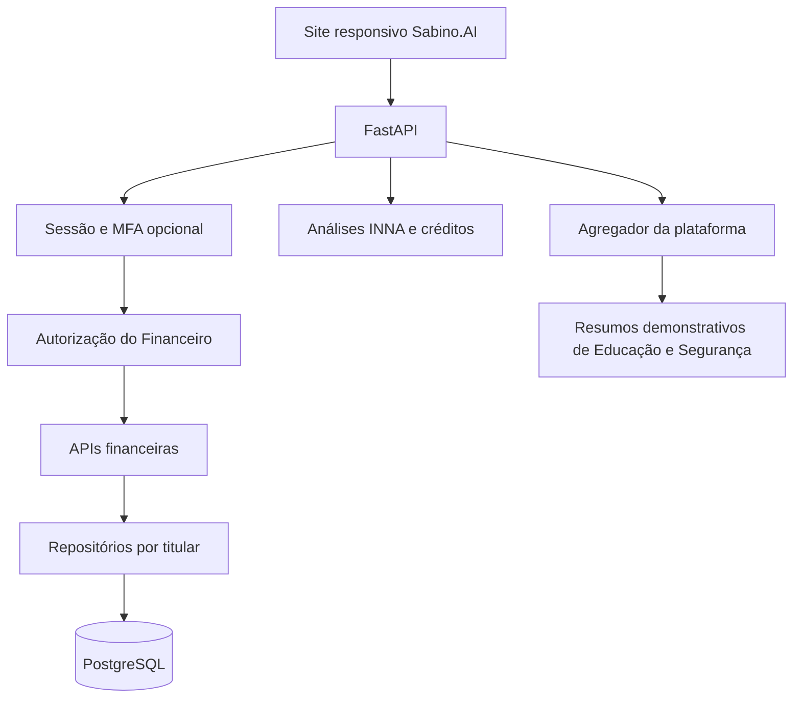
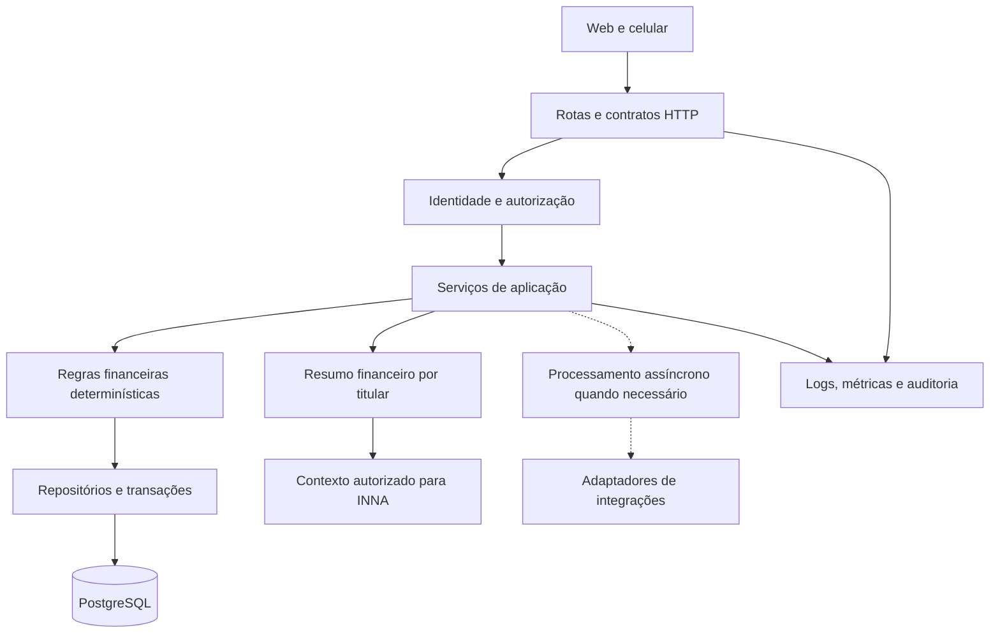
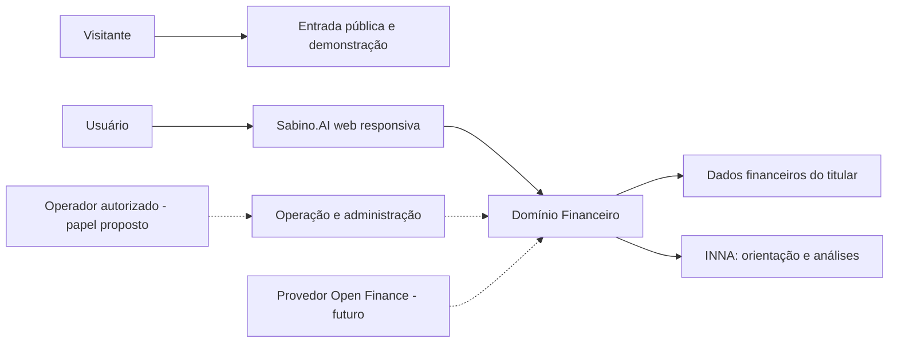
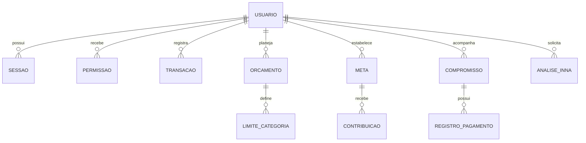
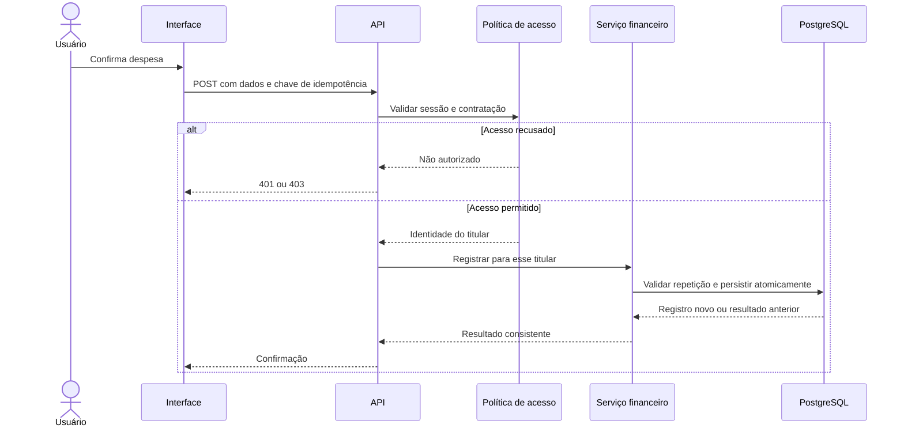
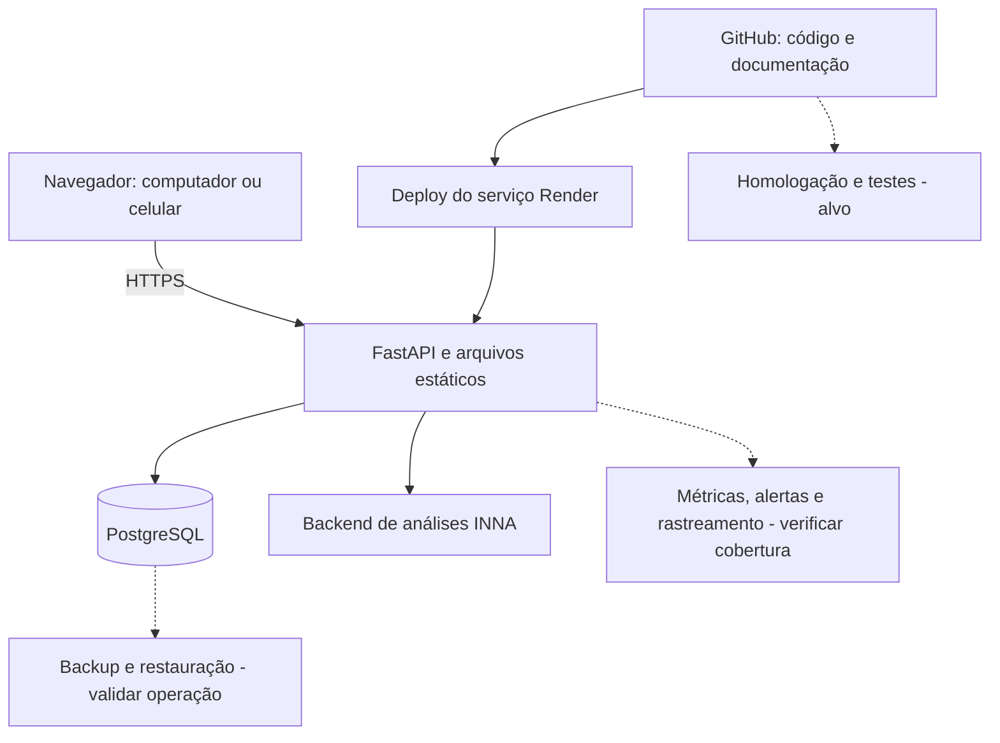

# Sabino.AI — Arquitetura de solução do Financeiro

Data: 23/10/2026
Base: Rogerio5/INNA-Financial-Coach-AI, branch deploy/sabino-pix-free.

## Objetivo e limite desta entrega

Consolidar a arquitetura a partir do código examinado e definir a evolução do backend. Esta análise confirma implementação no código, não certifica configuração ou funcionamento integral em produção. Não foram executados testes de backend nem alterados dados ou serviços em produção nesta etapa.

## Estrutura atual

| Área | Evidência examinada | Situação |
|---|---|---|
| Interface | Páginas HTML servidas pelo FastAPI | Site responsivo existente |
| Identidade | finance_identity.py e finance_auth_routes.py | Senhas com scrypt; sessões em PostgreSQL; cookie HttpOnly; revogação |
| MFA | mfa.py | TOTP opcional, segredo criptografado, proteção contra reutilização e códigos de recuperação |
| Autorização | finance_access_gate.py e platform_entitlements.py | Sessão válida e direito ativo de acesso ao Financeiro |
| Despesas | finance_transaction_routes.py e transaction_repository.py | Criar, listar, consultar, editar e excluir; titular resolvido no servidor |
| Planejamento e patrimônio | app.py e finance_setup_repository.py | Rotas e persistência para orçamento, metas, reserva, dívidas, contas, bens, seguros, tributos, investimentos e família |
| INNA | paid_analysis_routes.py e paid_analysis.py | Cotação, execução, histórico e estados de cobrança |
| Painel da plataforma | finance_aggregator.py | Agrega Educação e Segurança; ambas as fontes examinadas são demonstrativas |

Os indicadores de Educação e Segurança usam valores fixos e demo=True. Eles não comprovam usuários ativos, alertas reais ou disponibilidade. O progresso educacional individual tem funções de persistência próprias, distintas desses indicadores agregados.

## Achados que orientam a evolução

1. app.py concentra páginas, autorização, validação e casos de uso. Há redefinições históricas de rotas, dificultando entender a implementação efetiva.
2. finance_setup_repository.py concentra muitos domínios e redefine funções de metas. A extração precisa preservar a definição efetivamente usada.
3. As famílias /api/finance e /api/platform/finance coexistem. Preservar os contratos consumidos pelas telas durante a reorganização.
4. Alguns campos de capabilities ainda descrevem etapas anteriores, apesar de existirem controles implementados em outros componentes. Conciliar esses metadados com testes de comportamento.
5. Funções ensure_* criam esquemas. Planejar migrations versionadas após inventariar o banco, sem duplicar tabelas nem remover estruturas existentes.
6. Existe criação idempotente no repositório de transações, mas o POST de despesas examinado chama a criação comum. Mapear quais operações precisam garantir deduplicação por requisição.
7. O cookie Secure depende de variável de ambiente. Sua configuração efetiva de produção não foi verificada.

## Arquitetura proposta

Manter inicialmente o backend existente, organizando-o em módulos internos. Novos serviços e deployments devem surgir apenas quando carga, isolamento ou operação justificarem a separação.

Conexões pontilhadas representam evolução proposta, não integração confirmada.

| Camada | Responsabilidade |
|---|---|
| Rotas | Receber, validar e responder às requisições |
| Identidade e autorização | Resolver o titular e permitir a operação |
| Serviços | Coordenar casos de uso e transações de banco |
| Domínio | Aplicar cálculos e regras financeiras |
| Repositórios | Consultar e persistir registros do titular autorizado |
| Adaptadores | Encapsular integrações bancárias, mensagens e modelos de IA |
| Observabilidade | Registrar falhas, duração, correlação e eventos auditáveis |

### Módulos de negócio

- Identidade: cadastro, sessão, recuperação, MFA e autorização.
- Movimentações: despesas; receitas exigem evolução explícita do contrato atual, que aceita Despesa.
- Planejamento: orçamento, metas e reserva.
- Compromissos: contas, dívidas e registros de pagamento.
- Patrimônio: bens, investimentos, seguros e obrigações tributárias.
- Família: membros, despesas e metas; vínculo familiar não concede acesso automaticamente.
- Educação: progresso e indicadores derivados de registros reais.
- Reembolso: router já importado na aplicação; fluxo interno ainda precisa de auditoria específica.
- INNA: contexto autorizado, análise, evidências e histórico.
- Cobrança da plataforma: contratação e créditos separados das movimentações pessoais.
- Integrações: importações e eventual Open Finance; fornecedor e consentimento ainda não definidos nesta análise.

## Dados e contratos

Preservar as tabelas atuais até concluir o inventário. O modelo abaixo é conceitual.

| Entidade | Regra central |
|---|---|
| Usuário | Identidade canônica do servidor |
| Sessão | Expiração e revogação; token bruto não persistido |
| Permissão de plataforma | Acesso ativo ao Financeiro |
| Transação | Titular, valor decimal, moeda, data, categoria e origem |
| Orçamento | Titular, mês, renda informada e limites por categoria |
| Meta e contribuição | Objetivo e histórico de evolução |
| Conta/dívida e pagamento | Compromisso e registro de quitação; registrar pagamento não significa transferir dinheiro |
| Análise INNA | Titular, solicitação, contexto, resultado e estado da cobrança |
| Auditoria | Ator, ação, recurso, instante e correlação, sem senhas ou tokens |

O navegador não escolhe owner_id. Toda leitura e escrita deve usar a identidade resolvida pelo servidor. Valores monetários precisam de precisão explícita; datas financeiras devem ser distinguidas dos timestamps de auditoria. Um futuro aplicativo Flutter consumiria contratos HTTP, com autenticação definida especificamente para esse cliente.

## Fluxos essenciais

### Registrar despesa

1. Validar sessão e acesso ao Financeiro.
2. Resolver titular pelo servidor.
3. Validar valor, data, categoria e descrição.
4. Aplicar deduplicação quando contratada pela API.
5. Persistir com limites transacionais definidos.
6. Atualizar o resumo pela mesma fonte de dados.

### Consultar a INNA

1. Autenticar e validar a solicitação.
2. Carregar somente dados permitidos ao titular.
3. Calcular totais deterministicamente e identificar período e fontes.
4. Aplicar cotação e confirmação de créditos quando cabível.
5. Executar análise e retornar evidências e limitações.
6. Manter histórico e cobrança consistentes em falhas e repetição.

A INNA não deve alterar registros nem executar pagamentos implicitamente. Ações futuras de escrita exigem contrato e autorização próprios.

### Consultar indicadores

Separar resumo pessoal de painel administrativo. O painel administrativo exige autorização específica. Fontes demonstrativas devem permanecer identificadas; indisponibilidade não deve virar número fictício. Não transformar o agregador global existente em resumo pessoal sem definir identidade, escopo e compatibilidade.

## Plano de implementação

| Etapa | Entrega | Critério de conclusão |
|---|---|---|
| 1 | Inventário de telas, rotas, tabelas e testes | Cada funcionalidade ligada à autorização e persistência correspondentes |
| 2 | Extrair orçamento para router e serviço próprios | URLs e payloads preservados; regressão e isolamento aprovados |
| 3 | Migrations e revisão de transações/idempotência | Reexecução e concorrência testadas; restauração ensaiada |
| 4 | Resumo pessoal real | Totais reconciliados; nenhum dado de outro titular |
| 5 | Contexto financeiro da INNA | Respostas fundamentadas; histórico e créditos consistentes |
| 6 | Operação | Homologação, logs, métricas, rollback e deploy reproduzível |
| 7 | Integrações externas | Consentimento, sincronização, deduplicação e revogação validados |

### Primeiro recorte: orçamento

Preservar GET /api/finance/budget/{reference_month} e POST /api/finance/budget. Extrair suas regras de app.py, reutilizar a autorização existente e manter o formato consumido pelo frontend. Antes da alteração, registrar os contratos atuais e os casos de erro; depois, verificar equivalência. Não reorganizar todos os módulos simultaneamente.

### Critérios de validação do backend

- Usuário A não consulta nem altera registros de B.
- Sessão ausente, revogada ou expirada é recusada.
- Contratação inativa impede operações protegidas.
- Valores e datas inválidos não persistem.
- Repetição não duplica operações com garantia de idempotência.
- Falha intermediária não deixa registros relacionados inconsistentes.
- Totais de relatórios correspondem às fontes persistidas.
- Telas continuam compatíveis com as URLs e respostas existentes.
- Histórico de análises e cobrança permanecem coerentes em timeout e retomada.

Esses critérios ainda precisam ser executados; este documento não é um relatório de testes aprovados.

## Fontes e rastreabilidade

Repositório: https://github.com/Rogerio5/INNA-Financial-Coach-AI/tree/deploy/sabino-pix-free

Arquivos examinados: src/inna_platform/app.py; serviços em src/inna_platform/services/finance/: finance_auth_routes.py, finance_identity.py, mfa.py, finance_access_gate.py, platform_entitlements.py, finance_transaction_routes.py, transaction_repository.py, finance_setup_repository.py, finance_aggregator.py, education_service.py, security_service.py, paid_analysis_routes.py e paid_analysis.py.

README.md foi usado como contexto documental. Declarações históricas de testes e de integrações não foram reproduzidas nesta análise. O levantamento não cobre ainda todos os adaptadores, testes, migrations, rotas de reembolso ou configurações do Render.

## Visão de solução: objetivos, atores e limites

O objetivo é permitir que o usuário organize suas finanças, acompanhe compromissos e receba orientação da INNA com dados do próprio titular. A arquitetura deve atender também à manutenção do produto: contratos claros, rastreabilidade e evolução sem quebrar as telas existentes.

| Ator | Necessidade | Limite de acesso |
|---|---|---|
| Usuário autenticado | Consultar e registrar suas finanças | Dados próprios e permissões concedidas explicitamente |
| Visitante | Conhecer e acessar a plataforma | Conteúdo público ou demonstração identificada |
| Operador autorizado | Suporte e operação | Escopo de função a definir e auditar; sem acesso irrestrito implícito |
| INNA | Analisar contexto financeiro | Contexto mínimo autorizado; não é autoridade para pagamentos |
| Desenvolvedor/operador técnico | Manter e publicar | Mudanças versionadas, validação e recuperação documentada |

Fora do escopo implementado confirmado: execução bancária de pagamentos, aplicativo Flutter nativo, integração Open Finance operacional e indicadores administrativos inteiramente reais.

## Diagramas complementares

### Contexto da solução

### Modelo conceitual de dados

Este modelo expressa relações de negócio propostas. Não afirma nomes físicos, chaves estrangeiras ou cardinalidades já aplicadas no banco. O esquema físico precisa ser inventariado antes de migrations.

### Sequência alvo: despesa com isolamento e deduplicação

A autenticação e o uso de identidade do servidor existem. O contrato de idempotência na entrada HTTP e a camada de serviços representados aqui são evolução proposta.

### Implantação e operação

Render hospeda o serviço observado; PostgreSQL é usado pelo código examinado. Neon é descrito na documentação do projeto, mas a configuração ativa não foi auditada nesta entrega. Homologação, worker e monitoramento externo abaixo são alvos a verificar/implantar, não certificação de ambiente existente.

## Atributos de qualidade e critérios mensuráveis

Não há SLO numérico novo aprovado nesta entrega. Definir metas após medir a linha de base; não apresentar objetivos como resultados atuais.

| Atributo | Decisão de solução | Evidência de aceitação |
|---|---|---|
| Confidencialidade | Titular resolvido no servidor e filtragem de consultas | Testes cruzados entre duas contas |
| Integridade | Decimal, validação e transações de banco | Reconciliação e testes de falha intermediária |
| Confiabilidade | Idempotência nos casos definidos e retomada de análise | Repetição/concorrência sem duplicação |
| Desempenho | Medir latência por rota e chamada de IA | Baseline de p50/p95, separando cold start |
| Disponibilidade | Health, alertas e plano de recuperação | Exercício de falha e restauração |
| Manutenção | Rotas, serviços e repositórios separados gradualmente | Contratos e regressão preservados |
| Privacidade | Minimização de contexto e logs sem segredos | Revisão dos campos enviados à IA e registrados |
| Operabilidade | Correlação e trilha de mudanças | Diagnóstico de requisição sem expor dados pessoais |

RPO, RTO, retenção, volume esperado, orçamento operacional e metas de disponibilidade permanecem decisões abertas. O nível de serviço pretendido deve orientar plano de hospedagem e backup.

## Decisões de arquitetura propostas

| ID | Decisão | Justificativa e consequência |
|---|---|---|
| ADR-FIN-001 | Evoluir como aplicação modular antes de distribuir serviços | Aproveita o backend existente e reduz mudanças simultâneas; requer disciplina de limites internos |
| ADR-FIN-002 | Preservar URLs durante extração de módulos | Evita quebra das telas; depreciação futura precisa de inventário de consumidores |
| ADR-FIN-003 | PostgreSQL como fonte dos registros financeiros | Coerência transacional; migrations e restauração precisam ser organizadas |
| ADR-FIN-004 | Cálculos financeiros determinísticos; IA interpreta contexto | Totais reproduzíveis; resultados do modelo não viram saldo contábil |
| ADR-FIN-005 | Separar demonstração, resumo pessoal e administração | Evita confundir métricas fictícias ou globais com finanças pessoais |
| ADR-FIN-006 | Nenhuma integração bancária implícita | Provedor, consentimento, contratos e reconciliação exigem entrega própria |

Estas ADRs registram a proposta desta documentação; implementação e aprovação técnica devem ser acompanhadas nos respectivos trabalhos.

## Governança da documentação

Atualizar este documento quando mudar uma rota pública, fonte de dados, limite de autorização, integração ou decisão de implantação. Cada atualização deve indicar evidência no código, impacto nos contratos e testes executados. Manter a distinção entre observado, proposto e validado em produção.

A cobertura desta arquitetura é de solução ponta a ponta para o Financeiro; a validação de cada componente continua incremental. Diagramas representam essa mesma distinção e não substituem testes, inventário físico do banco ou revisão de configuração.
