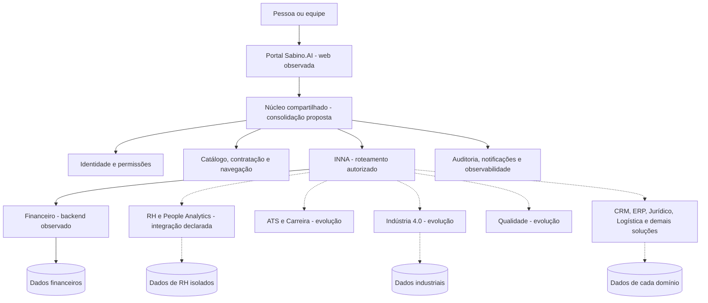
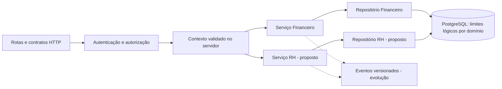
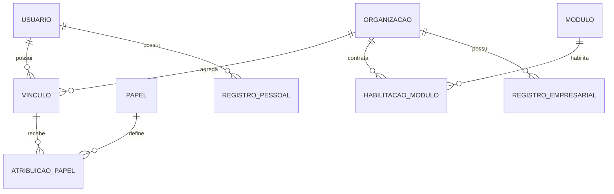
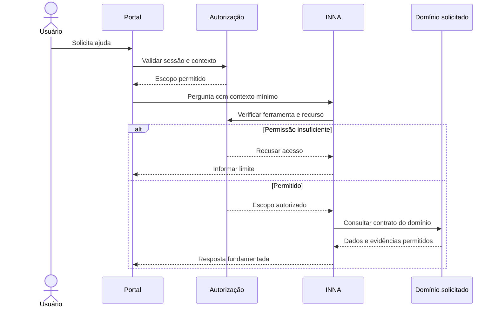
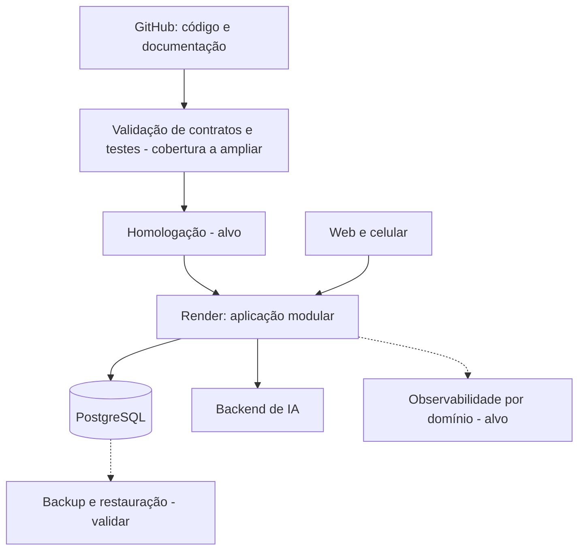

# Sabino.AI — Arquitetura Geral de Solução

Atualização: 23/10/2026. Escopo: plataforma multidomínio. Base examinada: branch `deploy/sabino-pix-free`.

## Leitura e estado da arquitetura

Esta é a arquitetura geral de referência para a evolução da Sabino.AI. O [Financeiro](financeiro.md) é o primeiro domínio detalhado. Esta documentação não implementa novos serviços nem certifica todos os módulos em produção.

**Observado:** aplicação web FastAPI no Render, interface responsiva, identidade/sessões, autorização de acesso ao Financeiro, persistência financeira em PostgreSQL e fluxo de análises INNA.  
**Declarado no catálogo:** estados registrados em `src/platform_modules.py`; não equivalem a testes de implantação.  
**Proposto:** organização multidomínio, isolamento empresarial, contratos entre domínios e evolução do RH descritos abaixo.

## 1. Objetivos de negócio

Uma entrada comum para acessar soluções de negócio, com contratação e permissões por módulo. Cada domínio mantém suas regras e dados. A INNA orienta e encaminha solicitações dentro do acesso autorizado.

A plataforma atende pessoas físicas e, como evolução, organizações e suas equipes. O contexto pessoal financeiro não se torna acessível ao empregador por existir vínculo com uma organização.

Atores: visitante, titular de conta, membro de organização, gestor de domínio, administrador da organização e operador da plataforma. Os papéis empresariais são proposta a implementar e validar; administrador técnico não deve receber leitura irrestrita dos dados por padrão.

## 2. Catálogo e organização

| Visão | Evidência | Tratamento |
|---|---|---|
| Interface Sabino.AI | Financeiro, Indústria 4.0, Qualidade, ATS & Carreira | Preservar navegação existente; módulos em desenvolvimento não viram operação por constarem em uma tela |
| Registro técnico | Soluções de negócio, núcleo tecnológico, soluções setoriais e administração | Inventário completo ao final; estados são declarações do registro |
| Financeiro | Backend e autorização examinados | Primeiro domínio documentado em profundidade |
| RH e People Analytics | `hr_people_analytics` marcado INTEGRATING, integração API | Próximo domínio a detalhar; prontidão operacional não verificada |
| ATS & Carreira | Jornada do candidato na interface | Relacionado ao RH, mas não equivalente à visão empresarial de colaboradores |
| Qualidade | Tela orientada à qualidade de software; registro também possui gestão de processos | Manter subdomínios distintos para não misturar testes de software e qualidade empresarial |

Hierarquia proposta: **plataforma → domínios de negócio → capacidades do domínio**. Núcleo tecnológico é capacidade compartilhada; solução setorial compõe capacidades autorizadas, sem duplicar automaticamente todo o backend.

## 3. Visão geral Mermaid

Diagrama alvo. Apenas componentes marcados como observados tiveram evidência de implementação revisada nesta etapa.

## 4. Núcleo compartilhado

| Capacidade | Responsabilidade | Evidência / evolução |
|---|---|---|
| Identidade | Conta, sessão, MFA, recuperação | Implementações existentes; generalizar contratos sem regressão |
| Autorização | Organização, módulo, recurso e operação | Financeiro possui acesso por contratação; contexto organizacional é proposta |
| Catálogo | Código estável, estado, rota, responsável e contrato | Há registro Python e catálogo na interface; reconciliar fontes |
| Contratação e créditos | Habilitação de módulo e cobrança de análises | Há componentes no Financeiro; não confundir com saldo financeiro do usuário |
| INNA | Classificar intenção e chamar ferramentas autorizadas | Reutilizar infraestrutura existente; validar conexão por domínio |
| Notificações | Entrega, preferência e tentativas | Contrato compartilhado proposto; inventariar implementações antes de centralizar |
| Auditoria | Ator, organização, ação, recurso e correlação | Definir cobertura e retenção; não registrar tokens ou conteúdo pessoal integral |
| Observabilidade | Saúde, latência, falhas, consumo e custo | Infraestrutura descrita no projeto; cobertura multidomínio ainda precisa de validação |
| Documentos e conhecimento | Armazenamento, busca e políticas de acesso | RAG existe no projeto; isolamento por domínio e organização exige testes próprios |

Compartilhar um serviço não significa compartilhar os dados dos seus consumidores.

## 5. Limites dos domínios

| Domínio | Dono das informações | Pode fornecer por contrato | Não deve expor implicitamente |
|---|---|---|---|
| Financeiro pessoal | Titular, despesas, metas, patrimônio | Resumo consentido e autorizado | Saldo e dívidas ao RH ou empregador |
| RH empresarial | Organização, vínculos, processos e registros de pessoas | Eventos administrativos mínimos e indicadores autorizados | Prontuários, avaliações e remuneração a outros módulos |
| ATS & Carreira | Candidato ou processo seletivo empresarial, conforme contexto | Candidatura autorizada e etapas | Histórico privado de carreira a qualquer recrutador |
| Indústria | Ativos, telemetria, manutenção e produção | Evento operacional e indicadores | Comandos físicos sem controles específicos |
| Qualidade | Casos, evidências, critérios e não conformidades | Resultado de verificação e plano de ação | Evidências de outro cliente ou projeto |
| CRM/ERP/Logística | Seus respectivos registros empresariais | Ordens e eventos com contrato definido | Leitura direta e irrestrita de tabelas de outro domínio |
| Jurídico e documentos | Documentos e processos autorizados | Metadados e resultados permitidos | Conteúdo integral sem autorização da origem |

## 6. Backend e dados

Evoluir inicialmente como aplicação modular. Separar rotas, serviços, regras e repositórios por domínio; novos deployments somente com justificativa de escala, isolamento ou operação. Não há necessidade de introduzir microserviços, broker ou Kubernetes para documentar essa arquitetura.

Contexto proposto: `actor_id`, `tenant_id` quando aplicável, `domain`, permissões e `correlation_id`. Todos são resolvidos ou validados pelo servidor; valores enviados pelo cliente não concedem acesso.

O Financeiro atual usa identidade por titular. Não converter `owner_id` em organização implicitamente. Introduzir organizações, vínculos e papéis com migration explícita e testes para preservar contas pessoais. RLS pode ser defesa adicional, caso adotada e validada; não está declarada aqui como implementada.

Modelo conceitual proposto, não esquema físico aplicado. Um colaborador de RH não é automaticamente uma conta de login; o vínculo deve ser explícito.

## 7. APIs e comunicação entre módulos

Preservar rotas atuais do Financeiro. Para novas APIs, propor namespaces versionados como `/api/v1/hr/...`; aprovar contratos antes de implementá-los. Não renomear todas as APIs existentes nesta etapa.

Requisições incluem contratos de dados, paginação, validação, erros e políticas de repetição. Operações críticas exigem idempotência definida por caso de uso. Nenhum módulo escreve diretamente nas tabelas de outro.

Eventos futuros devem possuir `event_id`, `event_type`, `schema_version`, `occurred_at`, contexto autorizado e payload mínimo. Consumidores deduplicam eventos. Se publicação e gravação precisarem de atomicidade, considerar outbox; isso é proposta, não dependência já instalada.

Exemplo proposto: RH envia a um futuro Financeiro empresarial uma obrigação aprovada, com referência e total necessários. Não envia automaticamente histórico completo do empregado e não mistura essa obrigação com finanças pessoais.

## 8. INNA multidomínio

A escolha de domínio pelo modelo não concede permissão. Aplicar políticas na execução das ferramentas. Memória, RAG, cache e histórico precisam incluir escopo de acesso e não reutilizar contexto entre organizações. Escritas exigem autorização específica e confirmação quando cabível; decisão de contratação, demissão ou pagamento não será tomada implicitamente pela INNA.

## 9. Próximo domínio: RH

Recorte inicial proposto: cadastro organizacional, vínculos e onboarding administrativo, com permissões de gestor e colaborador. Confirmar a aplicação/fornecedor correspondente ao catálogo INTEGRATING antes de escolher entre adaptador e implementação interna.

Sequência:
1. Inventariar integração RH existente, contratos, autenticação e responsável.
2. Definir organizações, vínculos, papéis e separação candidato/colaborador.
3. Especificar cadastro mínimo e workflow de onboarding.
4. Implementar leitura/escrita com auditoria e isolamento.
5. Só então ampliar para recrutamento, desempenho, clima, treinamentos e indicadores.

Dados sensíveis exigem minimização, finalidade e retenção definidas. Indicadores de grupos pequenos precisam de regra para evitar reidentificação. Decisões sobre pessoas permanecem sob responsáveis humanos; esta arquitetura não autoriza classificação automática de candidatos.

## 10. Implantação e qualidade

Estado observado: web/FastAPI hospedado no Render; código financeiro usa PostgreSQL. Configuração física atual do banco e recuperação não foram auditadas nesta entrega.

| Qualidade | Critério antes de liberar novo módulo |
|---|---|
| Isolamento | Testes entre usuários, organizações e domínios impedem leitura/escrita cruzadas |
| Integridade | Transações e repetição não duplicam efeitos |
| Compatibilidade | Fluxos do Financeiro continuam funcionando |
| Privacidade | Logs e contexto de IA não contêm segredos ou dados além do necessário |
| Operação | Health, alertas, rollback e restauração exercitados |
| IA | Ferramentas autorizadas, evidências, limites e avaliação por domínio |
| Desempenho | Medir p50/p95 e cold start antes de definir SLO |
| Custo | Medir consumo e limites por módulo e organização |

RPO, RTO, retenção, orçamento, volumes e disponibilidade alvo permanecem decisões abertas, não resultados existentes.

## 11. Decisões e roteiro

| Decisão proposta | Motivo |
|---|---|
| Núcleo compartilhado e domínios com responsabilidades próprias | Reuso sem mistura de dados |
| Aplicação modular primeiro | Evolução incremental sobre o serviço atual |
| Identidade pessoal distinta do contexto empresarial | Preserva privacidade e semântica dos registros |
| Catálogo único como alvo | Evita divergência entre UI e registro técnico |
| INNA subordinada à autorização das ferramentas | Modelo não decide seu próprio acesso |
| Contratos antes de eventos e integrações | Reduz acoplamento e efeitos duplicados |

**Ordem de execução:** reconciliar catálogo → especificar identidade organizacional → registrar contratos de RH → implementar recorte de onboarding em homologação → validar isolamento/regressão → liberar controladamente. A organização do Financeiro segue seu documento específico e pode avançar em mudanças delimitadas.

Definition of done de cada domínio: responsável, escopo, esquema de dados, APIs, permissões, integrações, diagramas, testes executados, operação e limitações documentadas. Documentação não equivale a implementação concluída.

## 12. Inventário do registro técnico

Fonte: [platform_modules.py](../../../src/platform_modules.py). ACTIVE/INTEGRATING/PLANNED são estados declarados pelo registro; nenhuma disponibilidade foi inferida apenas deles.

| Identificador | Categoria no código | Estado declarado |
|---|---|---|
| `financial_solutions` | BUSINESS_SOLUTIONS | ACTIVE |
| `hr_people_analytics` | BUSINESS_SOLUTIONS | INTEGRATING |
| `document_ai` | BUSINESS_SOLUTIONS | PLANNED |
| `business_automation` | BUSINESS_SOLUTIONS | PLANNED |
| `enterprise_rag` | TECHNOLOGY_CORE | ACTIVE |
| `site_app_generator` | BUSINESS_SOLUTIONS | PLANNED |
| `intelligent_support` | BUSINESS_SOLUTIONS | PLANNED |
| `data_bi_copilot` | BUSINESS_SOLUTIONS | PLANNED |
| `quality_process_management` | BUSINESS_SOLUTIONS | PLANNED |
| `crm_sales_intelligence` | BUSINESS_SOLUTIONS | PLANNED |
| `erp_business_operations` | BUSINESS_SOLUTIONS | PLANNED |
| `supply_chain_procurement_logistics` | BUSINESS_SOLUTIONS | PLANNED |
| `legal_compliance` | BUSINESS_SOLUTIONS | PLANNED |
| `api_integrations_connectors` | TECHNOLOGY_CORE | PLANNED |
| `data_platform_governance` | TECHNOLOGY_CORE | PLANNED |
| `cybersecurity_fraud_prevention` | TECHNOLOGY_CORE | PLANNED |
| `cloud_devops_finops` | TECHNOLOGY_CORE | PLANNED |
| `ai_operations` | TECHNOLOGY_CORE | ACTIVE |
| `tools_analytics` | TECHNOLOGY_CORE | ACTIVE |
| `knowledge_graph_semantic_ai` | TECHNOLOGY_CORE | PLANNED |
| `multimodal_ai` | TECHNOLOGY_CORE | PLANNED |
| `voice_audio_speech_ai` | TECHNOLOGY_CORE | PLANNED |
| `agent_process_orchestration` | TECHNOLOGY_CORE | PLANNED |
| `ai_model_agent_security` | TECHNOLOGY_CORE | PLANNED |
| `real_time_event_intelligence` | TECHNOLOGY_CORE | PLANNED |
| `privacy_data_protection_lgpd` | TECHNOLOGY_CORE | PLANNED |
| `zero_trust_identity_access` | TECHNOLOGY_CORE | PLANNED |
| `cryptography_confidential_computing` | TECHNOLOGY_CORE | PLANNED |
| `software_supply_chain_security` | TECHNOLOGY_CORE | PLANNED |
| `privacy_enhancing_technologies` | TECHNOLOGY_CORE | PLANNED |
| `geoai_earth_observation` | TECHNOLOGY_CORE | PLANNED |
| `gis_location_intelligence` | TECHNOLOGY_CORE | PLANNED |
| `drones_aerial_intelligence` | TECHNOLOGY_CORE | PLANNED |
| `spatial_computing_augmented_reality` | TECHNOLOGY_CORE | PLANNED |
| `iot_edge_intelligence` | TECHNOLOGY_CORE | PLANNED |
| `computer_vision_video_analytics` | TECHNOLOGY_CORE | PLANNED |
| `digital_twins_simulation` | TECHNOLOGY_CORE | PLANNED |
| `robotics_autonomous_systems` | TECHNOLOGY_CORE | PLANNED |
| `scientific_computing_engineering` | TECHNOLOGY_CORE | PLANNED |
| `simulation_optimization_operations_research` | TECHNOLOGY_CORE | PLANNED |
| `research_labs_assisted_discovery` | TECHNOLOGY_CORE | PLANNED |
| `materials_product_engineering` | TECHNOLOGY_CORE | PLANNED |
| `construction_bim_digital_engineering` | TECHNOLOGY_CORE | PLANNED |
| `climate_meteorological_intelligence` | TECHNOLOGY_CORE | PLANNED |
| `environmental_natural_resources_intelligence` | TECHNOLOGY_CORE | PLANNED |
| `energy_smart_grids` | TECHNOLOGY_CORE | PLANNED |
| `esg_sustainability` | TECHNOLOGY_CORE | PLANNED |
| `emergency_disaster_management` | TECHNOLOGY_CORE | PLANNED |
| `mobility_traffic_transport` | TECHNOLOGY_CORE | PLANNED |
| `smart_cities_urban_infrastructure` | TECHNOLOGY_CORE | PLANNED |
| `networks_telecommunications_connectivity` | TECHNOLOGY_CORE | PLANNED |
| `navigation_positioning_geolocation` | TECHNOLOGY_CORE | PLANNED |
| `asset_management_smart_maintenance` | TECHNOLOGY_CORE | PLANNED |
| `ai_software_engineering` | TECHNOLOGY_CORE | PLANNED |
| `ai_collaboration_meetings_productivity` | TECHNOLOGY_CORE | PLANNED |
| `digital_experiences_intelligent_interfaces` | TECHNOLOGY_CORE | PLANNED |
| `software_testing_quality_reliability` | TECHNOLOGY_CORE | PLANNED |
| `mobile_apps_omnichannel_experiences` | TECHNOLOGY_CORE | PLANNED |
| `digital_identity_verifiable_credentials` | TECHNOLOGY_CORE | PLANNED |
| `technology_governance_policy_compliance` | TECHNOLOGY_CORE | PLANNED |
| `data_traceability_provenance` | TECHNOLOGY_CORE | PLANNED |
| `enterprise_decision_intelligence` | TECHNOLOGY_CORE | PLANNED |
| `operational_security_resilience` | TECHNOLOGY_CORE | PLANNED |
| `responsible_ai_ethics_risk` | TECHNOLOGY_CORE | PLANNED |
| `ai_evaluation_benchmarks_red_team` | TECHNOLOGY_CORE | PLANNED |
| `model_explainability_interpretability` | TECHNOLOGY_CORE | PLANNED |
| `ai_bias_quality_monitoring` | TECHNOLOGY_CORE | PLANNED |
| `ai_certification_system_evidence` | TECHNOLOGY_CORE | PLANNED |
| `pet_shops_veterinary_services` | SECTOR_SOLUTIONS | PLANNED |
| `supermarkets_wholesale` | SECTOR_SOLUTIONS | PLANNED |
| `retail_stores` | SECTOR_SOLUTIONS | PLANNED |
| `dentistry` | SECTOR_SOLUTIONS | PLANNED |
| `hospitals_clinics` | SECTOR_SOLUTIONS | PLANNED |
| `mobility_transport_connected_vehicles` | SECTOR_SOLUTIONS | PLANNED |
| `agribusiness_smart_agriculture_bioeconomy` | SECTOR_SOLUTIONS | PLANNED |
| `administration` | PLATFORM_ADMINISTRATION | ACTIVE |

## 13. Fontes e manutenção

- [Catálogo técnico](../../../src/platform_modules.py).
- [Catálogo da interface](../../../src/inna_platform/static/sabino-modulos.html).
- [Aplicação FastAPI](../../../src/inna_platform/app.py).
- [Serviços financeiros](../../../src/inna_platform/services/finance/).
- [Arquitetura do Financeiro](financeiro.md).
- [Equipes hierárquicas de agentes](../HIERARCHICAL_AGENT_TEAMS.md).
- [Handoffs](../MULTI_AGENT_HANDOFFS.md).
- [Índice geral](../../arquitetura.md).

Atualizar esta visão quando surgir um domínio, contrato ou fronteira de dados. Manter o inventário ligado ao código e registrar separadamente testes executados e configuração efetiva. Esta entrega é documental; não altera backend nem habilita módulos.
