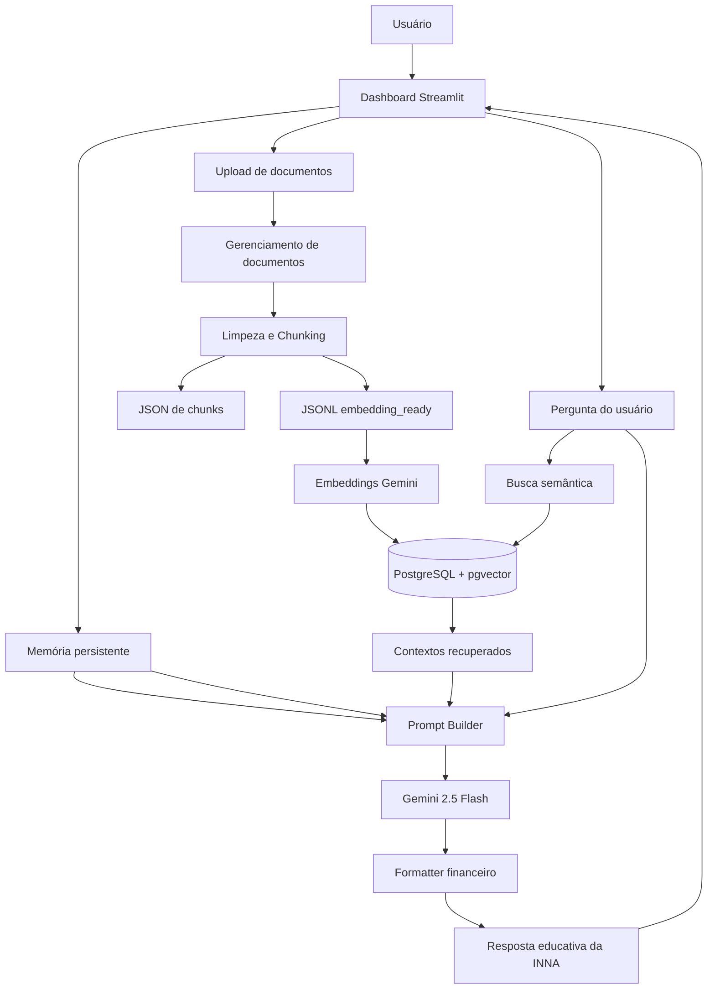
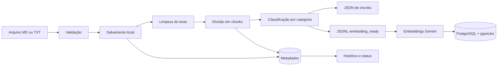
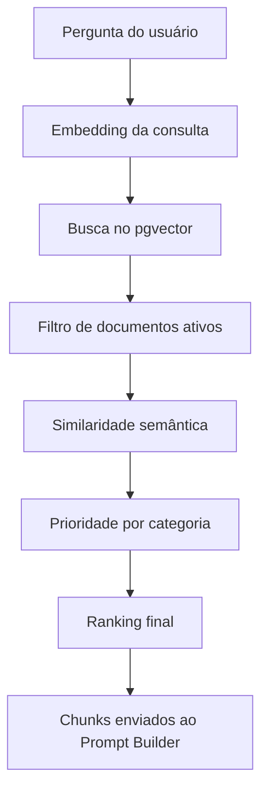
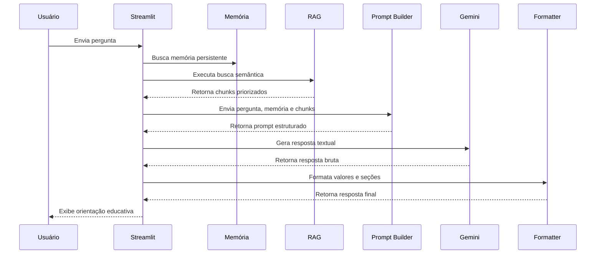

# Arquitetura Técnica — INNA Financial Coach AI

## Visão geral

A INNA Financial Coach AI é uma aplicação de educação financeira com Inteligência Artificial, memória persistente, recuperação de conhecimento por RAG, busca vetorial com PostgreSQL/pgvector e geração de respostas com Gemini.

A aplicação foi estruturada em módulos para separar interface, regras financeiras, memória, documentos, embeddings, recuperação semântica e geração textual.

> A INNA atua como educadora financeira. Ela apresenta informações, possibilidades e critérios para reflexão, sem decidir pelo usuário e sem substituir instituições financeiras, profissionais jurídicos, contábeis ou consultores habilitados.

---

## Arquitetura principal


---

## Objetivo da arquitetura

> A arquitetura da INNA foi organizada para reduzir dependências diretas entre componentes e permitir evolução gradual do sistema.

Os principais objetivos são:

- separar interface e regras de negócio;
- manter o código mais legível;
- facilitar testes automatizados;
- permitir substituição de serviços sem quebrar o dashboard;
- manter memória financeira persistente;
- organizar o fluxo RAG;
- centralizar acesso ao PostgreSQL;
- facilitar futuras integrações com APIs, novos canais e outros idiomas.

---

## Camadas principais
Interface

A interface principal é construída com Streamlit.

Arquivos principais:
```
src/dashboard.py
src/dashboard_pages/
```
Responsabilidades:

- exibir menus e formulários;
- receber perguntas;
- mostrar respostas;
- fazer upload de documentos;
- exibir memória persistente;
- exibir métricas e evolução;
- permitir ativação e desativação de documentos;
- iniciar geração de embeddings;
- testar busca semântica;
- exibir fontes usadas pela INNA.

A interface não deve concentrar regras complexas de negócio. Ela chama serviços especializados.

--- 

## Agentes e orquestração
src/agents/

Responsabilidades:

- coordenar etapas da aplicação;
- combinar memória, RAG, prompt e geração textual;
- preparar evolução para futuros agentes especializados;
- permitir novos fluxos automatizados.

---

## Banco de dados
src/database/

Responsabilidades:

- carregar a variável DATABASE_URL;
- abrir conexões com PostgreSQL;
- centralizar acesso ao Neon;
- reduzir duplicação de código de conexão;
- apoiar serviços de memória, documentos e pgvector.

Tecnologias principais:
```
PostgreSQL
Neon
pgvector
SQLAlchemy
psycopg2
```

---

## Modelos
src/models/

Responsabilidades:

- representar estruturas de memória;
- representar documentos e chunks;
- representar resultados financeiros;
- facilitar validação e tipagem;
- preparar a aplicação para Pydantic e APIs.

---

## Memória persistente
src/services/memory/

A memória persistente permite que a INNA mantenha contexto financeiro por usuário.

Ela pode armazenar:

- nome;
- idioma;
- moeda;
- renda mensal;
- gastos mensais;
- capacidade de guardar;
- presença de dívidas;
- uso do cartão de crédito;
- perfil financeiro;
- objetivo principal;
- última meta;
- score;
- risco;
- resumo contextual;
- nível de confiança;
- tags;
- dados adicionais em JSON;
- data de criação;
- data de atualização.

---

## Extração automática

A INNA consegue identificar informações financeiras em frases como:
```
Agora ganho R$ 6.500, gasto R$ 3.200 e consigo guardar R$ 1.300 por mês.
```
Os dados podem ser extraídos e incorporados à memória existente.

--- 

## Mesclagem segura

Quando a mensagem contém apenas uma informação nova, os demais dados antigos são preservados.

Exemplo:
```
Memória atual:
Renda: R$ 6.300
Gastos: R$ 3.300
Reserva: R$ 1.200
```
Nova mensagem:
Agora meus gastos são R$ 3.200

Resultado:
```
Renda: R$ 6.300
Gastos: R$ 3.200
Reserva: R$ 1.200
```

--- 

## Evolução financeira

A aplicação compara valores anteriores e atuais.

Exemplo:
```
Renda mensal:
R$ 6.300,00 → R$ 6.500,00

Gastos mensais:
R$ 3.300,00 → R$ 3.200,00

Capacidade de guardar:
R$ 1.200,00 → R$ 1.300,00
```
A INNA diferencia:

- capacidade financeira atual
- meta registrada
- valor efetivamente guardado
- histórico comprovado de evolução

Uma meta registrada não é tratada automaticamente como histórico real.

--- 

## Prompt Builder
src/services/prompts/

O Prompt Builder monta o contexto final enviado ao Gemini.

Ele combina:

- pergunta do usuário;
- memória persistente;
- cálculos financeiros;
- objetivo principal;
- meta registrada;
- contexto recuperado pelo RAG;
- regras educativas;
- regras de segurança;
- preferência de linguagem;
- idioma;
- moeda.

---

## Princípios do Prompt Builder

A resposta deve:

- usar linguagem clara;
- respeitar os valores atuais da memória;
- não inventar dados;
- diferenciar meta e evolução;
- explicar cálculos;
- usar contexto RAG quando disponível;
- orientar sem decidir pelo usuário;
- evitar recomendação financeira personalizada;
- usar canais oficiais em situações de fraude;
- não pedir dados sensíveis.

---

## Formatadores financeiros
src/services/formatters/

Responsabilidades:

- formatar moedas;
- formatar percentuais;
- calcular variações;
- calcular valores semanais;
- exibir comparações;
- manter padrão por idioma e moeda.

Exemplos:
```
BRL:
R$ 6.300,00

USD:
US$ 6,300.00

Percentual:
52,4%

Variação:
▲ +R$ 200,00

Comparação:
R$ 6.300,00 → R$ 6.500,00
```

---

## Embeddings Gemini
```
src/services/embeddings/
```
A INNA utiliza o SDK atual:
```
google-genai
```
Configuração:
```
Modelo: gemini-embedding-001
Dimensões: 3072
```
Para documentos:
```
task_type = RETRIEVAL_DOCUMENT
```
Para perguntas:
```
task_type = RETRIEVAL_QUERY
```
Essa separação melhora a busca semântica entre pergunta e conteúdo indexado.

---

## Modelo de linguagem
```
src/services/llm/
```
Modelo principal:
```
gemini-2.5-flash
```
Responsabilidades:

- gerar resposta textual;
- validar retorno do modelo;
- centralizar configuração;
- reduzir dependência direta no dashboard;
- tratar erros;
- permitir futura troca de modelo.

A geração textual usa:
```
google-genai
```

---

## RAG — Retrieval-Augmented Generation
```
src/services/rag/
```
O RAG permite que a INNA use documentos próprios como fonte de contexto.

Os principais módulos são:
```
Módulo	                | Responsabilidade
documents.py	        | Validação, nomes seguros e armazenamento local
chunking.py	            | Limpeza, divisão, JSON e JSONL
document_repository.py	| Metadados, status e histórico
vector_store.py	        | Embeddings, tabela e índices pgvector
retrieval.py	        | Busca semântica, categorias e ranking
```

---

## Fluxo de documentos RAG


---

## Validação de documentos

A primeira versão aceita:
```
.md
.txt
```
O sistema:

- valida extensão;
- normaliza nome;
- remove caracteres problemáticos;
- gera nome seguro;
- adiciona timestamp;
- salva em diretório local;
- registra metadados no banco.

---

## Limpeza e chunking

O texto é normalizado antes da divisão.

O processo pode:

- remover tabulações;
- padronizar quebras de linha;
- remover espaços excessivos;
- preservar títulos Markdown;
- dividir por seções;
- limitar o tamanho dos chunks;
- aplicar sobreposição quando configurada.

Exemplo de documento:
```
# Guia Financeiro

## Pix suspeito

Confira o aplicativo oficial.

## Reserva financeira

Crie o hábito de guardar um valor compatível com o orçamento.

Pode gerar dois chunks:

Chunk 1:
# Guia Financeiro
## Pix suspeito
Confira o aplicativo oficial.

Chunk 2:
# Guia Financeiro
## Reserva financeira
Crie o hábito de guardar um valor compatível com o orçamento.
```

---

## Categorias RAG

As categorias principais incluem:

- pix
- seguranca
- cartao_credito
- dividas
- organizacao_financeira
- reserva_financeira
- geral

A classificação ajuda a priorizar trechos relevantes.

Exemplo:
```
Pergunta:
Recebi um Pix estranho, devo devolver?
```
```
Categorias priorizadas:
pix
seguranca
```
---

## JSONL embedding_ready

O arquivo JSONL contém um registro por linha.

Exemplo:
```
{
  "chunk_id": "guia_chunk_1",
  "documento_origem": "guia.md",
  "chunk_index": 1,
  "texto": "Conteúdo do chunk",
  "metadata": {
    "categoria": "seguranca",
    "idioma": "pt"
  }
}
```
Esse formato é usado para gerar embeddings.

---

## Metadados dos documentos

Os metadados são armazenados no PostgreSQL.

Podem incluir:

- nome original;
- nome salvo;
- caminho do upload;
- caminho dos chunks;
- caminho do JSONL;
- extensão;
- tamanho;
- total de chunks;
- status;
- origem;
- ativo;
- data de criação;
- data de atualização.

---

## Histórico dos documentos

A INNA registra eventos como:
```
documento_registrado
documento_ativado
documento_desativado
documento_reprocessado
```

O histórico pode armazenar:

- status anterior;
- status novo;
- estado ativo anterior;
- estado ativo novo;
- detalhes;
- origem;
- data e hora.

---

## Ativação e desativação

Um documento ativo participa da busca RAG.

Um documento inativo:

- permanece no banco;
- mantém seu histórico;
- pode manter seus embeddings;
- é ignorado pela busca semântica.

---

## Armazenamento vetorial
```
src/services/rag/vector_store.py
```
Tecnologia:
```
PostgreSQL + pgvector
```
Tabela principal:
```
chunks_embeddings_rag
```
Dimensão:
```
vector(3072)
```
O sistema também usa:
```
halfvec(3072)
```
para otimização do índice.

---

## Índice vetorial

Índice principal:
```
HNSW
```
Métrica:
```
cosseno
```
Operador:
```
halfvec_cosine_ops
```
O sistema também cria índices auxiliares por:
```
documento_id
chunk_id
```
## Fluxo de busca semântica


---

## Ranking

O ranking combina:
```
similaridade vetorial
+
bônus de prioridade por categoria
```
Exemplo:
```
Similaridade:
0,85

Prioridade de categoria:
0,08

Score RAG:
0,93
```

---

## Fluxo de resposta


---

## Exemplo de resposta financeira

Entrada:

Quanto posso guardar por semana?

Memória:
```
Renda mensal: R$ 6.300,00
Gastos mensais: R$ 3.300,00
Capacidade de guardar: R$ 1.200,00
Possui dívidas: sim
```
Cálculos:
```
Saldo estimado:
R$ 6.300,00 - R$ 3.300,00 = R$ 3.000,00

Capacidade semanal:
R$ 1.200,00 / 4 = R$ 300,00
```
A INNA pode explicar que o valor semanal estimado é de R$ 300,00, mas deve considerar a existência de dívidas e apresentar apenas possibilidades educativas.

--- 

## Princípio educativo

A INNA atua como educadora financeira.

Ela pode:

- explicar conceitos;
- calcular valores;
- apresentar possibilidades;
- mostrar critérios;
- orientar organização;
- ajudar a interpretar dados;
- incentivar reflexão.

Ela não deve:

- decidir pelo usuário;
- dizer exatamente o que ele deve fazer;
- determinar percentuais obrigatórios;
- prometer resultados;
- substituir profissional habilitado;
- recomendar produto financeiro específico;
- pedir dados bancários sensíveis.

Linguagem preferida:
```
Vale avaliar...
Uma possibilidade é analisar...
Considere verificar...
É importante entender...
```
Evitar:
```
Você deve...
Faça isso...
A melhor opção é...
Coloque todo o valor...
```

---

## Segurança financeira

A INNA não deve pedir:

- senha;
- token;
- código de segurança;
- número completo do cartão;
- código CVV;
- acesso à conta;
- chave privada;
- credenciais.

Em situações de Pix suspeito, fraude, golpe, boleto ou link falso, deve orientar:

- verificar o aplicativo oficial;
- conferir os dados da transação;
- usar canais oficiais;
- evitar links recebidos;
- não devolver valores por fora;
- registrar ocorrência quando necessário;
- procurar a instituição financeira.

--- 

## Estrutura do projeto
```
inna-financial-coach-ai/
├── data/
│   └── knowledge_base/
│       ├── uploads/
│       ├── chunks/
│       ├── embedding_ready/
│       └── archive/
├── docs/
├── scripts/
├── src/
│   ├── agents/
│   ├── dashboard_pages/
│   ├── database/
│   ├── models/
│   ├── services/
│   │   ├── analytics/
│   │   ├── embeddings/
│   │   ├── formatters/
│   │   ├── llm/
│   │   ├── memory/
│   │   ├── prompts/
│   │   ├── rag/
│   │   └── scoring/
│   ├── utils/
│   ├── dashboard.py
│   └── prompts.py
├── tests/
│   ├── integration/
│   └── unit/
├── requirements.txt
└── README.md
```

---

## Arquivos principais
```
src/dashboard.py
```
Responsável pela interface Streamlit e orquestração dos serviços.
```
src/services/memory/extractor.py
```
Extrai informações financeiras das mensagens.
```
src/services/memory/evolution.py
```
Calcula mudanças entre memória anterior e atual.
```
src/services/memory/repository.py
```
Persiste a memória no PostgreSQL.
```
src/services/prompts/builder.py
```
Monta o prompt final.
```
src/services/formatters/financial.py
```
Formata moedas, percentuais e comparações.
```
src/services/embeddings/gemini.py
```
Gera embeddings de documentos e consultas.
```
src/services/llm/gemini.py
```
Gera respostas textuais.
```
src/services/rag/documents.py
```
Gerencia arquivos locais.
```
src/services/rag/chunking.py
```
Limpa e divide documentos.
```
src/services/rag/document_repository.py
```
Gerencia metadados e histórico.
```
src/services/rag/vector_store.py
```
Gerencia embeddings e pgvector.
```
src/services/rag/retrieval.py
```
Executa busca semântica e ranking.

---

## Testes automatizados

Os testes unitários não chamam a API Gemini e não alteram o banco.

Executar:
```
python -m pytest tests/unit -q
```
Resultado validado:
```
33 testes aprovados
0 falhas
```
Áreas cobertas:

- formatação financeira;
- extração da memória;
- mesclagem de memória;
- evolução financeira;
- Prompt Builder;
- regras educativas;
- chunking;
- JSON e JSONL;
- validação de documentos;
- classificação RAG;
- categorias de busca.

---

## Testes de integração

Os testes de integração devem ser executados separadamente.

Eles podem envolver:

- Gemini API;
- PostgreSQL;
- Neon;
- pgvector;
- geração de embeddings;
- busca semântica;
- persistência de memória;
- upload completo;
- criação de índices.

Diretório:
```
tests/integration/
```
---

## Dependências principais
```
streamlit
fastapi
pandas
pydantic
python-dotenv
google-genai
psycopg2-binary
SQLAlchemy
pytest
reportlab
python-telegram-bot
```

---

## Execução local

Ative o ambiente virtual:
```
.\.venv\Scripts\Activate.ps1
```
Execute o dashboard:
```
streamlit run src\dashboard.py
```
Execute os testes:
```
python -m pytest tests\unit -q
```

---

## Variáveis de ambiente

O projeto utiliza variáveis como:
```
DATABASE_URL
GEMINI_API_KEY
GOOGLE_API_KEY
```
Essas variáveis devem ficar no arquivo local:
```
.env
```
Nunca envie o .env ao GitHub.

Um arquivo seguro de exemplo pode ser mantido como:
```
.env.example
```

---

## Estado atual da arquitetura

A aplicação possui:
```
memória persistente;
extração automática;
evolução financeira;
Prompt Builder;
formatação financeira;
RAG;
upload de documentos;
chunking;
JSONL;
embeddings;
PostgreSQL;
pgvector;
HNSW;
histórico de documentos;
ativação e desativação;
Gemini com SDK atual;
testes unitários;
documentação técnica.
```

---

## Próximas evoluções

- testes de integração;
- cobertura de testes;
- internacionalização dos prompts;
- suporte a novos formatos de documentos;
- observabilidade avançada;
- painel de histórico;
- API modular;
- autenticação e permissões;
- monitoramento de custos;
- avaliação automática de respostas;
- versionamento dos embeddings;
- validação de deploy no Render;
- redução gradual da lógica restante no dashboard;
- melhoria contínua da documentação.


---

